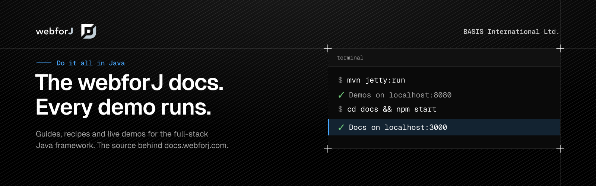

<div align="center">



**The source of [docs.webforj.com](https://docs.webforj.com).**

Every guide, blog post and cookbook recipe for webforJ, the full-stack Java framework, plus the live Java demos embedded in the pages. Each demo is a real webforJ app, so what you read is code that runs.

[](https://github.com/webforj/webforj-documentation/actions/workflows/test-build.yml)
[](LICENSE)

**[Read the docs](https://docs.webforj.com)** · [Framework](https://github.com/webforj/webforj) · [Cookbook](https://docs.webforj.com/cookbook) · [Blog](https://docs.webforj.com/blog)

</div>

## What's inside

- **[`docs/docs`](docs/docs):** the documentation, from getting started to routing, data binding, security, styling, testing, AI tooling and craftforJ.
- **[`docs/blog`](docs/blog):** release notes, tutorials and deep dives.
- **[`docs/cookbook`](docs/cookbook):** short recipes for everyday tasks.
- **[`src`](src):** the webforJ app behind every live demo on the site. Each demo page embeds a running view from here.
- **[`docs/i18n`](docs/i18n):** Spanish, German, French, Dutch, Finnish and Chinese. A nightly workflow keeps them in sync with the English pages, so edit the English source only.

## Run it locally

You need Java 21 or higher, Maven and Node.js 18 or higher. The site and the demos run side by side.

Start the demos, served at http://localhost:8080:

```bash
mvn jetty:run
```

Then, in a second terminal, start the docs site at http://localhost:3000:

```bash
cd docs
npm install
npm start
```

The docs pages load their demos from port 8080. If your demos run on another port, set `WEBFORJ_PORT` before `npm start`.

## Before you open a pull request

- **Prose:** run [Vale](https://vale.sh) on the pages you changed. The rules live in [`.vale.ini`](.vale.ini) and must report no errors or warnings.
- **Demo code:** `mvn compile` checks formatting with Spotless and the build must pass.
- **Cookbook:** `npm run validate:cookbook` from the `docs` folder checks your recipe.
- **Commits:** follow [Conventional Commits](https://www.conventionalcommits.org), for example `docs: explain table selection`.

## Contributing

Found a typo, a broken demo or a missing guide? [Open an issue](https://github.com/webforj/webforj-documentation/issues), or fix it and send a pull request. Read the [contributing guide](CONTRIBUTING.md) first. Questions about the framework itself belong in the [webforJ repository](https://github.com/webforj/webforj).

## License

Released under the [MIT License](LICENSE).
