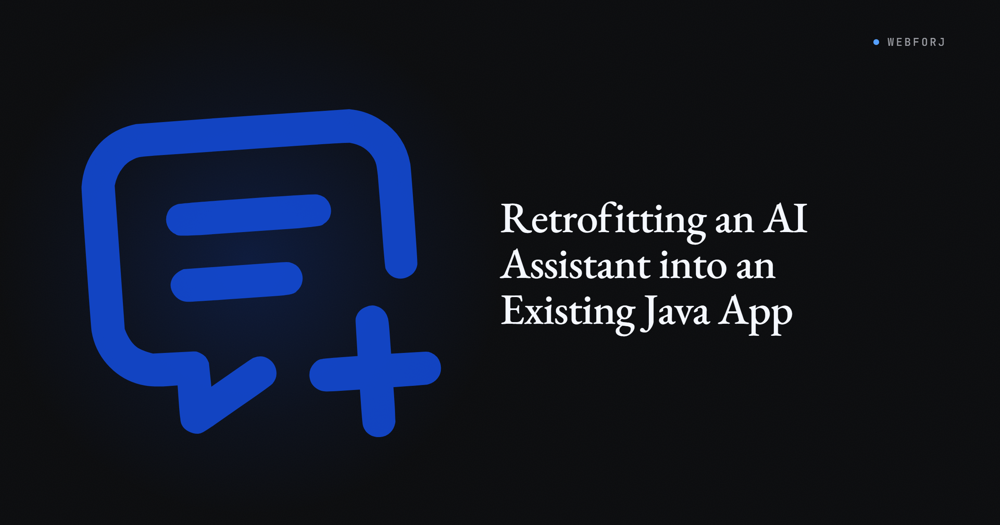

The request usually lands vague: leadership wants AI in the app. A day of back-and-forth resolves it into something concrete, a chat feature where users can ask questions and get streaming, well-formatted answers grounded in the app's own domain.

What most tutorials skip is what the feature looks like end to end: the streaming UI, the cancel behavior, the prompt shape, the error surface, and how it all hangs together in a real Java app. This post uses [`ghost:ai`](https://github.com/webforj/built-with-webforj/tree/main/webforj-ghostai), a small open source reference project in the built-with-webforJ collection, as the running example. Every code snippet is real code from that project.


<!-- truncate -->

## What ghost:ai actually is {#what-ghostai-actually-is}

A single-page chat app: text area at the bottom, streaming markdown response in the middle, thinking indicator while the model works. The webforJ MCP server is called for documentation lookups so answers about webforJ come from current docs rather than the model's training data. The full source is one Spring Boot entry class, one view, two services, and a handful of UI components, small enough to read in one sitting.

## The chat service {#the-chat-service}

The core of the feature is one Spring service that wraps Spring AI's `ChatClient`:

```java
@Service
public class ChatService {
  private final ChatClient chatClient;
  private final ChatMemory chatMemory;

  public ChatService(ChatModel chatModel, ToolCallbackProvider toolCallbackProvider) {
    this.chatMemory = MessageWindowChatMemory.builder().build();
    this.chatClient = ChatClient.builder(chatModel)
        .defaultSystem("""
            // ... role + tool-usage instructions ...
            """)
        .defaultAdvisors(MessageChatMemoryAdvisor.builder(chatMemory).build())
        .defaultToolCallbacks(toolCallbackProvider)
        .build();
  }

  public Flux<String> stream(String conversationId, String message) {
    return chatClient.prompt()
        .user(message)
        .advisors(a -> a.param(ChatMemory.CONVERSATION_ID, conversationId))
        .stream()
        .content();
  }

  public void forget(String conversationId) {
    chatMemory.clear(conversationId);
  }
}
```

The system prompt is where the feature is actually defined. It has two blocks: a role statement giving the assistant a personality, and an explicit tool-usage block telling the model to always call `search_knowledge_base` first, reminding it that its training data is outdated, and instructing it to say "I don't know" instead of guessing. Skip that block and the assistant hallucinates about webforJ features that don't exist.

`MessageWindowChatMemory` gives you a sliding window of recent messages in one line, and `MessageChatMemoryAdvisor` wires it into every request. The service is one bean for every user, so the memory is keyed by a conversation id that the caller passes in. Each open chat view creates its own id with `UUID.randomUUID()`, which keeps two users from ever sharing a conversation, and calls `forget()` when the view is destroyed. `stream()` returns a `Flux<String>` so users see text appear token by token instead of waiting for the whole response.

## The MCP piece {#the-mcp-piece}

Spring AI auto-wires a `ToolCallbackProvider` from any registered MCP clients. ghost:ai's `application.properties` registers one:

```properties
spring.ai.mcp.client.enabled=true
spring.ai.mcp.client.name=webforj-chat
spring.ai.mcp.client.streamable-http.connections.webforj.url=https://mcp.webforj.com
spring.ai.mcp.client.streamable-http.connections.webforj.endpoint=/mcp
```

Spring AI connects to `mcp.webforj.com`, discovers its tools, and hands them to the `ChatClient`. The chat service never touches a tool directly, the MCP server describes itself. That beats stuffing documentation into the prompt as static context, because the knowledge base changes on the server and the client never has to redeploy to pick up new docs.

The server offers more than the chat needs, and not every tool schema suits every model, so ghost:ai keeps only the two documentation tools and leaves their names as the server declares them, which lets the system prompt name them. Both are beans on the app class:

```java
@Bean
McpToolFilter documentationToolsOnly() {
  Set<String> allowed = Set.of("search_knowledge_base", "get_document");
  return (connection, tool) -> allowed.contains(tool.name());
}

@Bean
McpToolNamePrefixGenerator mcpToolNames() {
  return McpToolNamePrefixGenerator.noPrefix();
}
```

## The view: streaming, thinking, cancel {#the-view-streaming-thinking-cancel}

<video src="https://cdn.webforj.com/webforj-documentation/blogs/webforj-v25.11/ghsot-ai.mov" autoPlay muted loop playsInline style={{width: '100%', borderRadius: '8px', marginBottom: '1rem'}}></video>

[Streaming raw tokens into a Java UI](/blog/stream-llm-response-java) is where features usually go wrong. ghost:ai uses webforJ's `MarkdownViewer`, which renders markdown progressively as text is appended. Two flags matter: `setAutoScroll(true)` keeps the newest text in view as the response grows, and `setProgressiveRender(true)` renders markdown as it streams in, so code fences and lists appear formatted rather than raw text.

When the user hits send, the view starts the stream and shows a thinking indicator until the first chunk arrives:

```java
private void handleSend(String message) {
  // ...
  showThinking();
  firstChunkReceived = false;
  chatInput.setState(ChatInput.State.STREAMING);

  Environment env = Environment.getCurrent();
  int stream = ++streamId;
  currentSubscription = chatService.stream(conversationId, message).subscribe(
      chunk -> Environment.runLater(env, () -> {
        if (stream != streamId) {
          return;
        }
        if (!firstChunkReceived) {
          firstChunkReceived = true;
          hideThinking();
        }
        markdownViewer.append(chunk);
      }),
      error -> Environment.runLater(env, () -> {
        if (stream != streamId) {
          return;
        }
        hideThinking();
        markdownViewer.setVisible(true);
        markdownViewer.append("*Error: " + error.getMessage() + "*");
        currentSubscription = null;
        chatInput.setState(ChatInput.State.IDLE);
        chatInput.focusInput();
      }),
      () -> Environment.runLater(env, () -> {
        if (stream != streamId) {
          return;
        }
        currentSubscription = null;
        markdownViewer.whenRenderComplete().thenAccept(v -> {
          chatInput.setState(ChatInput.State.IDLE);
          chatInput.focusInput();
        });
      }));
}
```

Every chunk arrives on a Reactor thread, and webforJ components accept changes only from the thread of the session that owns them. `handleSend` runs on that thread, so it reads `Environment.getCurrent()` there and passes it to [`Environment.runLater`](/docs/advanced/asynchronous-updates), which queues each UI change on this user's thread no matter which thread delivered the chunk. The `stream` counter drops chunks that belong to a stream the user already stopped.

Failure paths get real UI treatment. An error becomes an italicized message in the response, the input returns to idle, and focus goes back to the text area. Silent failure, a spinning wheel that never resolves, is the worst outcome, and this handler prevents it.

`whenRenderComplete()` is small but load-bearing. Because progressive rendering means markdown is still animating in after the model finishes streaming, re-enabling the input the moment `.doOnComplete` fires would let the user send the next message before the previous one is done rendering. `whenRenderComplete()` waits for the animation to settle first.

**Cancel actually cancels.** The `Disposable` returned by `subscribe()` is stored, and the stop button tears the whole thing down:

```java
private void handleStop(Void v) {
  streamId++;
  if (currentSubscription != null) {
    currentSubscription.dispose();
    currentSubscription = null;
  }
  hideThinking();
  markdownViewer.setVisible(true);
  markdownViewer.stop();
  chatInput.setState(ChatInput.State.IDLE);
  chatInput.focusInput();
}
```

Disposing the subscription cancels the upstream stream. `markdownViewer.stop()` halts the progressive-rendering animation. Together they leave the UI in a state the user can immediately act on.

## Ghost text in the input {#ghost-text-in-the-input}

As the user types, faded suggestion text appears completing what they might want to ask. Hit Tab to accept, keep typing to ignore. A second, smaller `ChatClient` drives it via a dedicated `PredictionService` with an autocomplete-focused system prompt (see the repo for the full instructions). Its `predict` method is `@Async` and returns a `CompletableFuture<String>`, so the model call runs on Spring's task pool instead of the UI thread.

The interesting part is how this gets wired in. Firing a prediction on every keystroke would spam the API, so the input debounces through webforJ's `Debouncer`, which runs on the UI thread:

```java
private final Debouncer predictionDebouncer = new Debouncer(0.25f);
private String lastInput = "";

textArea.onValueChange(e -> {
  String input = e.getValue();
  lastInput = input == null ? "" : input;
  if (input == null || input.trim().length() < 10 || state != State.IDLE) {
    predictionDebouncer.cancel();
    textArea.setPredictedText("");
    return;
  }
  predictionDebouncer.run(() -> predict(input));
});

private void predict(String input) {
  Environment env = Environment.getCurrent();
  predictionService.predict(input).whenComplete((prediction, error) ->
      Environment.runLater(env, () -> {
        if (textArea.isDestroyed() || state != State.IDLE || !input.equals(lastInput)) {
          return;
        }
        if (error == null && prediction != null && !prediction.isEmpty()) {
          textArea.setPredictedText(prediction);
        }
      }));
}
```

Each keystroke restarts the 250 ms timer, and only when the user pauses does `predict` run. It reads the session's `Environment` on the UI thread, because the future completes on a pool thread that serves every user, and `Environment.runLater(env, ...)` brings the result back to this session. A prediction for text the user has since changed is dropped, the rest reaches `setPredictedText()`, which renders the faded suggestion. Users press Tab to accept or keep typing to overwrite.

## Retrofitting this into an existing app {#retrofitting-this-into-an-existing-app}

ghost:ai is a full-page chat, but the pattern is portable. In an app that already has a UI, put a `MarkdownViewer` plus a text input inside a `Drawer` on the right edge, open it from a button in your toolbar, and wire it to a `ChatService` scoped to whatever domain data the current user can see. Swap the MCP tool provider for one connected to your own services, or drop it and put domain context in the system prompt.

The permission story matters here. Because the chat service is just another Spring bean, any domain data it accesses goes through the same repositories and service methods your existing UI uses. Same `@PreAuthorize`, same tenant scoping, same audit trail.

## Get the source {#get-the-source}

**[View webforj-ghostai on GitHub](https://github.com/webforj/built-with-webforj/tree/main/webforj-ghostai)**

You'll need Java 21, Maven 3.9+, and a Gemini API key exported as `SPRING_AI_GOOGLE_GENAI_API_KEY`. `mvn` starts the app on `http://localhost:8080`. Swap the Spring AI starter in `pom.xml` and the model property in `application.properties` for OpenAI, Anthropic, or [a local Ollama](/blog/ollama-java-web-app) model if you'd prefer.

For deeper reading, see the [`MarkdownViewer` docs](/docs/components/markdownviewer), the [`TextArea` predicted-text guide](/docs/components/textarea#predicted-text), and [Spring AI's tool-calling reference](https://docs.spring.io/spring-ai/reference/api/tools.html).
