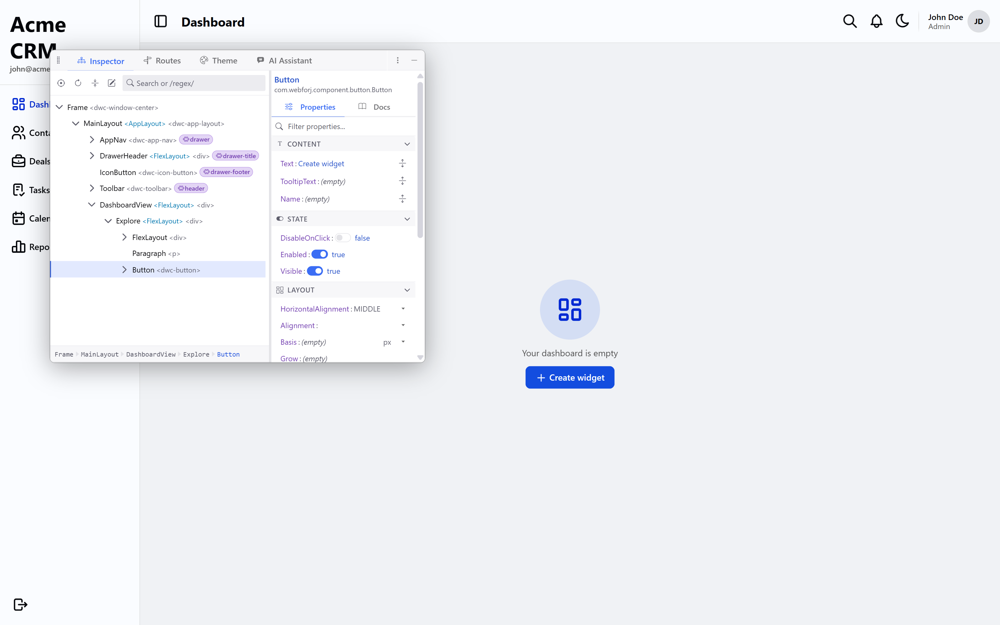
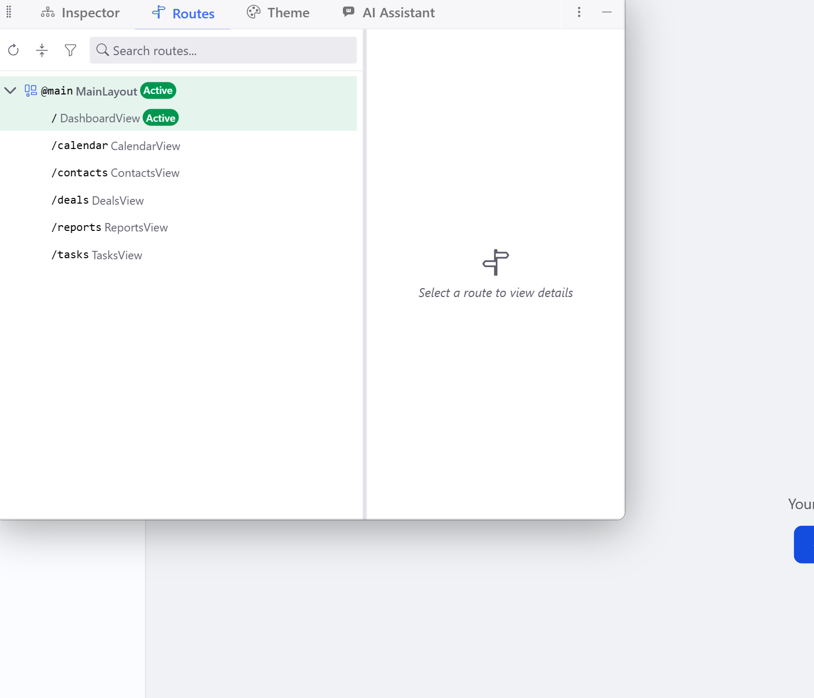

I first got my hands on craftforJ to test it out and play around with it as I was reviewing the docs written for it as it was being released. I wasn't sure what to expect from a "visual development environment" shipping with a Java framework. Not having any idea what to expect, it's safe to say I was thoroughly impressed at my first impression.

craftforJ opens next to your running app and shows you a tree. The tree isn't the browser's DOM, it's the components your Java code created, listed by the class names you wrote. If you click a `TextField` on the page, the inspector highlights the exact Java variable it came from. If you change a property, the running app updates and the diff lands in your source file.

<!-- truncate -->

## It reads the app through webforJ

The structural piece: craftforJ doesn't observe the running page the way browser DevTools do. It might seem that way at first glance since they can feel similar when you first fire up the tool, but it talks to your webforJ app directly and asks it what's there. The tree it shows you is the `com.webforj.component` objects your Java code constructed, not the HTML the browser rendered from them.

The practical consequence is that everything craftforJ names is a thing you can find in your source. A `FlexLayout` in the tree is the `FlexLayout` you wrote, and a property named `label` on a `Button` is the field your `setLabel()` call set. The vocabulary matches your editor, not the browser's inspector output. That's the design decision the rest of the tool stacks on top of.

## The inspector feels familiar

If you've used the Chrome or Firefox devtools inspector, the first thing you'll notice is how recognizable the interaction is. Click an element in the page, see it highlighted in the tree, see its properties in a side panel. craftforJ picks up the same mental model and applies it to Java objects. It was designed this way on purpose to keep the barrier to entry for developers familiar with dev tools practically non-existant. 

<video src="./craftforj-walkthrough.mp4" autoPlay muted loop playsInline style={{width: '100%', borderRadius: '8px', marginBottom: '1rem'}}></video>

The difference, which the familiarity makes easy to miss at first, is that the properties you're editing are the ones your code already knows about. Changing a `Button`'s theme in the side panel doesn't inject a style override. It calls the setter on the same instance your code built, exactly as if your Java had done it. The running app updates because the underlying object changed, not because craftforJ layered a visual on top.

That part isn't new conceptually. It's just more direct than I was used to.

## Writing changes back to source

Live edits are nice. Changes that make it into my source files are what actually matters. craftforJ handles that through a diff view: everything you change in the inspector is staged, and when you're ready to commit the work, you review the diff of the Java the tool wants to write.

The diff shows the before and after for each affected file, so you can see exactly what will land before it does. You can accept the whole thing, back out individual changes, or discard the staged edits entirely. The policy stays yours.

What I appreciated about this flow is that it removes the gap between "I made it look right in the running app" and "the source file reflects that." Those two states tend to drift when you're iterating fast, and this closes the loop without me having to think about it.

## The AI agent is the part I kept coming back to

I expected the inspector and source write-back to feel like polish on top of webforJ. The AI agent is where craftforJ moved into territory I didn't expect.

<video src="https://cdn.webforj.com/webforj-documentation/video/craftforJ/ai-conversation.mp4" controls preload="metadata" style={{width: '100%', borderRadius: '8px', marginBottom: '1rem'}}></video>

You give it a goal, not a command. It plans, reads your source, writes Java, compiles what it wrote through a real Java compiler before you ever see it, applies the change, and if the change requires a restart, waits for the app to come back and picks its plan up where it left off. Each step shows up in the transcript as it happens, and you can expand any of them to see exactly what the agent did and what came back.

The compile-before-you-see-it part is what elevates this. Most coding agents hand you code and leave verification to you. craftforJ hands you code that already compiled against the exact app running in front of you. Full validation needs a JDK; on a JRE it falls back to parsing and marks the edit as unverified, which is the honest fallback.

I'll do a dedicated post on the agent later, and the other craftforJ areas (inspector internals, source-change workflows, theming) are getting their own posts after that. For now, know that it's there, and know that it writes Java rather than suggesting snippets while waiting patiently through restarts rather than needing to be re-prompted.

## Routes and theme

The [routes](/docs/craftforj/routes) view shows your routing table, lets you navigate anywhere in your app from the panel, and lets you change the access rules declared on a route (handy when you're wiring up Spring Security annotations and want to flip them for testing).

The [theme](/docs/craftforj/theme) view exposes the design tokens your app is built from and lets you adjust them live, with the result saveable back into your stylesheet. Neither of these is where I spent most of my time, but both reinforce the same pattern as the inspector: see the thing you can edit, edit it, commit the change back to source.

## Where I ended up spending my time

I expected craftforJ to be a tool I'd open occasionally and then switch back to my IDE - so far there hasn't been much in the last few years that's managed to tear me away from my beloved VS Code. What happened was the opposite. For UI-heavy work, I kept finding myself in craftforJ longer than I meant to. The feedback loop between "change a property" and "see the running app" is tight enough that it took over the parts of my workflow where I used to context-switch between the editor and the browser.

My IDE is still where I write business logic and anything structural. For composition work, building a view and tuning how it looks, craftforJ is faster. It wasn't the tradeoff I was expecting, but it's the one I ended up making. When using AI, I surprisingly found myself in craftforJ more often, since everything I needed was in the same place as where I interact with the AI tool.

## It only runs in dev mode

Now, craftforJ requires two separate settings to be enabled, and by default only answers to the browser running on the same machine as the app. Projects created with [startforJ](https://docs.webforj.com/startforj) or from a webforJ [archetype](/docs/building-ui/archetypes/overview) enable it for you in dev mode. In production builds, it's off and inaccessible. The [security docs](/docs/craftforj/security) cover how to confirm that, which is worth doing before you ship.

## See it in motion

If you want to see craftforJ in action from another angle, my colleague put together a short walkthrough video that's worth a watch: [craftforJ on YouTube Shorts](https://www.youtube.com/shorts/dVCMJJtWjBM).

More posts on the individual features (inspector, source changes, theming, the AI agent) are coming — I'll link back to this one from each as they land.

## Where to go next

- [craftforJ overview](/docs/craftforj) covers every area in detail
- [Inspector](/docs/craftforj/inspector) for component selection, property editing, and highlighting
- [Source changes](/docs/craftforj/source-changes) for the diff review flow
- [AI assistant](/docs/craftforj/ai) for the agent in full detail
- [startforJ](https://docs.webforj.com/startforj) for the shortest path to a project with craftforJ enabled from the start

If you've been curious about what a visual development environment looks like when it's built into the framework from the ground up rather than bolted on, that's the fastest way to see it. Open an archetype, run `mvn jetty:run`, and poke the thing you were going to poke anyway. The rest will introduce itself.
