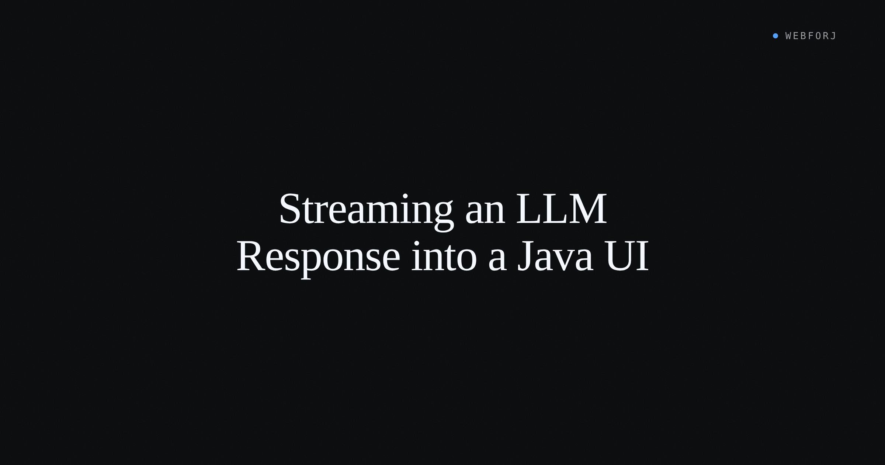

The LLM response works. The text is right, the model understood the prompt, and the API call returns clean. Then the UI waits three seconds and dumps the whole answer at once.

That isn't the product anyone ships. Every AI feature you've used fills the answer in token by token, because that feedback — seeing the response form — is part of how the interface communicates that something is happening. This post builds the Java UI side of that: a component that receives a token source and renders it progressively, with a cancel button that interrupts the stream.

The token source in the sample is a mock — pre-written text emitted a few characters at a time on a timer, self-contained and runnable on any JVM without an API key or cloud account. Swapping it for Anthropic Messages streaming, OpenAI Chat Completions, or a local Ollama endpoint is a matter of replacing one loop; the UI code in this post doesn't change.

<!-- truncate -->

## What we're building

One view: a text field for the prompt, a send button, a `MarkdownViewer` that fills in as tokens arrive, and a stop button that cancels mid-stream. The whole component runs as a self-contained webforJ view — no JavaScript build step, no REST endpoint between the token source and the screen.

The mock produces canned markdown responses — headers, lists, code blocks, tables — emitted character-by-character every 40ms. It's fast enough to feel live and slow enough to watch the progressive rendering at work. The [MarkdownViewer streaming demo](/docs/components/markdownviewer#progressive-rendering) in the docs is this component running in the browser; the source is `MarkdownViewerStreamingView.java` in the documentation samples.

This isn't a full chat interface — that's a larger component with conversation history, per-message rendering, and session memory. One question, one answer, one cancel button. Small enough to read in one sitting and retype without the sample repo.

## Why streaming is SSE, not WebSockets

Anthropic, OpenAI, and Ollama all send tokens over Server-Sent Events. SSE is a one-way HTTP stream: the server sends events in order, the client reads them as they arrive, and the connection closes when the model finishes. WebSockets are bidirectional and stateful — the right tool when both sides interleave messages, but unnecessary overhead for a response that flows one way.

For a Java client reading a real SSE stream, `HttpClient` opens a persistent connection and reads `data:` lines as the model emits them. Each line carries a JSON chunk with the next token (or a `[DONE]` sentinel at the end). The webforJ UI pattern in this post maps directly onto that loop: replace the mock timer with a line reader, and the `viewer.append()` calls stay the same.

## Rendering tokens as they arrive

`MarkdownViewer` renders markdown as HTML. The streaming-specific API is `append()`, which adds content incrementally without replacing what's already there:

```java
viewer.append("## New Section\n\n");
viewer.append("More content here...");
```

Two flags matter for a streaming UI. `setProgressiveRender(true)` routes appended content through a character-by-character buffer, producing the typewriter effect. `setAutoScroll(true)` keeps the viewport pinned to the bottom as the response grows, and pauses automatically if the user scrolls up to read earlier content:

```java
MarkdownViewer viewer = new MarkdownViewer();
viewer.setProgressiveRender(true);
```

```java
viewer.setAutoScroll(true);
```

`setRenderSpeed()` controls how many characters display per animation frame. The default of 4 puts you at roughly 240 characters per second at 60fps. For a mock that fires every 40ms, or a fast real provider, speed 6 gives the buffer room to breathe:

```java
viewer.setProgressiveRender(true).setAutoScroll(true).setRenderSpeed(6);
```

When progressive rendering is enabled and a user sends a new message, call `viewer.clear()` before starting the next stream. `clear()` stops any in-progress rendering and empties the content, leaving the viewer ready for fresh input.

## The mock: an on-timer token source

The mock slices a canned response string into 4–8 character chunks and appends them to the viewer on a 40ms `Interval`:

```java title="StreamingDemoView.java"
private void startStreaming() {
  sendButton.setVisible(false);
  stopButton.setVisible(true);

  String response = RESPONSES.get(random.nextInt(RESPONSES.size()));
  AtomicInteger index = new AtomicInteger(0);

  streamInterval =
      new Interval(
          0.04f,
          e -> {
            int current = index.get();
            if (current < response.length()) {
              int end = Math.min(current + 4 + random.nextInt(4), response.length());
              viewer.append(response.substring(current, end));
              index.set(end);
            } else {
              streamInterval.stop();
              viewer
                  .whenRenderComplete()
                  .thenAccept(
                      v -> {
                        sendButton.setVisible(true);
                        stopButton.setVisible(false);
                        input.focus();
                      });
            }
          });
  streamInterval.start();
}
```

`Interval` fires its callback on the webforJ event thread, so `viewer.append()` is always called from the right thread — no cross-thread coordination needed for the mock. When the response string is exhausted, the interval stops and `whenRenderComplete()` waits for the progressive renderer to finish displaying any buffered content before re-enabling the send button and returning focus to the input field.

`RESPONSES` is a `List<String>` of canned markdown answers defined as a static constant on the view class. The content doesn't matter for this pattern — the point is the emission cadence. Any markdown text serves as the mock payload.

## The cancel button

Most streaming demos show a stop button but don't show what it cleans up. The mock has three resources to clean up before the UI is in a state the user can act on again — the timer, the renderer, and the button state:

```java title="StreamingDemoView.java"
private void stopStreaming() {
  if (delayInterval != null) {
    delayInterval.stop();
    delayInterval = null;
  }
  if (streamInterval != null) {
    streamInterval.stop();
    streamInterval = null;
  }
  hideThinking();
  viewer.stop();
  sendButton.setVisible(true);
  stopButton.setVisible(false);
  input.focus();
}
```

`viewer.stop()` halts progressive rendering and discards any buffered content not yet displayed. The viewer shows exactly what had rendered to that point — a partial sentence, a half-built list, wherever the output was when the user pressed stop. `streamInterval.stop()` prevents the timer from appending further after cancel.

The edge case where a user submits a second prompt while the first is still streaming: `sendMessage()` calls `stopStreaming()` before starting a new interval, so the previous stream is always terminated before a new one begins. Two streams never run concurrently.

## Waiting for the renderer

One coordination detail that trips up first implementations: `viewer.append()` returns as soon as the content is in the buffer. The progressive renderer may still be displaying characters from that buffer for several hundred milliseconds after the last `append()` call. Re-enabling the send button immediately after the timer stops means users can submit again while text is still appearing mid-screen.

`whenRenderComplete()` solves this:

```java
viewer.whenRenderComplete().thenAccept(v -> {
  inputField.setEnabled(true);
  inputField.focus();
});
```

The `PendingResult` completes only after all buffered content has been displayed. If progressive rendering is off, or nothing is buffered, it completes immediately. The [MarkdownViewer docs](/docs/components/markdownviewer#waiting-for-completion) cover the related `isRendering()` method, which returns `true` while the component is actively displaying buffered content — useful for showing or hiding a stop button based on render state rather than just stream state.

## Swapping in a real provider

The mock uses `Interval` to stay self-contained, which means it fires on the webforJ event thread and can call `viewer.append()` directly. A real LLM client — an `HttpClient` SSE line reader, a Spring AI `Flux<String>` subscription, a LangChain4j streaming callback — receives tokens on a background thread. UI calls from background threads need coordination.

webforJ's `Environment.runLater()` is the bridge. Any thread created from within an Environment context inherits that context and can schedule UI work:

```java
@Route
public class DataView extends Composite<Div> {
  private final ExecutorService executor = Executors.newCachedThreadPool();

  public DataView() {
    // This thread has Environment context

    // Child threads inherit the context automatically
    executor.submit(() -> {
      String data = fetchRemoteData();

      // Can use runLater because context was inherited
      Environment.runLater(() -> {
        dataLabel.setText(data);
        loadingSpinner.setVisible(false);
      });
    });
  }
}
```

For a streaming loop, each `viewer.append(chunk)` call goes inside an `Environment.runLater()` call instead of directly. The [Asynchronous Updates](/docs/advanced/asynchronous-updates) docs cover the full pattern, including how to track and cancel pending `PendingResult` objects during component teardown so queued UI updates don't run after the user has navigated away.

For Spring AI's `Flux<String>` specifically: Reactor creates its worker threads from the Environment thread when `subscribe()` is called from a webforJ component. Those worker threads inherit the context, which means `.doOnNext()` callbacks can call `viewer.append()` directly without wrapping in `runLater()`. The threading model still holds; Reactor just handles the context inheritance automatically.

The swap-in is one file regardless of provider. Anthropic's Java SDK, the OpenAI Java client, and Ollama's HTTP API all emit responses as token sequences. The `viewer.append()` call in the streaming loop doesn't change. The loop around it changes to match how each SDK surfaces token events.

## Error handling

When the source errors — a network dropout, an API rate limit, a context-length overrun — the component needs to surface the failure rather than leave the user looking at a half-rendered response and a stop button that no longer does anything.

`viewer.append()` accepts markdown, so an error message can appear inline in the response. An italicized failure notice lands at the end of whatever rendered before the error:

```java
viewer.append("*Error: " + error.getMessage() + "*");
```

After appending the error, stop the interval or subscription, call `viewer.stop()` to halt any buffered rendering, and reset the button state. The user sees what the response reached before the failure, followed by the error, and can retry from a clean input field. An inline failure message — not a dialog or a silent spinner freeze — is what AI chat interfaces use, and it's one line to produce.

## The pattern, assembled

The streaming component has roughly 100 lines: the `MarkdownViewer` with progressive rendering and auto-scroll, a timer or subscription loop for the token source, a stop method that cleans up the timer, the buffer, and the button state, and `whenRenderComplete()` to gate the re-enable on actual render completion.

The viewer doesn't know what emitted the tokens. The mock uses `Interval` to stay self-contained. A Reactor subscription, a raw `HttpClient` SSE loop, or a LangChain4j callback all plug into the same `viewer.append()` calls. Replacing the emission loop doesn't touch the MarkdownViewer setup, the cancel logic, or the `whenRenderComplete()` coordination — those three pieces are identical whether the source is a timer or a production LLM endpoint.

The full `MarkdownViewer` API is at [/docs/components/markdownviewer](/docs/components/markdownviewer), including `flush()` (display buffered content immediately without waiting for the character-by-character animation), `isRendering()`, `setRenderSpeed()`, and the Prism.js syntax highlighting integration for code blocks in streamed responses. The threading pattern — `Environment.runLater()`, PendingResult tracking, lifecycle cleanup — is at [/docs/advanced/asynchronous-updates](/docs/advanced/asynchronous-updates).
