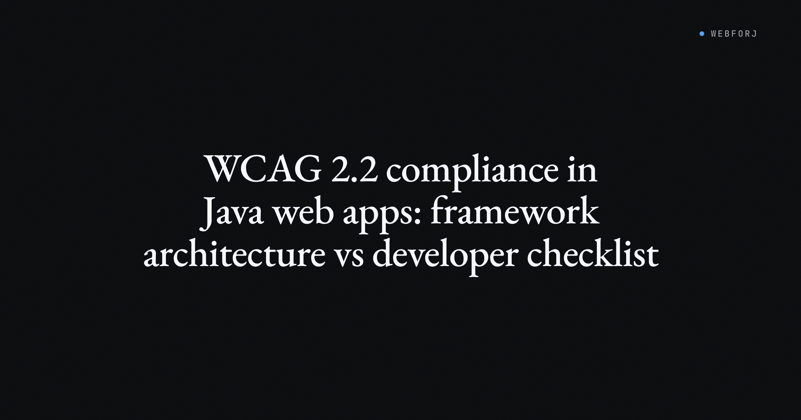

France's commercial court issued an order against Carrefour last quarter under the European Accessibility Act. Five hundred euros per day until compliant, six months to complete remediation. The act has been enforceable since June 2025. The cases are working through courts now.

The Dutch regulator is opening enforcement against e-commerce in the second half of 2026. Sweden has 28 active supervision cases. WCAG 2.2 is now ISO/IEC 40500:2025 — a standard procurement officers cite directly in RFPs — and it's appearing in Washington State contract requirements effective July 2026 and in UK NHS contract notices. For any Java web app with European users or public-sector customers, "we'll address accessibility in the next cycle" is no longer a workable answer.

What's missing from most of the compliance coverage is analysis of what this means specifically for Java developers — and how much of the remediation work your framework choice already determined before the first compliance deadline appeared.

<!-- truncate -->

## What WCAG 2.2 added at the AA level

WCAG 2.2 introduced nine new success criteria over 2.1. Six are required at AA level — the level governments and procurement offices specify. The ones most relevant to a Java web application:

**2.5.8 Target Size (Minimum):** Every interactive element that isn't inline text or user-agent-controlled must have an active area of at least 24×24 CSS pixels, or must be spaced so a 24-pixel circle centered on it doesn't intersect a neighboring target. Buttons at 18 pixels don't pass. Action icons in table rows don't pass without sizing or spacing adjustments.

**2.5.7 Dragging Movements:** Any operation that uses a drag gesture must have a single-pointer alternative — a click or tap path that accomplishes the same result. Sortable lists, sliders, and drag-to-reorder interfaces need a non-drag alternative.

**2.4.11 Focus Not Obscured (Minimum):** A focused component can't be completely hidden by author-created content — sticky headers, floating action bars, cookie banners, tooltips. Not partially obscured; wholly covered is the line.

These aren't edge-case criteria. Target Size affects every button and link in the application. Focus Not Obscured affects any layout with fixed or sticky elements.

## The template compliance surface

In a Thymeleaf or JSP application, the HTML delivered to the browser is built from templates. Accessibility attributes — ARIA labels, roles, descriptions — live in those templates. When a criterion requires behavioral or sizing changes, the fix lives in those templates too.

The compliance surface scales with the template count. A 200-template application with 15 interactive controls per template has 3,000 places where a Target Size failure can exist. Finding them requires audit tooling. Fixing them requires changing templates — there's no central location to update.

For WCAG 2.2's new criteria, this pattern is expensive. Target Size failures appear wherever a button, link, or interactive icon renders at less than 24×24px. Focus Not Obscured failures appear wherever a sticky element coexists with keyboard navigation. Each failure has as many instances as the template has use cases.

## What a component model changes

When UI is built from components, accessibility behavior can be defined at the component level and inherited everywhere the component is used. This is the structural property the template model doesn't have.

webforJ's handling of `prefers-reduced-motion` is the clearest example of this in practice. From the [Transitions & Easing docs](/docs/styling/transitions-easing):

> webforJ respects the user's "reduce motion" accessibility preference. When enabled at the OS level, webforJ disables non-essential animations across all components automatically. No Java code is required.

That's the model: a behavioral accessibility requirement implemented once in the framework, inherited by every component. The developer doesn't add a CSS media query per component or check a flag in each animation. The framework covers it uniformly.

Target Size and Focus Not Obscured don't have an equivalent built-in treatment in webforJ yet. But the architecture supports it: if the Button component is updated to enforce a 24×24 minimum active area, every button in every view meets the criterion. The remediation scope is one component definition, not 3,000 template locations.

For ARIA attributes without a dedicated component API, the `setAttribute` hook provides access:

```java
Button button = new Button("Submit");
button.setAttribute("aria-label", "Submit the form");
button.setAttribute("aria-describedby", "form-hint");
```

This is developer-side work — the component model doesn't eliminate the need to add ARIA where content meaning requires it. But it provides an architecture where those attributes can be built into a component definition for components that should carry them, rather than added at each call site in each template.

## Where webforJ is today

webforJ's documented accessibility support includes the `prefers-reduced-motion` automatic handling, per-component label APIs (several component docs note screen reader announcements for setLabel()), and the `setAttribute` path for ARIA not covered by a dedicated API. A comprehensive WCAG 2.2 compliance statement or unified accessibility overview doesn't currently exist in the docs — coverage is present but distributed across individual component pages.

The component architecture is right for centralizing compliance. The `prefers-reduced-motion` case shows this working in practice. For Target Size, Dragging, and Focus Not Obscured, the centralization possibility exists — but a WCAG 2.2 AA component conformance table hasn't been published. The component model provides the hooks; verifying conformance per criterion is a step the framework docs don't yet cover.

## What no framework handles

Content accessibility stays with the developer regardless of framework architecture.

Alt text for images requires authoring judgment — a component can expose the `alt` attribute, but only the developer knows what the image communicates in context. Link labels need to describe the destination; no component can derive intent from a URL. Heading hierarchy communicates document structure; no framework generates meaningful headings from raw content.

Error message clarity, form field descriptions, the reading order of complex layouts — these require understanding what information a user needs and in what sequence. WCAG's 1.1.1 (Non-text Content), 2.4.6 (Headings and Labels), and 3.3.2 (Labels or Instructions) live in this category. Framework infrastructure provides the API slots; the accessibility outcomes depend on what the developer puts in.

## Two compliance surfaces

A Java web app built from templates distributes accessibility work across every template, every developer, and every sprint cycle. New features ship; accessibility is audited after. When procurement bodies cite WCAG 2.2 in contract language and audits find failures, remediation is proportional to the number of places each failure exists.

A component-based architecture concentrates the compliance surface. The `prefers-reduced-motion` case is the clearest current example: zero developer effort for a behavioral requirement that would require per-component annotation in a template system. Target Size, Dragging Movements, and Focus Not Obscured are each remediable at the component level — one update covering every use of the component across the application.

That's a structural difference, not a guarantee. webforJ's component library doesn't provide a signed WCAG 2.2 AA conformance statement today. But the architecture makes the path to compliance narrower than the alternative. The choice of Java UI framework is, in part, an accessibility architecture decision. That decision matters more now that EAA enforcement is active and procurement bodies are specifying WCAG 2.2 by ISO number.

For the API reference, see [/docs/building-ui/using-components](/docs/building-ui/using-components) and the `prefers-reduced-motion` documentation at [/docs/styling/transitions-easing](/docs/styling/transitions-easing).
