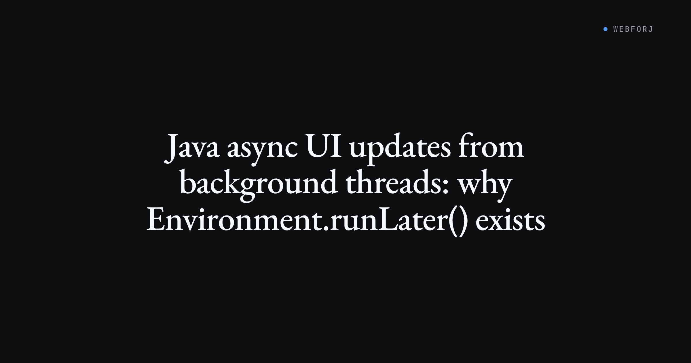

Your `@Scheduled` Spring task fires every five seconds. Inside it, you fetch a count from the database and call `statusLabel.setText(count + " items processed")`. The app starts, the task runs — and the label never changes. Or you get an exception. Or you get stale data with no error at all.

The problem is the thread. `statusLabel` belongs to a user session and must be updated from that session's `Environment` thread. Your `@Scheduled` task runs on Spring's shared thread pool, which knows nothing about any particular user's session. The fix is one method: `Environment.runLater()`.

<!-- truncate -->

## The session-thread invariant

webforJ UI components are not thread-safe. Each user's session runs on its own `Environment` thread — constructors, event handlers, and lifecycle methods all execute there. This is the same design pattern as Swing's Event Dispatch Thread or JavaFX's Application Thread: one thread owns the components, and all updates must come through it.

The constraint isn't arbitrary. Each session's `Environment` holds the state for one user's UI. A thread pool thread serves many users simultaneously, so there's no clean way for it to know which user's label it should update. If you write to the label directly from a pool thread, the write may race against the session thread reading the same state.

webforJ enforces this at runtime. Direct component access from a background thread either throws an exception or silently reads stale state.

## Environment.runLater()

`Environment.runLater()` hands a lambda to a specific session's `Environment` thread. The lambda executes on that thread on its next iteration, with the full thread safety guarantee.

The method signature:

```java
public static PendingResult<Void> runLater(Environment target, Runnable task)
```

The first argument is the target `Environment`. You read it with `Environment.getCurrent()` — but that method returns `null` on a background thread. Read it while you're still on the session thread, before the background work starts, and pass it in:

```java
asyncBtn.addClickListener(e -> {
  // The click handler runs on this user's UI thread
  Environment env = Environment.getCurrent();

  currentTask = backgroundService.performLongRunningTask(progress -> {
    Environment.runLater(env, () -> {
      progressBar.setValue(progress);
    });
  });
});
```

The same pattern works with any background thread source — a Spring `@Async` service, a `CompletableFuture`, a scheduled task, or an `ExecutorService`:

```java
@Route
public class DataView extends Composite<Div> {
  private final ExecutorService executor = Executors.newCachedThreadPool();

  public DataView() {
    // The constructor runs on the Environment thread
    Environment env = Environment.getCurrent();

    executor.submit(() -> {
      String data = fetchRemoteData();

      Environment.runLater(env, () -> {
        dataLabel.setText(data);
        loadingSpinner.setVisible(false);
      });
    });
  }
}
```

For a `@Scheduled` task, the `env` needs to come from somewhere in the session's lifecycle. Capture it in the view's constructor or in the button click handler that starts the work, store it as a field, and reference it from the scheduled callback.

## The mistake that compiles and fails at runtime

Reading `Environment.getCurrent()` inside the background work is the one mistake worth calling out explicitly:

```java
executor.submit(() -> {
  String data = fetchRemoteData();

  // Wrong: getCurrent() returns null on a background thread
  Environment.runLater(Environment.getCurrent(), () -> dataLabel.setText(data));
});
```

This compiles and starts fine. It fails at runtime with a `NullPointerException` when the background thread fires, because `getCurrent()` returns `null` there. The null propagates into `runLater()`, which can't dispatch to a null target.

Read the `env` before you submit. Store it in a local variable captured by the lambda.

## For polling: Interval instead of a background thread

If what you want is a UI refresh every N seconds, such as for polling a database or API on a schedule, the [`Interval`](/docs/advanced/interval) component is cleaner than a background thread plus `runLater`. An `Interval` fires its callback on the session thread directly. No Environment capture, no `runLater` wrapper needed.

Use `Environment.runLater()` when the update is driven by a background computation. Use `Interval` when the update is driven purely by time.

## What you don't need

This is a frequent source of over-engineering. Java developers who've solved the same problem in other contexts reach for:

- WebSocket infrastructure with `SimpMessagingTemplate`
- Spring `@EnableWebSocket` and a message broker
- Server-Sent Events and a streaming endpoint

None of that is needed for in-process UI updates. `Environment.runLater()` pushes state from background work to the right session's UI. The method is the entire infrastructure.

If you're using `@Async` for the background service, `@EnableAsync` is required for Spring's machinery — that's a Spring concern. The webforJ side is still one method call.

## Reference

- [Background Jobs with Spring](/docs/integrations/spring/background-jobs) — the Spring `@Async` integration pattern  
- [Asynchronous Updates](/docs/advanced/asynchronous-updates) — full threading model reference and `PendingResult` API
