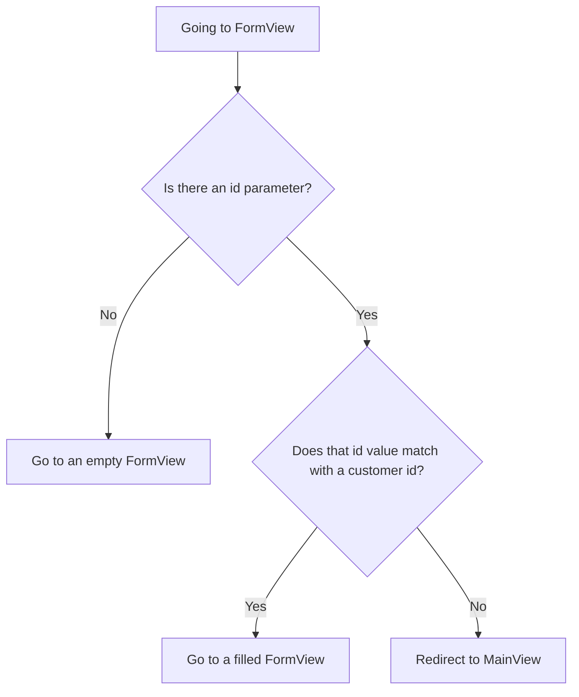

Die App aus [Routing und Composites](/docs/introduction/tutorial/routing-and-composites) kann der Datenbank nur neue Kunden hinzufügen. Mit den folgenden Konzepten kannst du Benutzern auch ermöglichen, die Daten bestehender Kunden zu bearbeiten:

- Routenmuster
- Parameterwerte über eine URL übergeben
- Lebenszyklus-Observer

Nach Abschluss dieses Schritts erhältst du eine Version von [4-observers-and-route-parameters](https://github.com/webforj/webforj-tutorial/tree/main/4-observers-and-route-parameters).

<!-- <VideoPlayer video="tutorial/scaling-with-routing-and-composites" width={1920} height={1080} title="Scaling with routing and composites" /> -->

## App starten {#running-the-app}

Während du deine App entwickelst, kannst du [4-observers-and-route-parameters](https://github.com/webforj/webforj-tutorial/tree/main/4-observers-and-route-parameters) als Vergleich heranziehen. So kannst du die App ausprobieren:

1. Wechsle in das Verzeichnis der obersten Ebene, das die Datei `pom.xml` enthält. Wenn du der Version auf GitHub folgst, ist das `4-observers-and-route-parameters`.

2. Führe den folgenden Maven-Befehl aus, um die Spring-Boot-App lokal zu starten:
    ```bash
    mvn
    ```

Beim Start der App wird automatisch ein neues Browserfenster unter `http://localhost:8080` geöffnet.

## Die `id` des Kunden verwenden {#using-the-customers-id}

Damit du `FormView` zum Bearbeiten bestehender Kunden verwenden kannst, musst du angeben, welcher Kunde bearbeitet werden soll.
Dazu kannst du `FormView` einen initialen Parameter mit der Kunden-ID übergeben.
In [Arbeiten mit Daten](/docs/introduction/tutorial/working-with-data) hast du eine `Customer`-Entität erstellt, die Kunden beim Hinzufügen zur Datenbank eine eindeutige numerische `Long`-ID zuweist.

```java
 @Id
 @GeneratedValue(strategy = GenerationType.IDENTITY)
  private Long id;
```

In diesem Schritt änderst du `FormView` so, dass vor dem Laden eine `id` als initialer Parameter verwendet wird. Anschließend wertet `FormView` die `id` aus, um festzustellen, ob das Formular zum Hinzufügen eines neuen Kunden oder zum Aktualisieren eines bestehenden Kunden dient. Zum Schluss änderst du `MainView` so, dass beim Navigieren zu `FormView` ein `id`-Wert übergeben wird.

## Ein Routenmuster zu `FormView` hinzufügen {#adding-a-route-pattern}

Im vorherigen Schritt ordnete die Einstellung der Route in `FormView` auf `@Route(customer)` die Klasse lokal der Adresse `http://localhost:8080/customer` zu. Mit einem Routenmuster kannst du `FormView` eine `id` als initialen Parameter hinzufügen.

Ein [Routenmuster](/docs/routing/route-patterns) ermöglicht es dir, einen Parameter in der URL hinzuzufügen, ihn optional zu machen und Einschränkungen für gültige Muster festzulegen. Mit der Annotation `@Route` wird `id` für `FormView` wie folgt zu einem optionalen Routenparameter:

- **`/:id`** fügt der Route einen benannten Parameter namens `id` hinzu. Der Aufruf von `http://localhost:8080/customer/6` lädt `FormView` also mit dem Parameter `id` mit dem Wert `6`.

- **`?`** macht den Parameter `id` optional. Parameter sind standardmäßig erforderlich. Ist `id` optional, kannst du `FormView` aber auch zum Hinzufügen neuer Kunden verwenden, die noch keine `id` haben.

- **`<[0-9]+>`** beschränkt `id` auf eine positive Zahl. Innerhalb der spitzen Klammern `<>` kannst du für den Parameter eine Einschränkung in Form eines regulären Ausdrucks angeben. Entspricht die `id` nicht dieser Einschränkung, beispielsweise bei `http://localhost:8080/customer/john-smith`, wird der Benutzer auf eine 404-Seite weitergeleitet.

Um den optionalen Routenparameter zu `FormView` hinzuzufügen, ändere die Annotation `@Route` wie folgt:

```java
@Route("customer/:id?<[0-9]+>")
```

## Zu `FormView` navigieren {#routing-to-formview}

`FormView` akzeptiert nun einen optionalen Parameter `id` und wird nur geladen, wenn `id` eine positive ganze Zahl ist.

`FormView` kann jedoch weiterhin geladen werden, wenn ein Benutzer manuell eine URL für einen nicht existierenden Kunden eingibt, beispielsweise `http://localhost:8080/customer/5000`. Mit einem Lebenszyklus-Observer, der vor dem Aufruf von `FormView` ausgeführt wird, kann deine App festlegen, wie mit dem eingehenden Wert von `id` umzugehen ist.

### Bedingte Navigation {#conditional-routing}

Lebenszyklus-Observer ermöglichen es Komponenten, auf Lebenszyklusereignisse in bestimmten Phasen zu reagieren. Im Artikel [Lebenszyklus-Observer](/docs/routing/navigation-lifecycle/observers) sind die verfügbaren Observer aufgeführt. In diesem Schritt verwendest du jedoch nur den `WillEnterObserver`.

Der `WillEnterObserver` wird ausgelöst, bevor die Navigation zur Komponente abgeschlossen ist.
Mit diesem Observer kannst du die eingehende `id` auswerten. Wenn die `id` keinem bestehenden Kunden entspricht, kannst du den Benutzer zurück zu `MainView` leiten, damit er einen gültigen Kunden zum Bearbeiten auswählen kann.

Bevor wir den Code für den `WillEnterObserver` besprechen, zeigt das folgende Flussdiagramm die möglichen Ergebnisse einer Navigation zu `FormView`:



### Den `WillEnterObserver` verwenden {#using-the-willenterobserver}

Mit dem Lebenszyklus-Observer `WillEnterObserver`, der ausgelöst wird, bevor die Komponente vollständig geladen ist, kannst du Bedingungen hinzufügen, anhand derer entschieden wird, ob die App mit `FormView` fortfahren oder Benutzer zu `MainView` umleiten soll.

Jeder Lebenszyklus-Observer ist ein Interface. Implementiere daher `WillEnterObserver` in der Deklaration von `FormView`:

```java
public class FormView extends Composite<Div> implements WillEnterObserver {
```

Der Observer `WillEnterObserver` verfügt über die Methode `onWillEnter()`, die webforJ vor der Navigation zur Komponente aufruft. Diese Methode hat zwei Parameter: `WillEnterEvent` und `ParametersBag`.

Mit `WillEnterEvent` wird über die Methode `accept()` festgelegt, ob die Navigation zur Komponente fortgesetzt werden soll. Mit der Methode `reject()` wird die Navigation abgebrochen. Nachdem du die aktuelle Route abgelehnt hast, musst du den Benutzer an eine andere Stelle weiterleiten.

`ParametersBag` enthält die Router-Parameter aus der URL. Im nächsten Abschnitt verwendest du `ParametersBag`, um mit dem Parameter `id` eine bedingte Logik für `onWillEnter()` zu erstellen.

Das folgende Beispiel für `onWillEnter()` zeigt zwei mögliche Ergebnisse:

```java
@Override
public void onWillEnter(WillEnterEvent event, ParametersBag parameters) {

  //Add conditional logic
  if (<condition>) {

    //Allow routing to FormView to proceed
    event.accept();

  } else {

    //Stop routing to FormView
    event.reject();

    //Send the user to MainView
    navigateToMain();
  }
}
```

### `ParametersBag` verwenden {#using-the-parametersbag}

Wie im vorherigen Abschnitt kurz erwähnt, enthält `ParametersBag` den Router-Parameter aus der URL. Jeder Lebenszyklus-Observer hat Zugriff auf dieses Objekt. In deiner App kannst du damit den Wert von `id` abrufen.

Das Objekt `ParametersBag` bietet mehrere Abfragemethoden, mit denen ein Parameter als bestimmter Objekttyp abgerufen werden kann. Mit `getInt()` kannst du einen Parameter beispielsweise als `Integer` abrufen.

Da einige Parameter jedoch optional sind, gibt `getInt()` tatsächlich `Optional<Integer>` zurück. Mit der Methode `ifPresentOrElse()` für `Optional<Integer>` kannst du eine Variable mit dem Wert von `Integer` festlegen.

Ist keine `id` vorhanden, kann der Benutzer weiterhin zu `FormView` navigieren, um einen neuen Kunden hinzuzufügen.

```java
@Override
public void onWillEnter(WillEnterEvent event, ParametersBag parameters) {

  //Determine which parameter to get, and check if it's present or not
  parameters.getInt("id").ifPresentOrElse(id -> {

    //Use the id as a variable
    customerId = Long.valueOf(id);

  //When no id is present, continue to FormView for a new customer
  }, () -> event.accept());

}
```

### Ist die `id` gültig? {#is-the-id-valid}

Der `WillEnterObserver` aus dem vorherigen Abschnitt akzeptiert die Navigation derzeit nur, wenn keine `id` vorhanden ist. Bevor die Navigation zu `FormView` fortgesetzt wird, muss der Observer noch eine weitere Prüfung durchführen: Er muss sicherstellen, dass die `id` zu einem bestehenden Kunden gehört.

Nun kann `FormView` mithilfe von `CustomerService` und der Methode `doesCustomerExist()` prüfen, ob ein Kunde existiert. Gibt es keine Übereinstimmung, kann die App die aktuelle Navigation ablehnen und den Benutzer mit `navigateToMain()` zu `MainView` weiterleiten.

Bei einer gültigen `id` kann die App mit `accept()` die Navigation zu `FormView` fortsetzen. Erstelle eine Methode `fillForm()`, um die Variable `customer` dem Kunden mit der entsprechenden `id` in der Datenbank zuzuweisen und die Feldwerte festzulegen:

```java
public void fillForm(Long customerId) {
  customer = customerService.getCustomerByKey(customerId);
  firstName.setValue(customer.getFirstName());
  lastName.setValue(customer.getLastName());
  company.setValue(customer.getCompany());
  country.selectKey(customer.getCountry());
}
```

Wie beim Hinzufügen eines neuen Kunden ermöglicht die Arbeitskopie den Benutzern, Kundendaten in der Benutzeroberfläche zu bearbeiten, ohne das Repository direkt zu ändern.

### Vollständiges `onWillEnter()` {#completed-onwillenter}

In den letzten beiden Abschnitten wurde ausführlich erläutert, wie die einzelnen Ergebnisse einer Navigation zu `FormView` mithilfe von `ParametersBag` und `CustomerService` behandelt werden.

Das folgende vollständige `onWillEnter()` für `FormView` verwendet `ParametersBag`, um die eingehende Route entweder abzulehnen oder anzunehmen. Außerdem ruft es weitere Methoden auf, um entweder das Formular auszufüllen oder den Benutzer zu `MainView` weiterzuleiten:

```java
@Override
public void onWillEnter(WillEnterEvent event, ParametersBag parameters) {

  //Determine which parameter to get, and check if it's present or not
  parameters.getInt("id").ifPresentOrElse(id -> {

    //Use the id as a variable
    customerId = Long.valueOf(id);

    //Check if there's a customer with this id
    if (customerService.doesCustomerExist(customerId)) {

        //This customer exists, so continue to FormView, and initialize the fields using the id
        event.accept();
        fillForm(customerId);
      } else {

        //This customer doesn't exists, so redirect to MainView
        event.reject();
        navigateToMain();
      }

  //No id was present, so continue to FormView for a new customer
  }, () -> event.accept());

}
```

## Einen Kunden hinzufügen oder bearbeiten {#adding-or-editing-a-customer}

Die vorherige Version dieser App fügte beim Absenden des Formulars nur neue Kunden hinzu. Da Benutzer nun auch bestehende Kunden bearbeiten können, muss die Methode `submitCustomer()` prüfen, ob der Kunde bereits existiert, bevor die Datenbank aktualisiert wird.

Zunächst war es nicht nötig, in `FormView` eine Variable für die Kunden-`id` festzulegen, da neue Kunden beim Hinzufügen zur Datenbank eine eindeutige `id` erhalten. Wenn du jedoch `customerId` in `FormView` als initiale Variable mit einem nicht verwendeten `id`-Wert deklarierst, bleibt dieser Wert bei neuen Kunden unverändert und wird für bestehende Kunden in `onWillEnter()` überschrieben.

So kannst du mit `doesCustomerExist()` prüfen, ob ein neuer Kunde hinzugefügt oder ein bestehender Kunde aktualisiert werden soll.

```java
private Long customerId = 0L;

//...

private void submitCustomer() {
  if (customerService.doesCustomerExist(customerId)) {
    customerService.updateCustomer(customer);
  } else {
    customerService.createCustomer(customer);
  }
  navigateToMain();
}
```

## Vollständiges `FormView` {#completed-formview}

So sollte `FormView` aussehen, nachdem es für die Bearbeitung bestehender Kunden angepasst wurde:

<!-- vale off -->
<ExpandableCode title="FormView.java" language="java" startLine={1} endLine={15}>

```java
@Route("customer/:id?<[0-9]+>")
@FrameTitle("Customer Form")
public class FormView extends Composite<Div> implements WillEnterObserver {
  private final CustomerService customerService;
  private Customer customer = new Customer();
  private Long customerId = 0L;
  private Div self = getBoundComponent();
  private TextField firstName = new TextField("First Name", e -> customer.setFirstName(e.getValue()));
  private TextField lastName = new TextField("Last Name", e -> customer.setLastName(e.getValue()));
  private TextField company = new TextField("Company", e -> customer.setCompany(e.getValue()));
  private ChoiceBox country = new ChoiceBox("Country",
      e -> customer.setCountry((Customer.Country) e.getSelectedItem().getKey()));
  private Button submit = new Button("Submit", ButtonTheme.PRIMARY, e -> submitCustomer());
  private Button cancel = new Button("Cancel", ButtonTheme.OUTLINED_PRIMARY, e -> navigateToMain());
  private ColumnsLayout layout = new ColumnsLayout(
      firstName, lastName,
      company, country,
      submit, cancel);

  public FormView(CustomerService customerService) {
    this.customerService = customerService;
    fillCountries();
    setColumnsLayout();
    self.setMaxWidth(600)
        .addClassName("card")
        .add(layout);
    submit.setStyle("margin-top", "var(--dwc-space-l)");
    cancel.setStyle("margin-top", "var(--dwc-space-l)");
  }

  private void setColumnsLayout() {
    List<Breakpoint> breakpoints = List.of(
        new Breakpoint(600, 2));
    layout.setSpacing("var(--dwc-space-l)")
        .setBreakpoints(breakpoints);
  }

  private void fillCountries() {
    ArrayList<ListItem> listCountries = new ArrayList<>();
    for (Country countryItem : Customer.Country.values()) {
      listCountries.add(new ListItem(countryItem, countryItem.toString()));
    }
    country.insert(listCountries);
    country.selectIndex(0);
  }

  private void submitCustomer() {
    if (customerService.doesCustomerExist(customerId)) {
      customerService.updateCustomer(customer);
    } else {
      customerService.createCustomer(customer);
    }
    navigateToMain();
  }

  private void navigateToMain() {
    Router.getCurrent().navigate(MainView.class);
  }

  @Override
  public void onWillEnter(WillEnterEvent event, ParametersBag parameters) {
    parameters.getInt("id").ifPresentOrElse(id -> {
      customerId = Long.valueOf(id);
      if (customerService.doesCustomerExist(customerId)) {
        event.accept();
        fillForm(customerId);
      } else {
        event.reject();
        navigateToMain();
      }

    }, () -> event.accept());
  }

  public void fillForm(Long customerId) {
    customer = customerService.getCustomerByKey(customerId);
    firstName.setValue(customer.getFirstName());
    lastName.setValue(customer.getLastName());
    company.setValue(customer.getCompany());
    country.selectKey(customer.getCountry());
  }
}
```

</ExpandableCode>
<!-- vale on -->

## Von `MainView` zu `FormView` navigieren, um Kunden zu bearbeiten {#navigating-from-mainview-to-formview-to-edit-customers}

Weiter oben in diesem Schritt hast du ein vorhandenes `ParametersBag` verwendet, um den Wert einer `id` zu ermitteln. Mit einem neuen `ParametersBag` kannst du direkt mit den Parametern deiner Wahl zwischen Klassen navigieren. Die Daten in der `Table` eignen sich dazu, Benutzer mit der `id` eines Kunden zu `FormView` zu navigieren.

Ähnlich wie bei einer Schaltfläche können Benutzer durch die Verknüpfung der Navigation mit einer von ihnen gewählten Aktion selbst bestimmen, wann sie zu `FormView` wechseln. Mit einem Event-Listener für `Table` kannst du den Benutzer zusammen mit einem `ParametersBag` zu `FormView` navigieren:

```java
table.addItemClickListener(this::editCustomer);

private void editCustomer(TableItemClickEvent<Customer> e) {
  Router.getCurrent().navigate(FormView.class,
      ParametersBag.of("id=" + e.getItemKey()));
  }
```

Der Schlüssel der `Table`-Elemente wird jedoch standardmäßig automatisch generiert. Mit der Methode `setKeyProvider()` kannst du explizit festlegen, dass jeder Schlüssel der `id` eines Kunden entspricht:

```java
table.setKeyProvider(Customer::getId);
```

Füge in `MainView` die Methoden `addItemClickListener()` und `setKeyProvider()` zu `buildTable()` hinzu. Ergänze anschließend die Methode, die den Benutzer mit einem Wert für `id` im `ParametersBag` zu `FormView` navigiert. Der Wert richtet sich danach, auf welche Stelle der Tabelle der Benutzer geklickt hat:

```java title="MainView.java" {30-31,34-37}
@Route("/")
@FrameTitle("Customer Table")
public class MainView extends Composite<Div> {
  private final CustomerService customerService;
  private Div self = getBoundComponent();
  private Table<Customer> table = new Table<>();
  private Button addCustomer = new Button("Add Customer", ButtonTheme.PRIMARY,
      e -> Router.getCurrent().navigate(FormView.class));

  public MainView(CustomerService customerService) {
    this.customerService = customerService;
    addCustomer.setWidth(200);
    buildTable();
    self.setWidth("fit-content")
        .addClassName("card")
        .add(table, addCustomer);
  }

  private void buildTable() {
    table.setSize("1000px", "294px");
    table.setMaxWidth("90vw");
    table.addColumn("firstName", Customer::getFirstName).setLabel("First Name");
    table.addColumn("lastName", Customer::getLastName).setLabel("Last Name");
    table.addColumn("company", Customer::getCompany).setLabel("Company");
    table.addColumn("country", Customer::getCountry).setLabel("Country");
    table.setColumnsToAutoFit();
    table.setColumnsToResizable(false);
    table.getColumns().forEach(column -> column.setSortable(true));
    table.setRepository(customerService.getRepositoryAdapter());
    table.setKeyProvider(Customer::getId);
    table.addItemClickListener(this::editCustomer);
  }

  private void editCustomer(TableItemClickEvent<Customer> e) {
    Router.getCurrent().navigate(FormView.class,
        ParametersBag.of("id=" + e.getItemKey()));
  }
}
```

## Nächster Schritt {#next-step}

Nachdem Benutzer Kundendaten nun direkt bearbeiten können, sollte deine App Änderungen validieren, bevor sie im Repository gespeichert werden. In [Daten validieren und binden](/docs/introduction/tutorial/validating-and-binding-data) erstellst du Validierungsregeln und verknüpfst das Datenmodell direkt mit der Benutzeroberfläche. So können die Komponenten Fehlermeldungen anzeigen, wenn die Daten ungültig sind.
