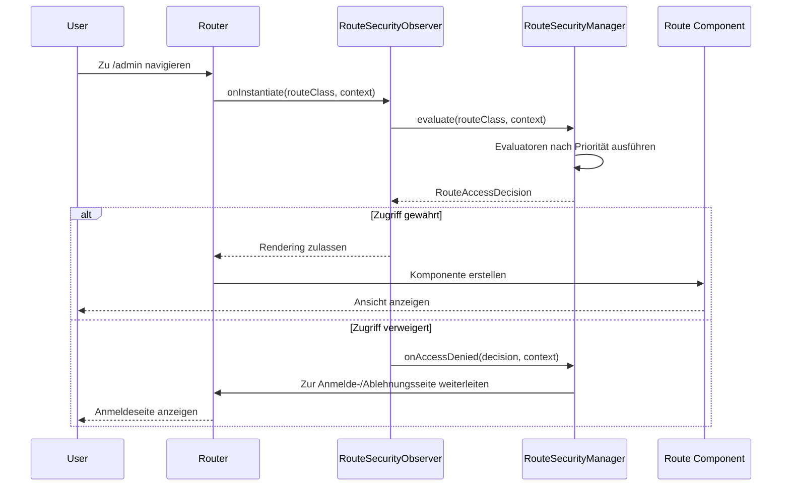

Die Durchsetzung der Sicherheit erfolgt in webforJ automatisch während der Navigation. Wenn ein Benutzer auf einen Link klickt oder zu einer Route navigiert, fängt das Sicherheitssystem die Navigation ab, wertet die Zugriffsregeln aus und lässt die Navigation entweder fortsetzen oder leitet den Benutzer zu einer geeigneten Seite weiter. Dieses Abfangen ist für Benutzer unsichtbar und erfordert keine manuellen Sicherheitsprüfungen im Code Ihrer Komponenten.

Wenn Sie verstehen, wie das Abfangen der Navigation funktioniert, können Sie Sicherheitsprobleme leichter beheben und benutzerdefinierte Navigationslogik erstellen, die in das Sicherheitssystem integriert ist.

## Der `RouteSecurityObserver` {#the-routesecurityobserver}

Der `RouteSecurityObserver` ist ein Navigationsbeobachter, der in den Lebenszyklus des Routers eingebunden ist. Er überwacht Navigationsereignisse und wertet Sicherheitsregeln aus, bevor eine Komponente gerendert wird.

Der Beobachter wird beim Start der App an den Renderer des Routers angehängt:

```java
// Create the observer with your security manager
RouteSecurityObserver observer = new RouteSecurityObserver(securityManager);

// Attach it to the router's renderer
Router router = Router.getCurrent();
if (router != null) {
  router.getRenderer().addObserver(observer);
}
```

Nach dem Anhängen fängt der Beobachter jede Navigationsanfrage ab. Er sitzt zwischen den Navigationsanfragen und dem Rendern der Komponenten. Sobald die Navigation beginnt, fragt er den Sicherheitsmanager nach einer Zugriffsentscheidung. Die Komponente wird nur gerendert, wenn der Zugriff gewährt wird.

## Ablauf des Abfangens der Navigation {#navigation-interception-flow}

Wenn ein Benutzer zu einer Route navigiert, läuft die folgende Sequenz ab:



Dieser Ablauf zeigt, dass die Sicherheitsprüfung erfolgt, bevor Code einer geschützten Route ausgeführt wird. Wird der Zugriff verweigert, wird die Komponente nie instanziiert. So wird verhindert, dass nicht autorisierte Benutzer Geschäftslogik auslösen oder auf geschützte Daten zugreifen.

## Abfangpunkte {#interception-points}

Der Beobachter fängt die Navigation an einem bestimmten Punkt im Routing-Lebenszyklus ab:

**Vor der Instanziierung** Die Methode `onInstantiate()` des Beobachters wird mit der Route-Klasse aufgerufen, nachdem die Route aufgelöst wurde und bevor die Komponente instanziiert wird. Dies ist der Sicherheitsprüfpunkt.

An diesem Punkt weiß der Router, welche Route-Klasse gerendert wird, die Route wurde jedoch noch nicht instanziiert. Der Beobachter kann Sicherheitsannotationen der Klasse auswerten, ohne die Routenlogik auszuführen.

Wird der Zugriff verweigert, verhindert der Beobachter das Rendering und löst eine Weiterleitung aus. Die ursprüngliche Route wird nie instanziiert.

## Der Auswertungsprozess {#the-evaluation-process}

Wenn der Beobachter die Navigation abfängt, delegiert er die Auswertung an den Sicherheitsmanager. Der Beobachter ruft die Route-Klasse aus dem Navigationskontext ab und bittet den Manager, den Zugriff auszuwerten. Gewährt die Entscheidung den Zugriff, wird die Navigation normal fortgesetzt. Verweigert die Entscheidung den Zugriff, stoppt der Beobachter die Weitergabe, um das Rendering zu verhindern, und überlässt dem Manager die Behandlung der Verweigerung.

Der Manager koordiniert die Auswertung, indem er:

1. Prüft, ob die Sicherheit in der Konfiguration aktiviert ist
2. Den aktuellen Sicherheitskontext (Benutzerinformationen) abruft
3. Die Evaluatorkette in der Reihenfolge ihrer Priorität ausführt
4. Die endgültige Zugriffsentscheidung zurückgibt

Der Beobachter reagiert auf die Entscheidung: Wird der Zugriff gewährt, wird die Navigation fortgesetzt; wird er verweigert, stoppt der Beobachter die Weitergabe und überlässt dem Manager die Behandlung der Verweigerung.

## Wie Zugriffsentscheidungen getroffen werden {#how-access-decisions-are-made}

Der Sicherheitsmanager erstellt eine Evaluatorkette und führt jeden Evaluator nach Priorität aus. Evaluatoren können drei Arten von Entscheidungen treffen:

- **Zugriff gewähren:** Der Evaluator genehmigt die Navigation und die Route wird gerendert. Weitere Evaluatoren werden nicht berücksichtigt. Der Evaluator gibt eine Entscheidung zurück, die den gewährten Zugriff anzeigt.

- **Zugriff verweigern:** Der Evaluator blockiert die Navigation. Der Beobachter stoppt das Rendering und löst eine Weiterleitung aus. Der Evaluator gibt eine Verweigerungsentscheidung zurück, optional mit einer Begründung. Die Verweigerung kann auf fehlender Authentifizierung (Anmeldung erforderlich) oder fehlender Autorisierung (unzureichende Berechtigungen) beruhen.

- **An den nächsten Evaluator delegieren:** Der Evaluator trifft keine Entscheidung und übergibt die Kontrolle an den nächsten Evaluator in der Kette. Der Evaluator ruft die Methode `evaluate` der Kette auf, die zum nächsten Evaluator in der Prioritätsreihenfolge wechselt.

Die meisten Evaluatoren verarbeiten nur Routen mit bestimmten Annotationen. Zum Beispiel wertet `RolesAllowedEvaluator` nur Routen aus, die mit `@RolesAllowed` annotiert sind. Ist die Annotation nicht vorhanden, delegiert der Evaluator an den nächsten Evaluator.

## Behandlung einer Zugriffsverweigerung {#handling-access-denial}

Wird der Zugriff verweigert, behandelt die Methode `onAccessDenied()` des Managers die Verweigerung abhängig von ihrem Typ:

- **Authentifizierung erforderlich:** Der Benutzer ist nicht angemeldet. Weiterleitung zur Anmeldeseite, die in `RouteSecurityConfiguration.getAuthenticationLocation()` konfiguriert ist.

- **Zugriff verweigert:** Der Benutzer ist angemeldet, verfügt aber nicht über die erforderlichen Berechtigungen. Weiterleitung zur Seite „Zugriff verweigert“, die in `RouteSecurityConfiguration.getDenyLocation()` konfiguriert ist.

Vor der Weiterleitung speichert der Manager den ursprünglich angeforderten Speicherort in der HTTP-Sitzung. Nach erfolgreicher Anmeldung kann dieser Speicherort mit der Methode `consumePreAuthenticationLocation()` des Managers abgerufen werden. Sie gibt den gespeicherten Speicherort zurück und entfernt ihn aus der Sitzung. Wurde ein Speicherort gespeichert, kann die App dorthin navigieren; andernfalls navigiert sie zu einer Standardseite.

## Wenn die Sicherheit deaktiviert ist {#when-security-is-disabled}

Wenn `RouteSecurityConfiguration.isEnabled()` `false` zurückgibt, überspringt der Manager die gesamte Auswertung und gewährt sofort Zugriff auf alle Routen. Die Evaluatorkette wird nicht ausgeführt und es finden keine Sicherheitsprüfungen statt.

Das ist während der Entwicklung oder für Anwendungen nützlich, die keine Sicherheit benötigen. Sie können die Sicherheit ein- und ausschalten, ohne Annotationen zu entfernen oder den Beobachter abzumelden.

## Integration in den Navigationslebenszyklus {#integration-with-navigation-lifecycle}

Der Sicherheitsbeobachter ist in den umfassenderen [Navigationslebenszyklus](/docs/routing/navigation-lifecycle/overview) integriert, in den mehrere Beobachter Navigationsereignisse einbinden können. Die Sicherheitsprüfung erfolgt früh in diesem Lebenszyklus, vor der Blockierung der Navigation oder den Ereignissen des Komponentenlebenszyklus.

Wenn Sie benutzerdefinierte Navigationsbeobachter implementieren, beachten Sie, dass die Sicherheitsprüfung zuerst stattfindet. Wird der Zugriff verweigert, werden weder `onInstantiate()` noch `onRouteRendererLifecycleEvent()` Ihres Beobachters aufgerufen, da die Route nie instanziiert wird.
