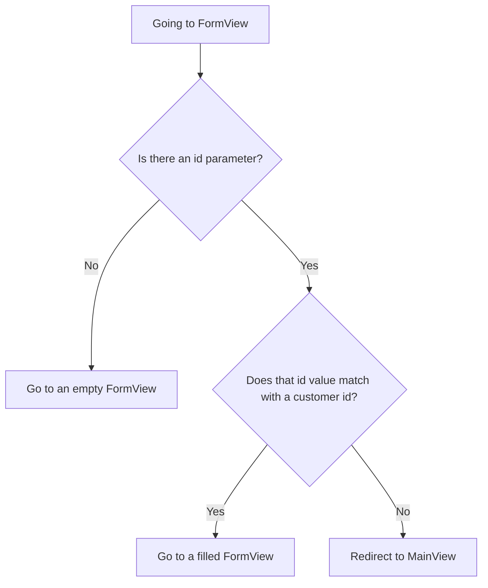

La aplicación de [Routing and Composites](/docs/introduction/tutorial/routing-and-composites) solo puede agregar clientes nuevos a la base de datos. Con los siguientes conceptos, permitirás que los usuarios también editen los datos de los clientes existentes:

- Patrones de ruta
- Pasar valores de parámetros a través de una URL
- Observadores del ciclo de vida

Al completar este paso, crearás una versión de [4-observers-and-route-parameters](https://github.com/webforj/webforj-tutorial/tree/main/4-observers-and-route-parameters).

<!-- <VideoPlayer video="tutorial/scaling-with-routing-and-composites" width={1920} height={1080} title="Scaling with routing and composites" /> -->

## Ejecutar la aplicación {#running-the-app}

Mientras desarrollas la aplicación, puedes usar [4-observers-and-route-parameters](https://github.com/webforj/webforj-tutorial/tree/main/4-observers-and-route-parameters) como referencia para comparar. Para ver la aplicación en acción:

1. Ve al directorio de nivel superior que contiene el archivo `pom.xml`. Si estás siguiendo la versión de GitHub, este directorio es `4-observers-and-route-parameters`.

2. Usa el siguiente comando de Maven para ejecutar la aplicación Spring Boot localmente:
    ```bash
    mvn
    ```

Al ejecutar la aplicación, se abre automáticamente una nueva ventana del navegador en `http://localhost:8080`.

## Usar el `id` del cliente {#using-the-customers-id}

Para usar `FormView` con el fin de editar clientes existentes, necesitarás una forma de indicarle qué cliente debe editar.
Puedes hacerlo proporcionando a `FormView` un parámetro inicial que represente el ID del cliente.
En [Working with Data](/docs/introduction/tutorial/working-with-data), creaste una entidad `Customer` que asigna un valor numérico `Long` como `id` único a los clientes cuando se agregan a la base de datos.

```java
 @Id
 @GeneratedValue(strategy = GenerationType.IDENTITY)
  private Long id;
```

En este paso, modificarás `FormView` para que use un `id` como parámetro inicial antes de que se cargue cualquier contenido. Luego, `FormView` evaluará el `id` para determinar si el formulario sirve para agregar un cliente nuevo o actualizar uno existente. Por último, modificarás `MainView` para que envíe un valor de `id` al navegar a `FormView`.

## Agregar un patrón de ruta a `FormView` {#adding-a-route-pattern}

En el paso anterior, establecer la ruta de `FormView` en `@Route(customer)` asigna la clase localmente a `http://localhost:8080/customer`. Al agregar un patrón de ruta, puedes incluir un `id` como parámetro inicial para `FormView`.

Un [patrón de ruta](/docs/routing/route-patterns) permite agregar un parámetro a la URL, hacerlo opcional y establecer restricciones para los patrones válidos. Con la anotación `@Route`, esto es lo que convierte `id` en un parámetro de ruta opcional para `FormView`:

- **`/:id`** asigna a la ruta un parámetro llamado `id`, de modo que al ir a `http://localhost:8080/customer/6`, se carga `FormView` con el parámetro `id` cuyo valor es `6`.

- **`?`** hace que el parámetro `id` sea opcional. De forma predeterminada, los parámetros son obligatorios, pero al hacer que `id` sea opcional puedes usar `FormView` para agregar clientes nuevos que todavía no tienen un `id`.

- **`<[0-9]+>`** restringe `id` a un número positivo. Entre corchetes angulares, `<>`, puedes agregar una restricción al parámetro mediante una expresión regular. Si el `id` no coincide con la restricción, por ejemplo, `http://localhost:8080/customer/john-smith`, se envía al usuario a una página 404.

Para agregar el parámetro de ruta opcional a `FormView`, cambia la anotación `@Route` por esta:

```java
@Route("customer/:id?<[0-9]+>")
```

## Enrutar a `FormView` {#routing-to-formview}

Ahora `FormView` acepta un parámetro `id` opcional y solo se carga si el `id` es un número entero positivo.

Sin embargo, `FormView` aún puede cargarse si un usuario escribe manualmente la URL de un cliente inexistente, como `http://localhost:8080/customer/5000`. Agregar un observador del ciclo de vida antes de entrar a `FormView` permite que tu aplicación determine cómo gestionar el valor de `id` recibido.

### Enrutamiento condicional {#conditional-routing}

Los observadores del ciclo de vida permiten que los componentes reaccionen a eventos del ciclo de vida en etapas específicas. El artículo [Lifecycle Observers](/docs/routing/navigation-lifecycle/observers) enumera los observadores disponibles, pero en este paso solo usarás `WillEnterObserver`.

El evento de `WillEnterObserver` ocurre antes de que termine el enrutamiento del componente.
Este observador permite evaluar el `id` recibido. Si el `id` no coincide con un cliente existente, puedes redirigir al usuario a `MainView` para que encuentre un cliente válido que editar.

Antes de analizar el código de `WillEnterObserver`, el siguiente diagrama de flujo muestra los posibles resultados al enrutar a `FormView`:



### Usar `WillEnterObserver` {#using-the-willenterobserver}

El observador del ciclo de vida `WillEnterObserver`, que se activa antes de que el componente se cargue por completo, permite agregar condiciones para determinar si la aplicación debe continuar a `FormView` o redirigir a los usuarios a `MainView`.

Cada observador del ciclo de vida es una interfaz, así que implementa `WillEnterObserver` como parte de la declaración de `FormView`:

```java
public class FormView extends Composite<Div> implements WillEnterObserver {
```

El observador `WillEnterObserver` tiene el método `onWillEnter()`, que webforJ llama antes de enrutar al componente. Este método tiene dos parámetros: `WillEnterEvent` y `ParametersBag`.

`WillEnterEvent` determina si se continúa el enrutamiento al componente mediante el método `accept()` o si se detiene mediante el método `reject()`. Después de rechazar la ruta actual, debes redirigir al usuario a otro lugar.

`ParametersBag` contiene los parámetros del enrutador que provienen de la URL. En la siguiente sección, usarás `ParametersBag` para crear la lógica condicional de `onWillEnter()` con el parámetro `id`.

El siguiente ejemplo de `onWillEnter()` tiene solo dos resultados:

```java
@Override
public void onWillEnter(WillEnterEvent event, ParametersBag parameters) {

  //Add conditional logic
  if (<condition>) {

    //Allow routing to FormView to proceed
    event.accept();

  } else {

    //Stop routing to FormView
    event.reject();

    //Send the user to MainView
    navigateToMain();
  }
}
```

### Usar `ParametersBag` {#using-the-parametersbag}

Como se mencionó brevemente en la sección anterior, `ParametersBag` contiene el parámetro del enrutador que proviene de la URL. Todos los observadores del ciclo de vida tienen acceso a este objeto, y usarlo en tu aplicación te permite obtener el valor de `id`.

El objeto `ParametersBag` proporciona varios métodos de consulta para recuperar un parámetro como un tipo de objeto específico. Por ejemplo, `getInt()` permite obtener un parámetro como un `Integer`.

Sin embargo, como algunos parámetros son opcionales, lo que `getInt()` devuelve en realidad es `Optional<Integer>`. Al usar el método `ifPresentOrElse()` en el `Optional<Integer>`, puedes asignar un valor a una variable usando el `Integer`.

Si no hay ningún `id`, el usuario puede continuar a `FormView` para agregar un cliente nuevo.

```java
@Override
public void onWillEnter(WillEnterEvent event, ParametersBag parameters) {

  //Determine which parameter to get, and check if it's present or not
  parameters.getInt("id").ifPresentOrElse(id -> {

    //Use the id as a variable
    customerId = Long.valueOf(id);

  //When no id is present, continue to FormView for a new customer
  }, () -> event.accept());

}
```

### ¿El `id` es válido? {#is-the-id-valid}

Por ahora, el `WillEnterObserver` de la sección anterior solo acepta el enrutamiento cuando no hay ningún `id`. Antes de continuar a `FormView`, el observador debe realizar una verificación más: comprobar que el `id` coincida con un cliente existente.

Ahora `FormView` puede usar `CustomerService` para confirmar la existencia de un cliente mediante el método `doesCustomerExist()`. Si no hay ninguna coincidencia, la aplicación puede rechazar el enrutamiento actual y redirigir al usuario a `MainView` mediante `navigateToMain()`.

Si el `id` es válido, la aplicación puede usar `accept()` para continuar el enrutamiento a `FormView`. Crea un método `fillForm()` para asignar a la variable `customer` el cliente de la base de datos cuyo `id` coincide y establecer los valores de los campos:

```java
public void fillForm(Long customerId) {
  customer = customerService.getCustomerByKey(customerId);
  firstName.setValue(customer.getFirstName());
  lastName.setValue(customer.getLastName());
  company.setValue(customer.getCompany());
  country.selectKey(customer.getCountry());
}
```

Al igual que cuando se agrega un cliente nuevo, el uso de una copia de trabajo permite que los usuarios editen los datos del cliente en la interfaz de usuario sin modificar directamente el repositorio.

### `onWillEnter()` completo {#completed-onwillenter}

Las dos secciones anteriores detallaron cómo gestionar cada resultado posible al enrutar a `FormView` mediante `ParametersBag` y `CustomerService`.

A continuación, se muestra el método `onWillEnter()` completo de `FormView`, que usa `ParametersBag` para rechazar o aceptar la ruta recibida y llama a otros métodos para rellenar el formulario o enviar al usuario a `MainView`:

```java
@Override
public void onWillEnter(WillEnterEvent event, ParametersBag parameters) {

  //Determine which parameter to get, and check if it's present or not
  parameters.getInt("id").ifPresentOrElse(id -> {

    //Use the id as a variable
    customerId = Long.valueOf(id);

    //Check if there's a customer with this id
    if (customerService.doesCustomerExist(customerId)) {

        //This customer exists, so continue to FormView, and initialize the fields using the id
        event.accept();
        fillForm(customerId);
      } else {

        //This customer doesn't exists, so redirect to MainView
        event.reject();
        navigateToMain();
      }

  //No id was present, so continue to FormView for a new customer
  }, () -> event.accept());

}
```

## Agregar o editar un cliente {#adding-or-editing-a-customer}

La versión anterior de esta aplicación solo agregaba clientes nuevos cuando el usuario enviaba el formulario. Ahora que los usuarios pueden editar clientes existentes, el método `submitCustomer()` debe verificar si el cliente ya existe antes de actualizar la base de datos.

Al principio, no era necesario asignar una variable para el `id` del cliente en `FormView`, porque a los clientes nuevos se les asigna un `id` único al guardarlos en la base de datos. Sin embargo, si declaras `customerId` como una variable inicial en `FormView` con un valor de `id` que no esté en uso, este permanecerá intacto para los clientes nuevos y se sobrescribirá en `onWillEnter()` para los clientes existentes.

Esto te permite usar `doesCustomerExist()` para verificar si debes agregar un cliente nuevo o actualizar uno existente.

```java
private Long customerId = 0L;

//...

private void submitCustomer() {
  if (customerService.doesCustomerExist(customerId)) {
    customerService.updateCustomer(customer);
  } else {
    customerService.createCustomer(customer);
  }
  navigateToMain();
}
```

## `FormView` completo {#completed-formview}

Así debería quedar `FormView` ahora que puede gestionar la edición de clientes existentes:

<!-- vale off -->
<ExpandableCode title="FormView.java" language="java" startLine={1} endLine={15}>

```java
@Route("customer/:id?<[0-9]+>")
@FrameTitle("Customer Form")
public class FormView extends Composite<Div> implements WillEnterObserver {
  private final CustomerService customerService;
  private Customer customer = new Customer();
  private Long customerId = 0L;
  private Div self = getBoundComponent();
  private TextField firstName = new TextField("First Name", e -> customer.setFirstName(e.getValue()));
  private TextField lastName = new TextField("Last Name", e -> customer.setLastName(e.getValue()));
  private TextField company = new TextField("Company", e -> customer.setCompany(e.getValue()));
  private ChoiceBox country = new ChoiceBox("Country",
      e -> customer.setCountry((Customer.Country) e.getSelectedItem().getKey()));
  private Button submit = new Button("Submit", ButtonTheme.PRIMARY, e -> submitCustomer());
  private Button cancel = new Button("Cancel", ButtonTheme.OUTLINED_PRIMARY, e -> navigateToMain());
  private ColumnsLayout layout = new ColumnsLayout(
      firstName, lastName,
      company, country,
      submit, cancel);

  public FormView(CustomerService customerService) {
    this.customerService = customerService;
    fillCountries();
    setColumnsLayout();
    self.setMaxWidth(600)
        .addClassName("card")
        .add(layout);
    submit.setStyle("margin-top", "var(--dwc-space-l)");
    cancel.setStyle("margin-top", "var(--dwc-space-l)");
  }

  private void setColumnsLayout() {
    List<Breakpoint> breakpoints = List.of(
        new Breakpoint(600, 2));
    layout.setSpacing("var(--dwc-space-l)")
        .setBreakpoints(breakpoints);
  }

  private void fillCountries() {
    ArrayList<ListItem> listCountries = new ArrayList<>();
    for (Country countryItem : Customer.Country.values()) {
      listCountries.add(new ListItem(countryItem, countryItem.toString()));
    }
    country.insert(listCountries);
    country.selectIndex(0);
  }

  private void submitCustomer() {
    if (customerService.doesCustomerExist(customerId)) {
      customerService.updateCustomer(customer);
    } else {
      customerService.createCustomer(customer);
    }
    navigateToMain();
  }

  private void navigateToMain() {
    Router.getCurrent().navigate(MainView.class);
  }

  @Override
  public void onWillEnter(WillEnterEvent event, ParametersBag parameters) {
    parameters.getInt("id").ifPresentOrElse(id -> {
      customerId = Long.valueOf(id);
      if (customerService.doesCustomerExist(customerId)) {
        event.accept();
        fillForm(customerId);
      } else {
        event.reject();
        navigateToMain();
      }

    }, () -> event.accept());
  }

  public void fillForm(Long customerId) {
    customer = customerService.getCustomerByKey(customerId);
    firstName.setValue(customer.getFirstName());
    lastName.setValue(customer.getLastName());
    company.setValue(customer.getCompany());
    country.selectKey(customer.getCountry());
  }
}
```

</ExpandableCode>
<!-- vale on -->

## Navegar de `MainView` a `FormView` para editar clientes {#navigating-from-mainview-to-formview-to-edit-customers}

Al principio de este paso, usaste un `ParametersBag` existente para determinar el valor de un `id`. Crear un `ParametersBag` nuevo te permite navegar entre clases directamente con los parámetros que elijas. Usar los datos de la `Table` es una opción viable para enviar a los usuarios a `FormView` con el `id` de un cliente.

Al igual que con un botón, asociar la navegación a una acción elegida por el usuario le permite decidir cuándo ir a `FormView`. Agregar un receptor de eventos a la `Table` te permite enviar al usuario a `FormView` con un `ParametersBag`:

```java
table.addItemClickListener(this::editCustomer);

private void editCustomer(TableItemClickEvent<Customer> e) {
  Router.getCurrent().navigate(FormView.class,
      ParametersBag.of("id=" + e.getItemKey()));
  }
```

Sin embargo, las claves de los elementos de `Table` se generan automáticamente de forma predeterminada. Puedes hacer que cada clave corresponda explícitamente al `id` de un cliente mediante el método `setKeyProvider()`:

```java
table.setKeyProvider(Customer::getId);
```

En `MainView`, agrega los métodos `addItemClickListener()` y `setKeyProvider()` a `buildTable()`. Luego, agrega el método que envía al usuario a `FormView` con un valor de `id` en `ParametersBag`, según el lugar de la tabla en el que haya hecho clic:

```java title="MainView.java" {30-31,34-37}
@Route("/")
@FrameTitle("Customer Table")
public class MainView extends Composite<Div> {
  private final CustomerService customerService;
  private Div self = getBoundComponent();
  private Table<Customer> table = new Table<>();
  private Button addCustomer = new Button("Add Customer", ButtonTheme.PRIMARY,
      e -> Router.getCurrent().navigate(FormView.class));

  public MainView(CustomerService customerService) {
    this.customerService = customerService;
    addCustomer.setWidth(200);
    buildTable();
    self.setWidth("fit-content")
        .addClassName("card")
        .add(table, addCustomer);
  }

  private void buildTable() {
    table.setSize("1000px", "294px");
    table.setMaxWidth("90vw");
    table.addColumn("firstName", Customer::getFirstName).setLabel("First Name");
    table.addColumn("lastName", Customer::getLastName).setLabel("Last Name");
    table.addColumn("company", Customer::getCompany).setLabel("Company");
    table.addColumn("country", Customer::getCountry).setLabel("Country");
    table.setColumnsToAutoFit();
    table.setColumnsToResizable(false);
    table.getColumns().forEach(column -> column.setSortable(true));
    table.setRepository(customerService.getRepositoryAdapter());
    table.setKeyProvider(Customer::getId);
    table.addItemClickListener(this::editCustomer);
  }

  private void editCustomer(TableItemClickEvent<Customer> e) {
    Router.getCurrent().navigate(FormView.class,
        ParametersBag.of("id=" + e.getItemKey()));
  }
}
```

## Siguiente paso {#next-step}

Ahora que los usuarios pueden editar directamente los datos de los clientes, tu aplicación debería validar los cambios antes de confirmarlos en el repositorio. En [Validating and Binding Data](/docs/introduction/tutorial/validating-and-binding-data), crearás reglas de validación y asociarás directamente el modelo de datos con la interfaz de usuario, lo que permitirá que los componentes muestren mensajes de error cuando los datos no sean válidos.
