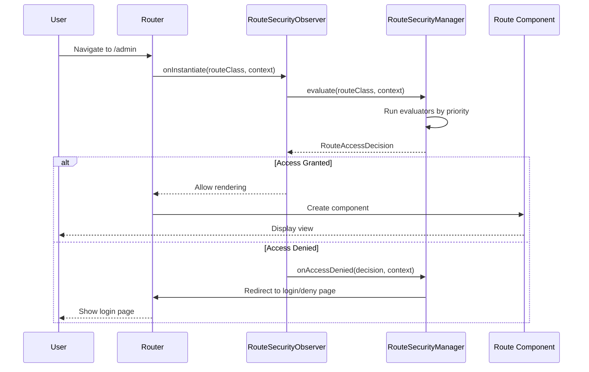

La aplicación de seguridad en webforJ se realiza automáticamente durante la navegación. Cuando un usuario hace clic en un enlace o navega a una ruta, el sistema de seguridad intercepta la navegación, evalúa las reglas de acceso y permite que la navegación continúe o redirige al usuario a una página adecuada. Esta interceptación es invisible para los usuarios y no requiere comprobaciones de seguridad manuales en el código de los componentes.

Comprender cómo funciona la interceptación de la navegación te ayuda a solucionar problemas de seguridad y a crear lógica de navegación personalizada que se integre con el sistema de seguridad.

## El `RouteSecurityObserver` {#the-routesecurityobserver}

`RouteSecurityObserver` es un observador de navegación que se conecta al ciclo de vida del enrutador. Escucha los eventos de navegación y evalúa las reglas de seguridad antes de que se renderice cualquier componente.

El observador se conecta al renderizador del enrutador durante el inicio de la aplicación:

```java
// Create the observer with your security manager
RouteSecurityObserver observer = new RouteSecurityObserver(securityManager);

// Attach it to the router's renderer
Router router = Router.getCurrent();
if (router != null) {
  router.getRenderer().addObserver(observer);
}
```

Una vez conectado, el observador intercepta cada solicitud de navegación. Se sitúa entre las solicitudes de navegación y el renderizado de componentes. Cuando comienza la navegación, consulta al gestor de seguridad para que evalúe el acceso. El componente solo se renderiza si se concede el acceso.

## Flujo de interceptación de la navegación {#navigation-interception-flow}

Cuando un usuario navega a una ruta, se produce la siguiente secuencia:



Este flujo muestra que la evaluación de seguridad se realiza antes de que se ejecute cualquier código de ruta sensible. Si se deniega el acceso, el componente nunca se instancia, lo que impide que usuarios no autorizados activen la lógica de negocio o accedan a datos protegidos.

## Puntos de interceptación {#interception-points}

El observador intercepta la navegación en un punto específico del ciclo de vida del enrutamiento:

**Antes de la instanciación** Se llama al método `onInstantiate()` del observador con la clase de la ruta una vez resuelta la ruta y antes de instanciar el componente. Este es el punto de control de seguridad.

En este punto, el enrutador sabe qué clase de ruta se renderizará, pero la ruta aún no se ha instanciado. El observador puede evaluar las anotaciones de seguridad de la clase sin ejecutar la lógica de la ruta.

Si se deniega el acceso, el observador impide el renderizado y activa una redirección. La ruta original nunca se instancia.

## El proceso de evaluación {#the-evaluation-process}

Cuando el observador intercepta la navegación, delega la evaluación al gestor de seguridad. El observador obtiene la clase de la ruta del contexto de navegación y solicita al gestor que evalúe el acceso. Si la decisión concede el acceso, la navegación continúa con normalidad. Si la decisión deniega el acceso, el observador detiene la propagación para impedir el renderizado y permite que el gestor gestione la denegación.

El gestor coordina la evaluación mediante estos pasos:

1. Comprobar si la seguridad está habilitada en la configuración
2. Obtener el contexto de seguridad actual (información del usuario)
3. Ejecutar la cadena de evaluadores en orden de prioridad
4. Devolver la decisión de acceso final

El observador actúa según la decisión: si se concede el acceso, la navegación continúa; si se deniega, el observador detiene la propagación y permite que el gestor gestione la denegación.

## Cómo se toman las decisiones de acceso {#how-access-decisions-are-made}

El gestor de seguridad crea una cadena de evaluadores y ejecuta cada evaluador por orden de prioridad. Los evaluadores pueden tomar tres tipos de decisiones:

- **Conceder el acceso:** El evaluador aprueba la navegación y se renderiza la ruta. No se consulta a ningún otro evaluador. El evaluador devuelve una decisión que indica que se concede el acceso.

- **Denegar el acceso:** El evaluador bloquea la navegación. El observador detiene el renderizado y activa una redirección. El evaluador devuelve una decisión de denegación, que puede incluir un mensaje con el motivo. La denegación puede deberse a la falta de autenticación (se requiere iniciar sesión) o a la falta de autorización (permisos insuficientes).

- **Delegar al siguiente evaluador:** El evaluador no toma ninguna decisión y pasa el control al siguiente evaluador de la cadena. El evaluador llama al método `evaluate` de la cadena, que avanza al siguiente evaluador según el orden de prioridad.

La mayoría de los evaluadores solo gestionan rutas con anotaciones específicas. Por ejemplo, `RolesAllowedEvaluator` solo evalúa las rutas anotadas con `@RolesAllowed`. Si la anotación no está presente, delega al siguiente evaluador.

## Gestión de la denegación de acceso {#handling-access-denial}

Cuando se deniega el acceso, el método `onAccessDenied()` del gestor gestiona la denegación según su tipo:

- **Se requiere autenticación:** El usuario no ha iniciado sesión. Se le redirige a la página de inicio de sesión configurada en `RouteSecurityConfiguration.getAuthenticationLocation()`.

- **Acceso denegado:** El usuario ha iniciado sesión, pero no tiene los permisos necesarios. Se le redirige a la página de acceso denegado configurada en `RouteSecurityConfiguration.getDenyLocation()`.

Antes de redirigir, el gestor almacena en la sesión HTTP la ubicación solicitada originalmente. Tras iniciar sesión correctamente, esta ubicación se puede recuperar con el método `consumePreAuthenticationLocation()` del gestor, que devuelve la ubicación almacenada y la elimina de la sesión. Si se había almacenado una ubicación, la aplicación puede navegar hasta ella; de lo contrario, navega a una página predeterminada.

## Cuando la seguridad está deshabilitada {#when-security-is-disabled}

Si `RouteSecurityConfiguration.isEnabled()` devuelve `false`, el gestor omite toda evaluación y concede acceso de inmediato a todas las rutas. La cadena de evaluadores no se ejecuta y no se realizan comprobaciones de seguridad.

Esto resulta útil durante el desarrollo o para aplicaciones que no requieren seguridad. Puedes activar y desactivar la seguridad sin eliminar anotaciones ni anular el registro del observador.

## Integración con el ciclo de vida de navegación {#integration-with-navigation-lifecycle}

El observador de seguridad se integra con el [ciclo de vida de navegación](/docs/routing/navigation-lifecycle/overview) general, en el que varios observadores pueden conectarse a los eventos de navegación. La evaluación de seguridad se realiza en una fase temprana de este ciclo, antes del bloqueo de la navegación o de los eventos del ciclo de vida de los componentes.

Si implementas observadores de navegación personalizados, ten en cuenta que la evaluación de seguridad se realiza primero. Si se deniega el acceso, no se llama ni a `onInstantiate()` ni a `onRouteRendererLifecycleEvent()` de tu observador, porque la ruta nunca se instancia.
