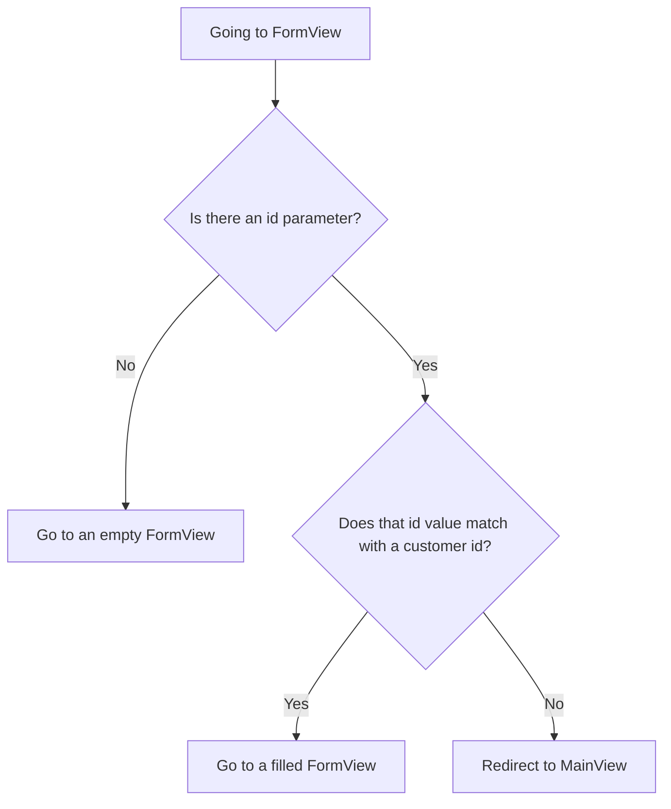

Sovellus sivulta [Reititys ja koostekomponentit](/docs/introduction/tutorial/routing-and-composites) voi lisätä tietokantaan vain uusia asiakkaita. Seuraavien käsitteiden avulla voit antaa käyttäjille mahdollisuuden myös muokata olemassa olevien asiakkaiden tietoja:

- Reittimallit
- Parametriarvojen välittäminen URL-osoitteessa
- Elinkaaren tarkkailijat

Tämän vaiheen suorittaminen luo version [4-observers-and-route-parameters](https://github.com/webforj/webforj-tutorial/tree/main/4-observers-and-route-parameters)-esimerkistä.

<!-- <VideoPlayer video="tutorial/scaling-with-routing-and-composites" width={1920} height={1080} title="Scaling with routing and composites" /> -->

## Sovelluksen suorittaminen {#running-the-app}

Kun kehität sovellustasi, voit käyttää vertailukohtana [4-observers-and-route-parameters](https://github.com/webforj/webforj-tutorial/tree/main/4-observers-and-route-parameters)-esimerkkiä. Näet sovelluksen toiminnassa seuraavasti:

1. Siirry ylimmän tason hakemistoon, joka sisältää `pom.xml`-tiedoston. Jos seuraat GitHubissa olevaa versiota, hakemisto on `4-observers-and-route-parameters`.

2. Suorita Spring Boot -sovellus paikallisesti seuraavalla Maven-komennolla:
    ```bash
    mvn
    ```

Sovelluksen suorittaminen avaa automaattisesti uuden selaimen osoitteessa `http://localhost:8080`.

## Asiakkaan `id`-tunnuksen käyttäminen {#using-the-customers-id}

Jotta voit muokata olemassa olevia asiakkaita `FormView`-näkymässä, tarvitset tavan kertoa sille, mitä asiakasta muokataan.
Voit tehdä tämän antamalla `FormView`-näkymälle alkuparametrin, joka vastaa asiakkaan tunnusta.
[Työskentely datan kanssa](/docs/introduction/tutorial/working-with-data) -osiossa loit `Customer`-entiteetin, joka määrittää asiakkaalle yksilölliseksi `id`-tunnukseksi numeerisen `Long`-arvon, kun asiakas lisätään tietokantaan.

```java
 @Id
 @GeneratedValue(strategy = GenerationType.IDENTITY)
  private Long id;
```

Tässä vaiheessa muokkaat `FormView`-näkymää niin, että se käyttää `id`-tunnusta alkuparametrina ennen kuin mitään ladataan. Sen jälkeen `FormView` tarkistaa `id`-tunnuksen avulla, lisätäänkö lomakkeella uusi asiakas vai päivitetäänkö olemassa olevaa. Lopuksi muokkaat `MainView`-näkymää niin, että se välittää `id`-arvon siirryttäessä `FormView`-näkymään.

## Reittimallin lisääminen `FormView`-näkymään {#adding-a-route-pattern}

Edellisessä vaiheessa reitin asettaminen `FormView`-näkymässä muotoon `@Route(customer)` yhdisti luokan paikallisesti osoitteeseen `http://localhost:8080/customer`. Reittimallin lisääminen mahdollistaa `id`-tunnuksen lisäämisen `FormView`-näkymän alkuparametriksi.

[Reittimallin](/docs/routing/route-patterns) avulla voit lisätä URL-osoitteeseen parametrin, määrittää sen valinnaiseksi ja asettaa kelvollisia malleja koskevia rajoituksia. `@Route`-annotaatiolla voit määrittää `id`-tunnuksen `FormView`-näkymän valinnaiseksi reittiparametriksi seuraavasti:

- **`/:id`** antaa reitille nimetyn `id`-parametrin. Kun siirryt osoitteeseen `http://localhost:8080/customer/6`, `FormView` avautuu ja sen `id`-parametrin arvo on `6`.

- **`?`** määrittää `id`-parametrin valinnaiseksi. Parametrit ovat oletusarvoisesti pakollisia, mutta `id`-parametrin määrittäminen valinnaiseksi mahdollistaa `FormView`-näkymän käyttämisen uusien asiakkaiden lisäämiseen, vaikka heillä ei vielä ole `id`-tunnusta.

- **`<[0-9]+>`** rajoittaa `id`-arvon positiiviseksi luvuksi. Kulmasulkeissa `<>` voit määrittää parametrille säännöllisen lausekkeen mukaisen rajoituksen. Jos `id` ei vastaa rajoitusta, esimerkiksi osoitteessa `http://localhost:8080/customer/john-smith`, käyttäjä ohjataan 404-sivulle.

Lisää valinnainen reittiparametri `FormView`-näkymään muuttamalla `@Route`-annotaatio seuraavaksi:

```java
@Route("customer/:id?<[0-9]+>")
```

## Reititys `FormView`-näkymään {#routing-to-formview}

`FormView` hyväksyy nyt valinnaisen `id`-parametrin ja latautuu vain, jos `id` on positiivinen kokonaisluku.

Käyttäjä voi kuitenkin yhä avata `FormView`-näkymän kirjoittamalla selaimeen manuaalisesti olemattoman asiakkaan URL-osoitteen, kuten `http://localhost:8080/customer/5000`. Elinkaaren tarkkailijan lisääminen ennen `FormView`-näkymään siirtymistä antaa sovellukselle mahdollisuuden päättää, miten saapuvaa `id`-arvoa käsitellään.

### Ehdollinen reititys {#conditional-routing}

Elinkaaren tarkkailijoiden avulla komponentit voivat reagoida elinkaaren tapahtumiin tietyissä vaiheissa. [Elinkaaren tarkkailijat](/docs/routing/navigation-lifecycle/observers) -artikkelissa luetellaan käytettävissä olevat tarkkailijat, mutta tässä vaiheessa käytetään vain `WillEnterObserver`-tarkkailijaa.

`WillEnterObserver` käynnistyy ennen kuin komponentin reititys on valmis.
Tämän tarkkailijan avulla voit tarkistaa saapuvan `id`-arvon. Jos `id` ei vastaa olemassa olevaa asiakasta, voit ohjata käyttäjän takaisin `MainView`-näkymään, josta hän voi etsiä muokattavan asiakkaan.

Ennen kuin käsittelemme `WillEnterObserver`-tarkkailijan koodia, seuraava vuokaavio esittää mahdolliset lopputulokset reititettäessä `FormView`-näkymään:



### `WillEnterObserver`-tarkkailijan käyttäminen {#using-the-willenterobserver}

Ennen komponentin täyttä latautumista käynnistyvän elinkaaren tarkkailijan `WillEnterObserver` avulla voit määrittää ehdot, joiden perusteella päätetään, jatkaako sovellus `FormView`-näkymään vai pitääkö käyttäjä ohjata `MainView`-näkymään.

Jokainen elinkaaren tarkkailija on rajapinta, joten ota `WillEnterObserver` käyttöön osana `FormView`-luokan määrittelyä:

```java
public class FormView extends Composite<Div> implements WillEnterObserver {
```

`WillEnterObserver`-tarkkailijassa on `onWillEnter()`-metodi, jota webforJ kutsuu ennen komponenttiin reitittämistä. Metodilla on kaksi parametria: `WillEnterEvent` ja `ParametersBag`.

`WillEnterEvent`-parametrin `accept()`-metodilla voit jatkaa reititystä komponenttiin, ja `reject()`-metodilla voit pysäyttää sen. Kun hylkäät nykyisen reitin, sinun on ohjattava käyttäjä johonkin muualle.

`ParametersBag` sisältää URL-osoitteen reitittimen parametrit. Seuraavassa osiossa käytät `ParametersBag`-oliota `onWillEnter()`-metodin ehdollisen logiikan luomiseen `id`-parametrin avulla.

Seuraava `onWillEnter()`-esimerkki sisältää vain kaksi mahdollista lopputulosta:

```java
@Override
public void onWillEnter(WillEnterEvent event, ParametersBag parameters) {

  //Add conditional logic
  if (<condition>) {

    //Allow routing to FormView to proceed
    event.accept();

  } else {

    //Stop routing to FormView
    event.reject();

    //Send the user to MainView
    navigateToMain();
  }
}
```

### `ParametersBag`-olion käyttäminen {#using-the-parametersbag}

Kuten edellisessä osiossa lyhyesti mainittiin, `ParametersBag` sisältää URL-osoitteen reitittimen parametrin. Jokaisella elinkaaren tarkkailijalla on pääsy tähän olioon, ja sen avulla sovellus voi hakea `id`-arvon.

`ParametersBag`-olio tarjoaa useita kyselymetodeja, joilla parametri voidaan hakea tietyn tyyppisenä oliona. Esimerkiksi `getInt()` voi hakea parametrin `Integer`-arvona.

Koska jotkin parametrit ovat kuitenkin valinnaisia, `getInt()` palauttaa todellisuudessa arvon `Optional<Integer>`. `Optional<Integer>`-olion `ifPresentOrElse()`-metodilla voit asettaa muuttujan `Integer`-arvon perusteella.

Jos `id`-arvoa ei ole, käyttäjä voi jatkaa `FormView`-näkymään uuden asiakkaan lisäämistä varten.

```java
@Override
public void onWillEnter(WillEnterEvent event, ParametersBag parameters) {

  //Determine which parameter to get, and check if it's present or not
  parameters.getInt("id").ifPresentOrElse(id -> {

    //Use the id as a variable
    customerId = Long.valueOf(id);

  //When no id is present, continue to FormView for a new customer
  }, () -> event.accept());

}
```

### Onko `id` kelvollinen? {#is-the-id-valid}

Tässä vaiheessa edellisen osion `WillEnterObserver`-tarkkailija hyväksyy reitityksen vain silloin, kun `id`-arvoa ei ole. Ennen `FormView`-näkymään siirtymistä tarkkailijan on tehtävä vielä yksi tarkistus: varmista, että `id` vastaa olemassa olevaa asiakasta.

`FormView` voi nyt käyttää `CustomerService`-palvelua asiakkaan olemassaolon tarkistamiseen `doesCustomerExist()`-metodilla. Jos vastaavaa asiakasta ei löydy, sovellus voi hylätä nykyisen reitin ja ohjata käyttäjän `MainView`-näkymään `navigateToMain()`-metodilla.

Jos `id` on kelvollinen, sovellus voi jatkaa reititystä `FormView`-näkymään `accept()`-metodilla. Luo `fillForm()`-metodi, joka asettaa `customer`-muuttujaksi tietokannasta löytyvän, vastaavan `id`-tunnuksen asiakkaan ja määrittää kenttien arvot:

```java
public void fillForm(Long customerId) {
  customer = customerService.getCustomerByKey(customerId);
  firstName.setValue(customer.getFirstName());
  lastName.setValue(customer.getLastName());
  company.setValue(customer.getCompany());
  country.selectKey(customer.getCountry());
}
```

Kuten uutta asiakasta lisättäessä, työkopion avulla käyttäjät voivat muokata asiakkaan tietoja käyttöliittymässä ilman, että he muokkaavat tietovarastoa suoraan.

### Valmis `onWillEnter()` {#completed-onwillenter}

Kahdessa edellisessä osiossa käsiteltiin yksityiskohtaisesti, miten `FormView`-näkymään reititettäessä voidaan käsitellä eri lopputuloksia `ParametersBag`- ja `CustomerService`-olioiden avulla.

Seuraava `FormView`-näkymän valmis `onWillEnter()`-metodi käyttää `ParametersBag`-oliota saapuvan reitin hylkäämiseen tai hyväksymiseen ja kutsuu muita metodeja joko lomakkeen täyttämiseksi tai käyttäjän ohjaamiseksi `MainView`-näkymään:

```java
@Override
public void onWillEnter(WillEnterEvent event, ParametersBag parameters) {

  //Determine which parameter to get, and check if it's present or not
  parameters.getInt("id").ifPresentOrElse(id -> {

    //Use the id as a variable
    customerId = Long.valueOf(id);

    //Check if there's a customer with this id
    if (customerService.doesCustomerExist(customerId)) {

        //This customer exists, so continue to FormView, and initialize the fields using the id
        event.accept();
        fillForm(customerId);
      } else {

        //This customer doesn't exists, so redirect to MainView
        event.reject();
        navigateToMain();
      }

  //No id was present, so continue to FormView for a new customer
  }, () -> event.accept());

}
```

## Asiakkaan lisääminen tai muokkaaminen {#adding-or-editing-a-customer}

Sovelluksen edellinen versio lisäsi uusia asiakkaita vain, kun käyttäjä lähetti lomakkeen. Nyt kun käyttäjät voivat muokata olemassa olevia asiakkaita, `submitCustomer()`-metodin on tarkistettava ennen tietokannan päivittämistä, onko asiakas jo olemassa.

Aluksi `FormView`-näkymässä ei tarvinnut määrittää muuttujaa asiakkaan `id`-tunnukselle, koska uusille asiakkaille määritetään yksilöllinen `id`-tunnus, kun ne lisätään tietokantaan. Jos kuitenkin määrität `customerId`-muuttujan `FormView`-näkymässä alkuarvolla, joka ei ole käytössä, sen arvo säilyy muuttumattomana uusien asiakkaiden kohdalla ja korvataan `onWillEnter()`-metodissa olemassa olevien asiakkaiden kohdalla.

Näin voit tarkistaa `doesCustomerExist()`-metodilla, lisätäänkö uusi asiakas vai päivitetäänkö olemassa olevaa.

```java
private Long customerId = 0L;

//...

private void submitCustomer() {
  if (customerService.doesCustomerExist(customerId)) {
    customerService.updateCustomer(customer);
  } else {
    customerService.createCustomer(customer);
  }
  navigateToMain();
}
```

## Valmis `FormView` {#completed-formview}

Tältä `FormView`-näkymän pitäisi näyttää nyt, kun sillä voi käsitellä olemassa olevien asiakkaiden muokkaamista:

<!-- vale off -->
<ExpandableCode title="FormView.java" language="java" startLine={1} endLine={15}>

```java
@Route("customer/:id?<[0-9]+>")
@FrameTitle("Customer Form")
public class FormView extends Composite<Div> implements WillEnterObserver {
  private final CustomerService customerService;
  private Customer customer = new Customer();
  private Long customerId = 0L;
  private Div self = getBoundComponent();
  private TextField firstName = new TextField("First Name", e -> customer.setFirstName(e.getValue()));
  private TextField lastName = new TextField("Last Name", e -> customer.setLastName(e.getValue()));
  private TextField company = new TextField("Company", e -> customer.setCompany(e.getValue()));
  private ChoiceBox country = new ChoiceBox("Country",
      e -> customer.setCountry((Customer.Country) e.getSelectedItem().getKey()));
  private Button submit = new Button("Submit", ButtonTheme.PRIMARY, e -> submitCustomer());
  private Button cancel = new Button("Cancel", ButtonTheme.OUTLINED_PRIMARY, e -> navigateToMain());
  private ColumnsLayout layout = new ColumnsLayout(
      firstName, lastName,
      company, country,
      submit, cancel);

  public FormView(CustomerService customerService) {
    this.customerService = customerService;
    fillCountries();
    setColumnsLayout();
    self.setMaxWidth(600)
        .addClassName("card")
        .add(layout);
    submit.setStyle("margin-top", "var(--dwc-space-l)");
    cancel.setStyle("margin-top", "var(--dwc-space-l)");
  }

  private void setColumnsLayout() {
    List<Breakpoint> breakpoints = List.of(
        new Breakpoint(600, 2));
    layout.setSpacing("var(--dwc-space-l)")
        .setBreakpoints(breakpoints);
  }

  private void fillCountries() {
    ArrayList<ListItem> listCountries = new ArrayList<>();
    for (Country countryItem : Customer.Country.values()) {
      listCountries.add(new ListItem(countryItem, countryItem.toString()));
    }
    country.insert(listCountries);
    country.selectIndex(0);
  }

  private void submitCustomer() {
    if (customerService.doesCustomerExist(customerId)) {
      customerService.updateCustomer(customer);
    } else {
      customerService.createCustomer(customer);
    }
    navigateToMain();
  }

  private void navigateToMain() {
    Router.getCurrent().navigate(MainView.class);
  }

  @Override
  public void onWillEnter(WillEnterEvent event, ParametersBag parameters) {
    parameters.getInt("id").ifPresentOrElse(id -> {
      customerId = Long.valueOf(id);
      if (customerService.doesCustomerExist(customerId)) {
        event.accept();
        fillForm(customerId);
      } else {
        event.reject();
        navigateToMain();
      }

    }, () -> event.accept());
  }

  public void fillForm(Long customerId) {
    customer = customerService.getCustomerByKey(customerId);
    firstName.setValue(customer.getFirstName());
    lastName.setValue(customer.getLastName());
    company.setValue(customer.getCompany());
    country.selectKey(customer.getCountry());
  }
}
```

</ExpandableCode>
<!-- vale on -->

## Siirtyminen `MainView`-näkymästä `FormView`-näkymään asiakkaiden muokkaamista varten {#navigating-from-mainview-to-formview-to-edit-customers}

Aiemmin tässä vaiheessa käytit olemassa olevaa `ParametersBag`-oliota `id`-arvon selvittämiseen. Luomalla uuden `ParametersBag`-olion voit siirtyä suoraan luokasta toiseen valitsemiesi parametrien avulla. `Table`-komponentin datan avulla käyttäjä voidaan ohjata `FormView`-näkymään asiakkaan `id`-tunnuksen kanssa.

Painikkeen tapaan navigoinnin sitominen käyttäjän valitsemaan toimintoon antaa käyttäjälle mahdollisuuden päättää, milloin hän siirtyy `FormView`-näkymään. Lisäämällä tapahtumankuuntelijan `Table`-komponenttiin voit ohjata käyttäjän `FormView`-näkymään `ParametersBag`-olion kanssa:

```java
table.addItemClickListener(this::editCustomer);

private void editCustomer(TableItemClickEvent<Customer> e) {
  Router.getCurrent().navigate(FormView.class,
      ParametersBag.of("id=" + e.getItemKey()));
  }
```

`Table`-komponentin alkioiden avaimet luodaan kuitenkin oletusarvoisesti automaattisesti. Voit määrittää kunkin avaimen vastaamaan asiakkaan `id`-tunnusta käyttämällä `setKeyProvider()`-metodia:

```java
table.setKeyProvider(Customer::getId);
```

Lisää `addItemClickListener()`- ja `setKeyProvider()`-metodit `MainView`-näkymän `buildTable()`-metodiin. Lisää sitten metodi, joka ohjaa käyttäjän `FormView`-näkymään ja välittää `ParametersBag`-oliossa `id`-arvon sen perusteella, mitä taulukon kohtaa käyttäjä napsautti:

```java title="MainView.java" {30-31,34-37}
@Route("/")
@FrameTitle("Customer Table")
public class MainView extends Composite<Div> {
  private final CustomerService customerService;
  private Div self = getBoundComponent();
  private Table<Customer> table = new Table<>();
  private Button addCustomer = new Button("Add Customer", ButtonTheme.PRIMARY,
      e -> Router.getCurrent().navigate(FormView.class));

  public MainView(CustomerService customerService) {
    this.customerService = customerService;
    addCustomer.setWidth(200);
    buildTable();
    self.setWidth("fit-content")
        .addClassName("card")
        .add(table, addCustomer);
  }

  private void buildTable() {
    table.setSize("1000px", "294px");
    table.setMaxWidth("90vw");
    table.addColumn("firstName", Customer::getFirstName).setLabel("First Name");
    table.addColumn("lastName", Customer::getLastName).setLabel("Last Name");
    table.addColumn("company", Customer::getCompany).setLabel("Company");
    table.addColumn("country", Customer::getCountry).setLabel("Country");
    table.setColumnsToAutoFit();
    table.setColumnsToResizable(false);
    table.getColumns().forEach(column -> column.setSortable(true));
    table.setRepository(customerService.getRepositoryAdapter());
    table.setKeyProvider(Customer::getId);
    table.addItemClickListener(this::editCustomer);
  }

  private void editCustomer(TableItemClickEvent<Customer> e) {
    Router.getCurrent().navigate(FormView.class,
        ParametersBag.of("id=" + e.getItemKey()));
  }
}
```

## Seuraava vaihe {#next-step}

Nyt kun käyttäjät voivat muokata asiakkaiden tietoja suoraan, sovelluksen pitäisi validoida muutokset ennen niiden tallentamista tietovarastoon. [Datan validointi ja sidonta](/docs/introduction/tutorial/validating-and-binding-data) -osiossa luot validointisäännöt ja liität datamallin suoraan käyttöliittymään, jolloin komponentit voivat näyttää virheilmoituksia, kun data ei ole kelvollista.
