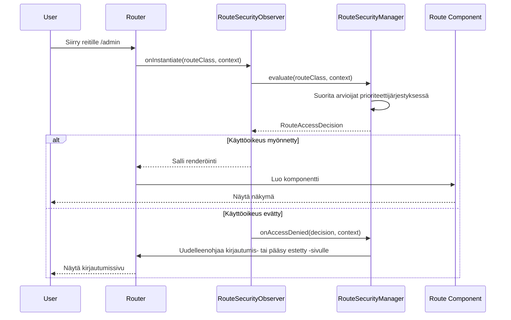

webforJ:n tietoturvan valvonta tapahtuu automaattisesti navigoinnin aikana. Kun käyttäjä napsauttaa linkkiä tai siirtyy reitille, tietoturvajärjestelmä sieppaa navigoinnin, arvioi käyttöoikeussäännöt ja joko sallii navigoinnin jatkua tai ohjaa käyttäjän sopivalle sivulle. Käyttäjät eivät huomaa tätä sieppausta, eikä komponenttikoodiin tarvitse lisätä manuaalisia tietoturvatarkistuksia.

Navigoinnin sieppauksen toiminnan ymmärtäminen auttaa selvittämään tietoturvaongelmia ja rakentamaan mukautettua navigointilogiikkaa, joka integroituu tietoturvajärjestelmään.

## `RouteSecurityObserver` {#the-routesecurityobserver}

`RouteSecurityObserver` on navigoinnin tarkkailija, joka kytkeytyy reitittimen elinkaareen. Se kuuntelee navigointitapahtumia ja arvioi tietoturvasäännöt ennen komponentin renderöintiä.

Tarkkailija liitetään reitittimen renderöijään sovelluksen käynnistyksen aikana:

```java
// Luo tarkkailija tietoturvan hallinnan avulla
RouteSecurityObserver observer = new RouteSecurityObserver(securityManager);

// Liitä se reitittimen renderöijään
Router router = Router.getCurrent();
if (router != null) {
  router.getRenderer().addObserver(observer);
}
```

Liittämisen jälkeen tarkkailija sieppaa jokaisen navigointipyynnön. Tarkkailija toimii navigointipyyntöjen ja komponentin renderöinnin välissä. Kun navigointi alkaa, se pyytää tietoturvan hallintaa arvioimaan käyttöoikeudet. Komponentti renderöidään vain, jos käyttöoikeus myönnetään.

## Navigoinnin sieppauksen kulku {#navigation-interception-flow}

Kun käyttäjä siirtyy reitille, tapahtumat etenevät seuraavasti:



Tämä kulku osoittaa, että tietoturvan arviointi tapahtuu ennen suojatun reitin koodin suorittamista. Jos käyttöoikeus evätään, komponenttia ei koskaan luoda, joten luvattomat käyttäjät eivät voi käynnistää liiketoimintalogiikkaa tai käyttää suojattuja tietoja.

## Sieppauskohdat {#interception-points}

Tarkkailija sieppaa navigoinnin tietyssä reitityksen elinkaaren vaiheessa:

**Ennen instanssin luontia** Tarkkailijan `onInstantiate()`-metodia kutsutaan reitin luokan kanssa sen jälkeen, kun reitti on ratkaistu mutta ennen komponentin instanssin luontia. Tämä on tietoturvatarkistuksen kohta.

Tässä vaiheessa reititin tietää, mikä reittiluokka renderöidään, mutta reitistä ei ole vielä luotu instanssia. Tarkkailija voi arvioida luokan tietoturvamerkintöjä suorittamatta reitin logiikkaa.

Jos käyttöoikeus evätään, tarkkailija estää renderöinnin ja käynnistää uudelleenohjauksen. Alkuperäisestä reitistä ei koskaan luoda instanssia.

## Arviointiprosessi {#the-evaluation-process}

Kun tarkkailija sieppaa navigoinnin, se delegoi arvioinnin tietoturvan hallinnalle. Tarkkailija hakee reittiluokan navigointikontekstista ja pyytää hallintaa arvioimaan käyttöoikeudet. Jos päätös myöntää käyttöoikeuden, navigointi jatkuu normaalisti. Jos päätös evää käyttöoikeuden, tarkkailija pysäyttää tapahtuman etenemisen renderöinnin estämiseksi ja antaa hallinnan käsitellä eväyksen.

Hallinta koordinoi arviointia seuraavasti:

1. Tarkistaa, onko tietoturva otettu käyttöön määrityksissä
2. Hakee nykyisen tietoturvakontekstin (käyttäjätiedot)
3. Suorittaa arvioijaketjun prioriteettijärjestyksessä
4. Palauttaa lopullisen käyttöoikeuspäätöksen

Tarkkailija toimii päätöksen mukaisesti: jos käyttöoikeus myönnetään, navigointi jatkuu; jos se evätään, tarkkailija pysäyttää tapahtuman etenemisen ja antaa hallinnan käsitellä eväyksen.

## Miten käyttöoikeuspäätökset tehdään {#how-access-decisions-are-made}

Tietoturvan hallinta luo arvioijaketjun ja suorittaa sen jokaisen arvioijan prioriteettijärjestyksessä. Arvioijat voivat tehdä kolmenlaisia päätöksiä:

- **Myönnä käyttöoikeus:** Arvioija hyväksyy navigoinnin, ja reitti renderöidään. Muita arvioijia ei enää kutsuta. Arvioija palauttaa päätöksen, joka ilmaisee käyttöoikeuden myönnetyksi.

- **Evä käyttöoikeus:** Arvioija estää navigoinnin. Tarkkailija pysäyttää renderöinnin ja käynnistää uudelleenohjauksen. Arvioija palauttaa eväyspäätöksen, johon voidaan liittää syyviesti. Eväyksen syynä voi olla tunnistautumisen puuttuminen (jolloin käyttäjän on kirjauduttava sisään) tai valtuutuksen puuttuminen (käyttöoikeudet eivät riitä).

- **Delegoi seuraavalle arvioijalle:** Arvioija ei tee päätöstä, vaan siirtää käsittelyn ketjun seuraavalle arvioijalle. Arvioija kutsuu ketjun `evaluate`-metodia, joka siirtyy seuraavaan arvioijaan prioriteettijärjestyksessä.

Useimmat arvioijat käsittelevät vain reittejä, joilla on tietty merkintä. Esimerkiksi `RolesAllowedEvaluator` arvioi vain reittejä, joihin on lisätty `@RolesAllowed`-merkintä. Jos merkintää ei ole, se delegoi käsittelyn seuraavalle arvioijalle.

## Käyttöoikeuden eväämisen käsittely {#handling-access-denial}

Kun käyttöoikeus evätään, hallinnan `onAccessDenied()`-metodi käsittelee tilanteen eväyksen tyypin mukaan:

- **Tunnistautuminen vaaditaan:** Käyttäjä ei ole kirjautunut sisään. Käyttäjä ohjataan kirjautumissivulle, joka on määritetty kohdassa `RouteSecurityConfiguration.getAuthenticationLocation()`.

- **Pääsy evätty:** Käyttäjä on kirjautunut sisään, mutta hänellä ei ole tarvittavia käyttöoikeuksia. Käyttäjä ohjataan pääsyn estämisestä kertovalle sivulle, joka on määritetty kohdassa `RouteSecurityConfiguration.getDenyLocation()`.

Ennen uudelleenohjausta hallinta tallentaa alun perin pyydetyn sijainnin HTTP-istuntoon. Onnistuneen kirjautumisen jälkeen tämän sijainnin voi hakea hallinnan `consumePreAuthenticationLocation()`-metodilla, joka palauttaa tallennetun sijainnin ja poistaa sen istunnosta. Jos sijainti oli tallennettu, sovellus voi navigoida sinne; muussa tapauksessa se navigoi oletussivulle.

## Kun tietoturva on poistettu käytöstä {#when-security-is-disabled}

Jos `RouteSecurityConfiguration.isEnabled()` palauttaa arvon `false`, hallinta ohittaa kaikki arvioinnit ja myöntää välittömästi käyttöoikeuden kaikille reiteille. Arvioijaketjua ei suoriteta eikä tietoturvatarkistuksia tehdä.

Tämä on hyödyllistä kehityksen aikana tai sovelluksissa, jotka eivät tarvitse tietoturvaa. Voit ottaa tietoturvan käyttöön ja poistaa sen käytöstä poistamatta merkintöjä tai irrottamatta tarkkailijaa.

## Integrointi navigoinnin elinkaareen {#integration-with-navigation-lifecycle}

Tietoturvatarkkailija integroituu laajempaan [navigoinnin elinkaareen](/docs/routing/navigation-lifecycle/overview), jossa useat tarkkailijat voivat kytkeytyä navigointitapahtumiin. Tietoturvan arviointi tapahtuu elinkaaren alkuvaiheessa, ennen navigoinnin estämistä tai komponentin elinkaaritapahtumia.

Jos toteutat mukautettuja navigointitarkkailijoita, huomaa, että tietoturvan arviointi tapahtuu ensin. Jos käyttöoikeus evätään, tarkkailijasi `onInstantiate()`- tai `onRouteRendererLifecycleEvent()`-metodia ei kutsuta, koska reittiä ei koskaan instansioida.
