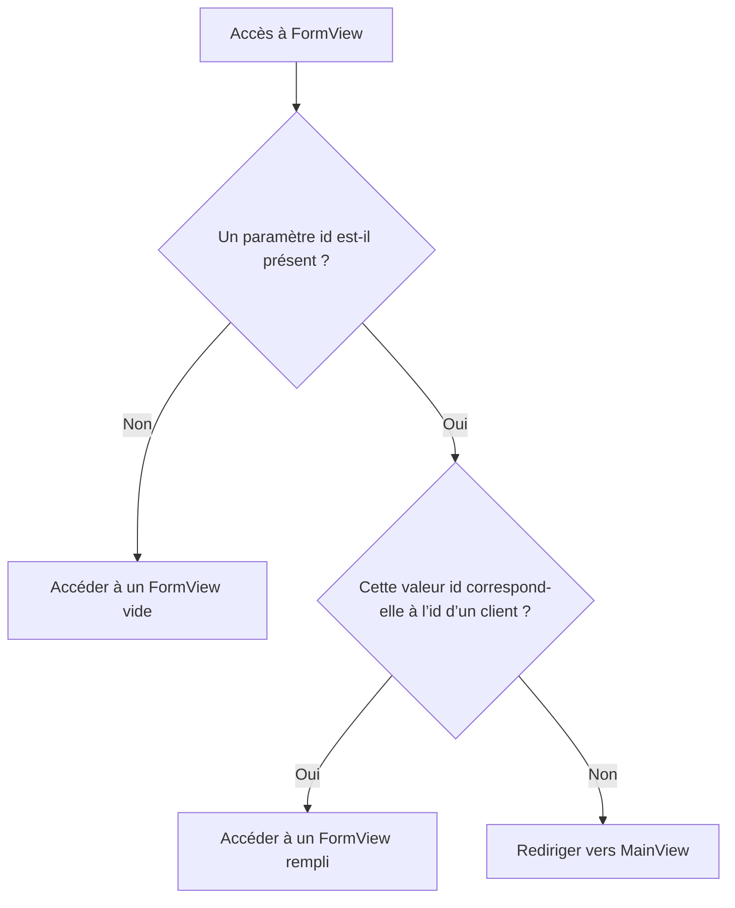

L’application de [Routage et composants composites](/docs/introduction/tutorial/routing-and-composites) ne peut qu’ajouter de nouveaux clients à la base de données. En vous appuyant sur les concepts suivants, vous allez permettre aux utilisateurs de modifier également les données des clients existants :

- Les modèles de route
- Le passage de valeurs de paramètres dans une URL
- Les observateurs de cycle de vie

Une fois cette étape terminée, vous aurez créé une version de [4-observers-and-route-parameters](https://github.com/webforj/webforj-tutorial/tree/main/4-observers-and-route-parameters).

<!-- <VideoPlayer video="tutorial/scaling-with-routing-and-composites" width={1920} height={1080} title="Scaling with routing and composites" /> -->

## Exécuter l’application {#running-the-app}

Pendant le développement de votre application, vous pouvez comparer votre travail à [4-observers-and-route-parameters](https://github.com/webforj/webforj-tutorial/tree/main/4-observers-and-route-parameters). Pour voir l’application en action :

1. Accédez au répertoire racine contenant le fichier `pom.xml`. Si vous suivez la version disponible sur GitHub, il s’agit de `4-observers-and-route-parameters`.

2. Utilisez la commande Maven suivante pour exécuter l’application Spring Boot localement :
    ```bash
    mvn
    ```

L’exécution de l’application ouvre automatiquement une nouvelle fenêtre de navigateur à l’adresse `http://localhost:8080`.

## Utiliser l’`id` du client {#using-the-customers-id}

Pour utiliser `FormView` afin de modifier des clients existants, vous devez pouvoir lui indiquer quel client modifier.
Pour cela, vous pouvez fournir à `FormView` un paramètre initial correspondant à l’identifiant du client.
Dans [Travailler avec les données](/docs/introduction/tutorial/working-with-data), vous avez créé une entité `Customer` qui attribue aux clients un identifiant unique `Long` numérique lors de leur ajout à la base de données.

```java
 @Id
 @GeneratedValue(strategy = GenerationType.IDENTITY)
  private Long id;
```

Dans cette étape, vous allez modifier `FormView` afin qu’elle utilise un `id` comme paramètre initial avant le chargement de quoi que ce soit. Ensuite, `FormView` évaluera cet `id` pour déterminer si le formulaire sert à ajouter un nouveau client ou à en modifier un existant. Enfin, vous modifierez `MainView` pour qu’elle transmette une valeur `id` lors de la navigation vers `FormView`.

## Ajouter un modèle de route à `FormView` {#adding-a-route-pattern}

À l’étape précédente, en définissant la route de `FormView` sur `@Route(customer)`, vous avez associé la classe à l’URL locale `http://localhost:8080/customer`. L’ajout d’un modèle de route permet de fournir un `id` comme paramètre initial à `FormView`.

Un [modèle de route](/docs/routing/route-patterns) permet d’ajouter un paramètre à l’URL, de le rendre facultatif et de définir des contraintes pour les modèles valides. Voici comment l’annotation `@Route` permet de définir `id` comme paramètre de route facultatif pour `FormView` :

- **`/:id`** ajoute à la route un paramètre nommé `id`. Ainsi, accéder à `http://localhost:8080/customer/6` charge `FormView` avec un paramètre `id` ayant la valeur `6`.

- **`?`** rend le paramètre `id` facultatif. Les paramètres sont obligatoires par défaut, mais le fait de rendre `id` facultatif permet d’utiliser `FormView` pour ajouter de nouveaux clients qui n’ont pas encore d’`id`.

- **`<[0-9]+>`** impose que `id` soit un nombre positif. Vous pouvez ajouter une contrainte sous forme d’expression régulière au paramètre, entre chevrons `<>`. Si `id` ne respecte pas cette contrainte, par exemple dans `http://localhost:8080/customer/john-smith`, l’utilisateur est redirigé vers une page 404.

Pour ajouter le paramètre de route facultatif à `FormView`, modifiez l’annotation `@Route` comme suit :

```java
@Route("customer/:id?<[0-9]+>")
```

## Naviguer vers `FormView` {#routing-to-formview}

`FormView` accepte maintenant un paramètre `id` facultatif et ne se charge que si `id` est un nombre entier positif.

Cependant, `FormView` peut toujours se charger si un utilisateur saisit manuellement l’URL d’un client inexistant, comme `http://localhost:8080/customer/5000`. L’ajout d’un observateur de cycle de vie avant l’entrée dans `FormView` permet à votre application de déterminer comment traiter la valeur `id` reçue.

### Routage conditionnel {#conditional-routing}

Les observateurs de cycle de vie permettent aux composants de réagir aux événements du cycle de vie à des étapes précises. L’article [Observateurs de cycle de vie](/docs/routing/navigation-lifecycle/observers) répertorie les observateurs disponibles, mais cette étape utilise uniquement `WillEnterObserver`.

L’événement `WillEnterObserver` se produit avant la fin du routage du composant.
Cet observateur vous permet d’évaluer l’`id` reçu. Si cet `id` ne correspond à aucun client existant, vous pouvez rediriger l’utilisateur vers `MainView` afin qu’il puisse trouver un client valide à modifier.

Avant d’examiner le code de `WillEnterObserver`, le diagramme ci-dessous présente les différents résultats possibles lors du routage vers `FormView` :



### Utiliser `WillEnterObserver` {#using-the-willenterobserver}

L’utilisation de l’observateur de cycle de vie `WillEnterObserver`, qui se déclenche avant le chargement complet du composant, vous permet d’ajouter des conditions pour déterminer si l’application doit poursuivre vers `FormView` ou rediriger les utilisateurs vers `MainView`.

Chaque observateur de cycle de vie est une interface. Implémentez donc `WillEnterObserver` dans la déclaration de `FormView` :

```java
public class FormView extends Composite<Div> implements WillEnterObserver {
```

L’observateur `WillEnterObserver` possède la méthode `onWillEnter()`, que webforJ appelle avant le routage vers le composant. Cette méthode prend deux paramètres : `WillEnterEvent` et `ParametersBag`.

`WillEnterEvent` détermine si le routage vers le composant doit se poursuivre à l’aide de la méthode `accept()` ou s’arrêter à l’aide de la méthode `reject()`. Après avoir rejeté la route actuelle, vous devez rediriger l’utilisateur ailleurs.

`ParametersBag` contient les paramètres du routeur issus de l’URL. Dans la section suivante, vous utiliserez `ParametersBag` pour créer la logique conditionnelle de `onWillEnter()` à partir du paramètre `id`.

Voici un exemple de `onWillEnter()` avec seulement deux résultats possibles :

```java
@Override
public void onWillEnter(WillEnterEvent event, ParametersBag parameters) {

  //Ajouter la logique conditionnelle
  if (<condition>) {

    //Autoriser la poursuite du routage vers FormView
    event.accept();

  } else {

    //Arrêter le routage vers FormView
    event.reject();

    //Envoyer l’utilisateur vers MainView
    navigateToMain();
  }
}
```

### Utiliser `ParametersBag` {#using-the-parametersbag}

Comme indiqué brièvement dans la section précédente, `ParametersBag` contient le paramètre du routeur issu de l’URL. Chaque observateur de cycle de vie a accès à cet objet. En l’utilisant dans votre application, vous pouvez récupérer la valeur `id`.

L’objet `ParametersBag` fournit plusieurs méthodes de requête permettant de récupérer un paramètre sous la forme d’un type d’objet spécifique. Par exemple, `getInt()` permet de récupérer un paramètre sous la forme d’un `Integer`.

Cependant, comme certains paramètres sont facultatifs, `getInt()` renvoie en réalité un `Optional<Integer>`. La méthode `ifPresentOrElse()` de `Optional<Integer>` vous permet de définir une variable à l’aide de l’`Integer`.

Lorsqu’aucun `id` n’est présent, l’utilisateur peut continuer vers `FormView` pour ajouter un nouveau client.

```java
@Override
public void onWillEnter(WillEnterEvent event, ParametersBag parameters) {

  //Déterminer quel paramètre récupérer et vérifier s’il est présent
  parameters.getInt("id").ifPresentOrElse(id -> {

    //Utiliser id comme variable
    customerId = Long.valueOf(id);

  //En l’absence d’id, continuer vers FormView pour ajouter un nouveau client
  }, () -> event.accept());

}
```

### L’`id` est-il valide ? {#is-the-id-valid}

À ce stade, le `WillEnterObserver` de la section précédente n’accepte le routage qu’en l’absence d’`id`. Avant de poursuivre vers `FormView`, l’observateur doit effectuer une vérification supplémentaire : s’assurer que l’`id` correspond à un client existant.

`FormView` peut maintenant utiliser `CustomerService` pour vérifier qu’un client existe, à l’aide de la méthode `doesCustomerExist()`. En l’absence de correspondance, l’application peut rejeter le routage actuel et rediriger l’utilisateur vers `MainView` avec `navigateToMain()`.

Si l’`id` est valide, l’application peut utiliser `accept()` pour poursuivre le routage vers `FormView`. Créez une méthode `fillForm()` qui affecte à la variable `customer` le client de la base de données correspondant à l’`id`, puis renseigne les champs :

```java
public void fillForm(Long customerId) {
  customer = customerService.getCustomerByKey(customerId);
  firstName.setValue(customer.getFirstName());
  lastName.setValue(customer.getLastName());
  company.setValue(customer.getCompany());
  country.selectKey(customer.getCountry());
}
```

Comme lors de l’ajout d’un nouveau client, l’utilisation d’une copie de travail permet aux utilisateurs de modifier les données du client dans l’interface sans modifier directement le dépôt.

### `onWillEnter()` terminé {#completed-onwillenter}

Les deux dernières sections ont expliqué en détail comment gérer chaque résultat possible du routage vers `FormView` à l’aide de `ParametersBag` et de `CustomerService`.

Voici la méthode `onWillEnter()` complète de `FormView`. Elle utilise `ParametersBag` pour accepter ou rejeter la route reçue et appelle d’autres méthodes pour remplir le formulaire ou rediriger l’utilisateur vers `MainView` :

```java
@Override
public void onWillEnter(WillEnterEvent event, ParametersBag parameters) {

  //Déterminer quel paramètre récupérer et vérifier s’il est présent
  parameters.getInt("id").ifPresentOrElse(id -> {

    //Utiliser id comme variable
    customerId = Long.valueOf(id);

    //Vérifier s’il existe un client ayant cet id
    if (customerService.doesCustomerExist(customerId)) {

        //Ce client existe. Poursuivre vers FormView et initialiser les champs à l’aide de l’id
        event.accept();
        fillForm(customerId);
      } else {

        //Ce client n’existe pas. Rediriger vers MainView
        event.reject();
        navigateToMain();
      }

  //Aucun id n’était présent. Poursuivre vers FormView pour ajouter un nouveau client
  }, () -> event.accept());

}
```

## Ajouter ou modifier un client {#adding-or-editing-a-customer}

La version précédente de cette application ajoutait uniquement de nouveaux clients lorsque l’utilisateur soumettait le formulaire. Maintenant que les utilisateurs peuvent modifier des clients existants, la méthode `submitCustomer()` doit vérifier si le client existe déjà avant de mettre à jour la base de données.

Au départ, il n’était pas nécessaire d’attribuer une variable à l’`id` du client dans `FormView`, puisque les nouveaux clients reçoivent un `id` unique lors de leur enregistrement dans la base de données. Toutefois, si vous déclarez `customerId` comme variable initiale dans `FormView` avec une valeur `id` inutilisée, cette valeur restera inchangée pour les nouveaux clients et sera remplacée dans `onWillEnter()` pour les clients existants.

Vous pouvez ainsi utiliser `doesCustomerExist()` pour vérifier s’il faut ajouter un nouveau client ou mettre à jour un client existant.

```java
private Long customerId = 0L;

//...

private void submitCustomer() {
  if (customerService.doesCustomerExist(customerId)) {
    customerService.updateCustomer(customer);
  } else {
    customerService.createCustomer(customer);
  }
  navigateToMain();
}
```

## `FormView` terminée {#completed-formview}

Voici à quoi devrait ressembler `FormView`, maintenant qu’elle peut modifier des clients existants :

<!-- vale off -->
<ExpandableCode title="FormView.java" language="java" startLine={1} endLine={15}>

```java
@Route("customer/:id?<[0-9]+>")
@FrameTitle("Customer Form")
public class FormView extends Composite<Div> implements WillEnterObserver {
  private final CustomerService customerService;
  private Customer customer = new Customer();
  private Long customerId = 0L;
  private Div self = getBoundComponent();
  private TextField firstName = new TextField("First Name", e -> customer.setFirstName(e.getValue()));
  private TextField lastName = new TextField("Last Name", e -> customer.setLastName(e.getValue()));
  private TextField company = new TextField("Company", e -> customer.setCompany(e.getValue()));
  private ChoiceBox country = new ChoiceBox("Country",
      e -> customer.setCountry((Customer.Country) e.getSelectedItem().getKey()));
  private Button submit = new Button("Submit", ButtonTheme.PRIMARY, e -> submitCustomer());
  private Button cancel = new Button("Cancel", ButtonTheme.OUTLINED_PRIMARY, e -> navigateToMain());
  private ColumnsLayout layout = new ColumnsLayout(
      firstName, lastName,
      company, country,
      submit, cancel);

  public FormView(CustomerService customerService) {
    this.customerService = customerService;
    fillCountries();
    setColumnsLayout();
    self.setMaxWidth(600)
        .addClassName("card")
        .add(layout);
    submit.setStyle("margin-top", "var(--dwc-space-l)");
    cancel.setStyle("margin-top", "var(--dwc-space-l)");
  }

  private void setColumnsLayout() {
    List<Breakpoint> breakpoints = List.of(
        new Breakpoint(600, 2));
    layout.setSpacing("var(--dwc-space-l)")
        .setBreakpoints(breakpoints);
  }

  private void fillCountries() {
    ArrayList<ListItem> listCountries = new ArrayList<>();
    for (Country countryItem : Customer.Country.values()) {
      listCountries.add(new ListItem(countryItem, countryItem.toString()));
    }
    country.insert(listCountries);
    country.selectIndex(0);
  }

  private void submitCustomer() {
    if (customerService.doesCustomerExist(customerId)) {
      customerService.updateCustomer(customer);
    } else {
      customerService.createCustomer(customer);
    }
    navigateToMain();
  }

  private void navigateToMain() {
    Router.getCurrent().navigate(MainView.class);
  }

  @Override
  public void onWillEnter(WillEnterEvent event, ParametersBag parameters) {
    parameters.getInt("id").ifPresentOrElse(id -> {
      customerId = Long.valueOf(id);
      if (customerService.doesCustomerExist(customerId)) {
        event.accept();
        fillForm(customerId);
      } else {
        event.reject();
        navigateToMain();
      }

    }, () -> event.accept());
  }

  public void fillForm(Long customerId) {
    customer = customerService.getCustomerByKey(customerId);
    firstName.setValue(customer.getFirstName());
    lastName.setValue(customer.getLastName());
    company.setValue(customer.getCompany());
    country.selectKey(customer.getCountry());
  }
}
```

</ExpandableCode>
<!-- vale on -->

## Naviguer de `MainView` vers `FormView` pour modifier des clients {#navigating-from-mainview-to-formview-to-edit-customers}

Plus tôt dans cette étape, vous avez utilisé un objet `ParametersBag` existant pour déterminer la valeur d’un `id`. La création d’un nouvel objet `ParametersBag` vous permet de naviguer directement entre les classes en transmettant les paramètres de votre choix. Les données du `Table` peuvent servir à envoyer les utilisateurs vers `FormView` avec l’`id` d’un client.

Comme pour un bouton, associer la navigation à une action choisie par l’utilisateur lui permet de décider quand accéder à `FormView`. L’ajout d’un écouteur d’événement au `Table` vous permet d’envoyer l’utilisateur vers `FormView` avec un objet `ParametersBag` :

```java
table.addItemClickListener(this::editCustomer);

private void editCustomer(TableItemClickEvent<Customer> e) {
  Router.getCurrent().navigate(FormView.class,
      ParametersBag.of("id=" + e.getItemKey()));
  }
```

Toutefois, la clé des éléments du `Table` est générée automatiquement par défaut. Vous pouvez faire correspondre explicitement chaque clé à l’`id` d’un client à l’aide de la méthode `setKeyProvider()` :

```java
table.setKeyProvider(Customer::getId);
```

Dans `MainView`, ajoutez les méthodes `addItemClickListener()` et `setKeyProvider()` à `buildTable()`. Ajoutez ensuite la méthode qui envoie l’utilisateur vers `FormView` avec une valeur `id` dans le `ParametersBag`, en fonction de l’endroit du tableau où il a cliqué :

```java title="MainView.java" {30-31,34-37}
@Route("/")
@FrameTitle("Customer Table")
public class MainView extends Composite<Div> {
  private final CustomerService customerService;
  private Div self = getBoundComponent();
  private Table<Customer> table = new Table<>();
  private Button addCustomer = new Button("Add Customer", ButtonTheme.PRIMARY,
      e -> Router.getCurrent().navigate(FormView.class));

  public MainView(CustomerService customerService) {
    this.customerService = customerService;
    addCustomer.setWidth(200);
    buildTable();
    self.setWidth("fit-content")
        .addClassName("card")
        .add(table, addCustomer);
  }

  private void buildTable() {
    table.setSize("1000px", "294px");
    table.setMaxWidth("90vw");
    table.addColumn("firstName", Customer::getFirstName).setLabel("First Name");
    table.addColumn("lastName", Customer::getLastName).setLabel("Last Name");
    table.addColumn("company", Customer::getCompany).setLabel("Company");
    table.addColumn("country", Customer::getCountry).setLabel("Country");
    table.setColumnsToAutoFit();
    table.setColumnsToResizable(false);
    table.getColumns().forEach(column -> column.setSortable(true));
    table.setRepository(customerService.getRepositoryAdapter());
    table.setKeyProvider(Customer::getId);
    table.addItemClickListener(this::editCustomer);
  }

  private void editCustomer(TableItemClickEvent<Customer> e) {
    Router.getCurrent().navigate(FormView.class,
        ParametersBag.of("id=" + e.getItemKey()));
  }
}
```

## Étape suivante {#next-step}

Maintenant que les utilisateurs peuvent modifier directement les données des clients, votre application doit valider les modifications avant de les enregistrer dans le dépôt. Dans [Valider et associer les données](/docs/introduction/tutorial/validating-and-binding-data), vous allez créer des règles de validation et associer directement le modèle de données à l’interface utilisateur, afin que les composants puissent afficher des messages d’erreur lorsque les données ne sont pas valides.
