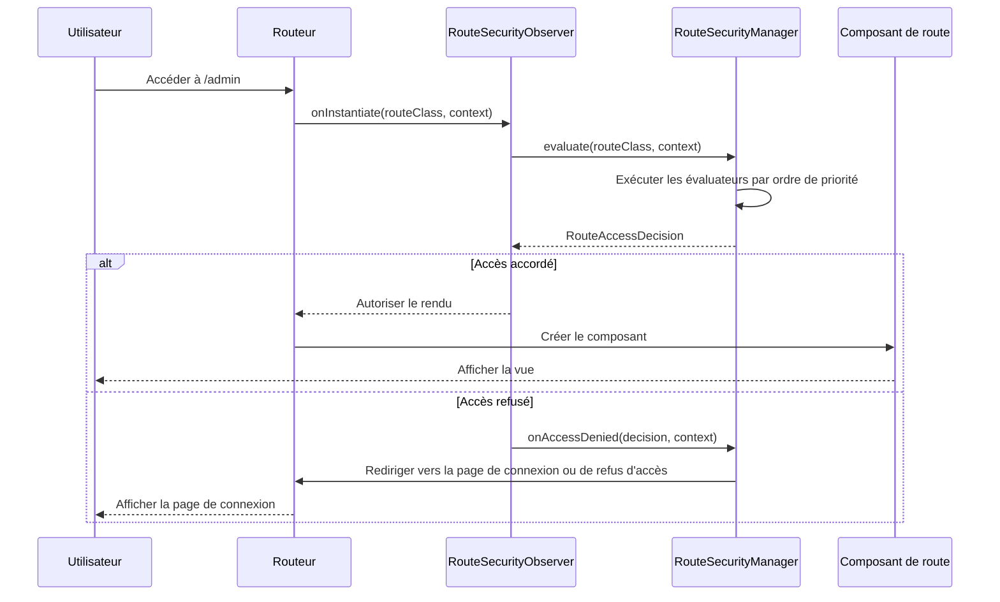

L’application de la sécurité dans webforJ se fait automatiquement pendant la navigation. Lorsqu’un utilisateur clique sur un lien ou accède à une route, le système de sécurité intercepte la navigation, évalue les règles d’accès, puis autorise la navigation ou redirige l’utilisateur vers une page appropriée. Cette interception est invisible pour les utilisateurs et ne nécessite aucun contrôle de sécurité manuel dans le code de vos composants.

Comprendre le fonctionnement de l’interception de la navigation vous aide à résoudre les problèmes de sécurité et à créer une logique de navigation personnalisée qui s’intègre au système de sécurité.

## `RouteSecurityObserver` {#the-routesecurityobserver}

`RouteSecurityObserver` est un observateur de navigation qui s’intègre au cycle de vie du routeur. Il écoute les événements de navigation et évalue les règles de sécurité avant le rendu de tout composant.

L’observateur est associé au moteur de rendu du routeur au démarrage de l’application :

```java
// Créer l'observateur avec votre gestionnaire de sécurité
RouteSecurityObserver observer = new RouteSecurityObserver(securityManager);

// L'associer au moteur de rendu du routeur
Router router = Router.getCurrent();
if (router != null) {
  router.getRenderer().addObserver(observer);
}
```

Une fois associé, l’observateur intercepte chaque demande de navigation. Il s’interpose entre les demandes de navigation et le rendu des composants. Au début de la navigation, il demande au gestionnaire de sécurité d’évaluer l’accès. Le composant est rendu uniquement si l’accès est accordé.

## Flux d’interception de la navigation {#navigation-interception-flow}

Lorsqu’un utilisateur accède à une route, la séquence suivante se produit :



Ce flux montre que l’évaluation de la sécurité a lieu avant l’exécution du code d’une route sensible. Si l’accès est refusé, le composant n’est jamais instancié, ce qui empêche les utilisateurs non autorisés de déclencher la logique métier ou d’accéder aux données protégées.

## Points d’interception {#interception-points}

L’observateur intercepte la navigation à un point précis du cycle de vie du routage :

**Avant l’instanciation** La méthode `onInstantiate()` de l’observateur est appelée avec la classe de route une fois la route résolue et avant l’instanciation du composant. C’est le point de contrôle de sécurité.

À ce stade, le routeur sait quelle classe de route sera rendue, mais la route n’a pas encore été instanciée. L’observateur peut évaluer les annotations de sécurité de la classe sans exécuter la logique de la route.

Si l’accès est refusé, l’observateur empêche le rendu et déclenche une redirection. La route d’origine n’est jamais instanciée.

## Processus d’évaluation {#the-evaluation-process}

Lorsque l’observateur intercepte la navigation, il délègue l’évaluation au gestionnaire de sécurité. Il récupère la classe de route depuis le contexte de navigation et demande au gestionnaire d’évaluer l’accès. Si la décision accorde l’accès, la navigation se poursuit normalement. Si la décision refuse l’accès, l’observateur interrompt la propagation pour empêcher le rendu et laisse le gestionnaire traiter le refus.

Le gestionnaire coordonne l’évaluation en :

1. Vérifiant si la sécurité est activée dans la configuration
2. Récupérant le contexte de sécurité actuel (informations sur l’utilisateur)
3. Exécutant la chaîne d’évaluateurs par ordre de priorité
4. Renvoyant la décision d’accès finale

L’observateur agit en fonction de la décision : si l’accès est accordé, la navigation se poursuit ; s’il est refusé, l’observateur interrompt la propagation et laisse le gestionnaire traiter le refus.

## Comment les décisions d’accès sont prises {#how-access-decisions-are-made}

Le gestionnaire de sécurité crée une chaîne d’évaluateurs et exécute chaque évaluateur par ordre de priorité. Les évaluateurs peuvent prendre trois types de décisions :

- **Accorder l’accès :** L’évaluateur approuve la navigation et la route est rendue. Aucun autre évaluateur n’est consulté. L’évaluateur renvoie une décision indiquant que l’accès est accordé.

- **Refuser l’accès :** L’évaluateur bloque la navigation. L’observateur arrête le rendu et déclenche une redirection. L’évaluateur renvoie une décision de refus, éventuellement accompagnée d’un motif. Le refus peut être dû à l’absence d’authentification (connexion requise) ou à l’absence d’autorisation (permissions insuffisantes).

- **Déléguer à l’évaluateur suivant :** L’évaluateur ne prend pas de décision et passe le contrôle à l’évaluateur suivant de la chaîne. Il appelle la méthode `evaluate` de la chaîne, qui passe à l’évaluateur suivant dans l’ordre de priorité.

La plupart des évaluateurs ne traitent que les routes dotées d’annotations spécifiques. Par exemple, `RolesAllowedEvaluator` évalue uniquement les routes annotées avec `@RolesAllowed`. Si l’annotation est absente, il délègue à l’évaluateur suivant.

## Traitement d’un refus d’accès {#handling-access-denial}

Lorsque l’accès est refusé, la méthode `onAccessDenied()` du gestionnaire traite le refus selon son type :

- **Authentification requise :** L’utilisateur n’est pas connecté. Redirection vers la page de connexion configurée dans `RouteSecurityConfiguration.getAuthenticationLocation()`.

- **Accès refusé :** L’utilisateur est connecté, mais ne dispose pas des permissions nécessaires. Redirection vers la page de refus d’accès configurée dans `RouteSecurityConfiguration.getDenyLocation()`.

Avant la redirection, le gestionnaire stocke l’emplacement initialement demandé dans la session HTTP. Après une connexion réussie, cet emplacement peut être récupéré à l’aide de la méthode `consumePreAuthenticationLocation()` du gestionnaire, qui renvoie l’emplacement stocké et le supprime de la session. Si un emplacement a été stocké, l’application peut y accéder ; sinon, elle navigue vers une page par défaut.

## Lorsque la sécurité est désactivée {#when-security-is-disabled}

Si `RouteSecurityConfiguration.isEnabled()` renvoie `false`, le gestionnaire ignore toute évaluation et accorde immédiatement l’accès à toutes les routes. La chaîne d’évaluateurs n’est jamais exécutée et aucun contrôle de sécurité n’a lieu.

Cette option est utile pendant le développement ou pour les applications qui n’ont pas besoin de sécurité. Vous pouvez activer ou désactiver la sécurité sans supprimer les annotations ni désenregistrer l’observateur.

## Intégration au cycle de vie de la navigation {#integration-with-navigation-lifecycle}

L’observateur de sécurité s’intègre au [cycle de vie de la navigation](/docs/routing/navigation-lifecycle/overview) plus général, dans lequel plusieurs observateurs peuvent se rattacher aux événements de navigation. L’évaluation de la sécurité a lieu tôt dans ce cycle, avant le blocage de la navigation ou les événements du cycle de vie des composants.

Si vous implémentez des observateurs de navigation personnalisés, sachez que l’évaluation de la sécurité a lieu en premier. Si l’accès est refusé, ni la méthode `onInstantiate()` ni la méthode `onRouteRendererLifecycleEvent()` de votre observateur ne sont appelées, car la route n’est jamais instanciée.
