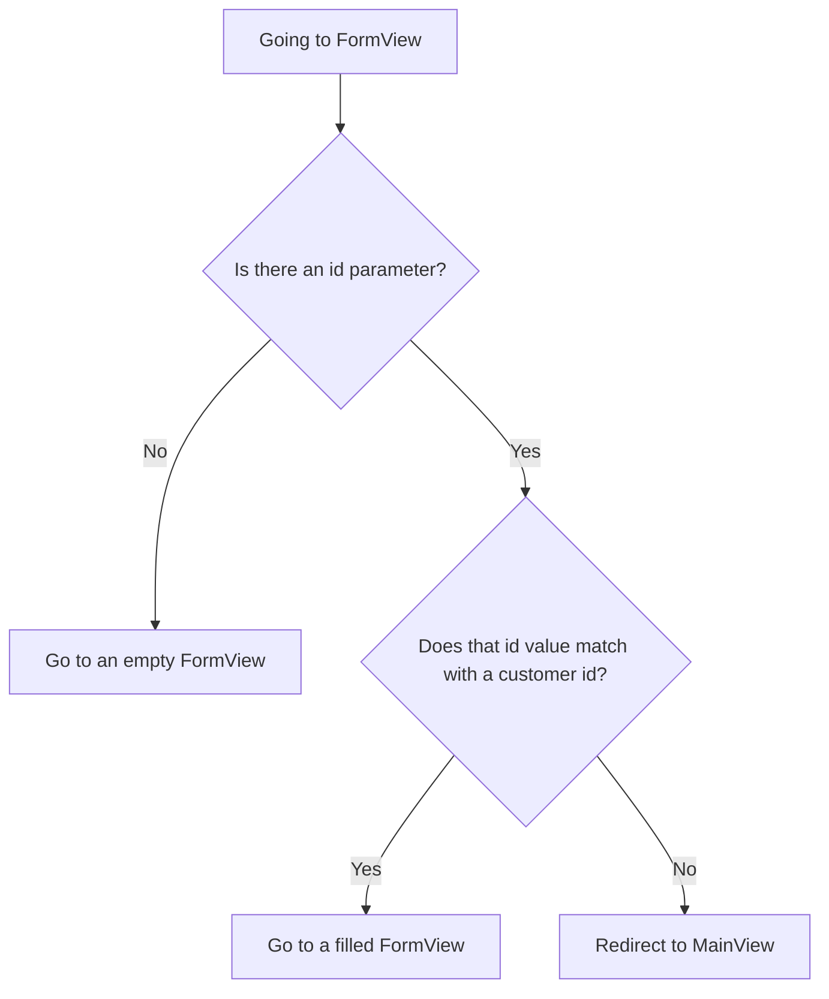

De app uit [Routing en composieten](/docs/introduction/tutorial/routing-and-composites) kan alleen nieuwe klanten aan de database toevoegen. Met de volgende concepten geef je gebruikers ook de mogelijkheid om de gegevens van bestaande klanten te bewerken:

- Routepatronen
- Parameterwaarden doorgeven via een URL
- Lifecycle-observers

Als je deze stap voltooit, maak je een versie van [4-observers-and-route-parameters](https://github.com/webforj/webforj-tutorial/tree/main/4-observers-and-route-parameters).

<!-- <VideoPlayer video="tutorial/scaling-with-routing-and-composites" width={1920} height={1080} title="Scaling with routing and composites" /> -->

## De app uitvoeren {#running-the-app}

Tijdens het ontwikkelen van je app kun je [4-observers-and-route-parameters](https://github.com/webforj/webforj-tutorial/tree/main/4-observers-and-route-parameters) als referentie gebruiken. Zo bekijk je de app in actie:

1. Ga naar de map op het hoogste niveau met het bestand `pom.xml`. Als je de versie op GitHub volgt, is dit de map `4-observers-and-route-parameters`.

2. Gebruik de volgende Maven-opdracht om de Spring Boot-app lokaal uit te voeren:
    ```bash
    mvn
    ```

Als je de app uitvoert, wordt automatisch een nieuw browservenster geopend op `http://localhost:8080`.

## De `id` van de klant gebruiken {#using-the-customers-id}

Als je `FormView` wilt gebruiken om bestaande klanten te bewerken, moet je kunnen aangeven welke klant moet worden bewerkt.
Dit kan door een initiële parameter met de klant-ID aan `FormView` mee te geven.
In [Werken met gegevens](/docs/introduction/tutorial/working-with-data) heb je een entiteit `Customer` gemaakt die klanten bij het toevoegen aan de database een unieke numerieke `Long`-waarde als `id` toekent.

```java
 @Id
 @GeneratedValue(strategy = GenerationType.IDENTITY)
  private Long id;
```

In deze stap pas je `FormView` zo aan dat deze een `id` als initiële parameter gebruikt voordat er iets wordt geladen. Vervolgens laat je `FormView` de `id` evalueren om te bepalen of het formulier bedoeld is om een nieuwe klant toe te voegen of een bestaande klant bij te werken. Tot slot pas je `MainView` aan, zodat deze een `id`-waarde doorstuurt wanneer er naar `FormView` wordt genavigeerd.

## Een routepatroon toevoegen aan `FormView` {#adding-a-route-pattern}

In de vorige stap koppelde de route die in `FormView` was ingesteld als `@Route(customer)` de klasse lokaal aan `http://localhost:8080/customer`. Met een routepatroon kun je een `id` als initiële parameter aan `FormView` toevoegen.

Met een [routepatroon](/docs/routing/route-patterns) kun je een parameter aan de URL toevoegen, deze optioneel maken en beperkingen instellen voor geldige patronen. Met de annotatie `@Route` maak je `id` als volgt een optionele routeparameter voor `FormView`:

- **`/:id`** geeft de route een parameter met de naam `id`. Als je naar `http://localhost:8080/customer/6` gaat, wordt `FormView` geladen met `6` als parameterwaarde voor `id`.

- **`?`** maakt de parameter `id` optioneel. Parameters zijn standaard verplicht, maar door `id` optioneel te maken kun je `FormView` gebruiken om nieuwe klanten toe te voegen die nog geen `id` hebben.

- **`<[0-9]+>`** beperkt `id` tot een positief getal. Tussen punthaken, `<>`, kun je als reguliere expressie een beperking aan de parameter toevoegen. Als de `id` niet aan de beperking voldoet, bijvoorbeeld bij `http://localhost:8080/customer/john-smith`, wordt de gebruiker naar een 404-pagina gestuurd.

Voeg de optionele routeparameter aan `FormView` toe door de annotatie `@Route` als volgt te wijzigen:

```java
@Route("customer/:id?<[0-9]+>")
```

## Naar `FormView` navigeren {#routing-to-formview}

`FormView` accepteert nu een optionele parameter `id` en wordt alleen geladen als de `id` een positief geheel getal is.

Toch kan `FormView` nog steeds worden geladen als een gebruiker handmatig een URL invoert voor een niet-bestaande klant, zoals `http://localhost:8080/customer/5000`. Met een lifecycle-observer die wordt uitgevoerd voordat `FormView` wordt geopend, kan je app bepalen hoe de binnenkomende waarde van `id` moet worden afgehandeld.

### Voorwaardelijke navigatie {#conditional-routing}

Lifecycle-observers laten componenten reageren op lifecycle-gebeurtenissen tijdens specifieke fasen. Het artikel [Lifecycle-observers](/docs/routing/navigation-lifecycle/observers) bevat een overzicht van de beschikbare observers. In deze stap wordt alleen de `WillEnterObserver` gebruikt.

De `WillEnterObserver` wordt uitgevoerd voordat de navigatie van de component is voltooid.
Met deze observer kun je de binnenkomende `id` evalueren. Als de `id` niet overeenkomt met een bestaande klant, kun je de gebruiker terugsturen naar `MainView`, zodat die een geldige klant kan zoeken om te bewerken.

Voordat we de code voor de `WillEnterObserver` bespreken, laat het volgende stroomschema de mogelijke uitkomsten zien wanneer er naar `FormView` wordt genavigeerd:



### De `WillEnterObserver` gebruiken {#using-the-willenterobserver}

Met de lifecycle-observer `WillEnterObserver`, die wordt geactiveerd voordat de component volledig wordt geladen, kun je voorwaarden toevoegen om te bepalen of de app doorgaat naar `FormView` of dat gebruikers naar `MainView` moeten worden teruggestuurd.

Elke lifecycle-observer is een interface. Implementeer daarom `WillEnterObserver` in de declaratie van `FormView`:

```java
public class FormView extends Composite<Div> implements WillEnterObserver {
```

De observer `WillEnterObserver` heeft de methode `onWillEnter()`, die webforJ aanroept voordat er naar de component wordt genavigeerd. Deze methode heeft twee parameters: `WillEnterEvent` en `ParametersBag`.

Met `WillEnterEvent` bepaal je of de navigatie naar de component doorgaat via de methode `accept()`, of wordt gestopt via de methode `reject()`. Nadat je de huidige route hebt afgewezen, moet je de gebruiker ergens anders naartoe sturen.

`ParametersBag` bevat de routerparameters uit de URL. In de volgende sectie gebruik je `ParametersBag` om voorwaardelijke logica voor `onWillEnter()` te maken met de parameter `id`.

De volgende versie van `onWillEnter()` is een voorbeeld met slechts twee mogelijke uitkomsten:

```java
@Override
public void onWillEnter(WillEnterEvent event, ParametersBag parameters) {

  //Add conditional logic
  if (<condition>) {

    //Allow routing to FormView to proceed
    event.accept();

  } else {

    //Stop routing to FormView
    event.reject();

    //Send the user to MainView
    navigateToMain();
  }
}
```

### De `ParametersBag` gebruiken {#using-the-parametersbag}

Zoals kort vermeld in de vorige sectie, bevat `ParametersBag` de routerparameter uit de URL. Elke lifecycle-observer heeft toegang tot dit object. Je kunt het in je app gebruiken om de waarde van `id` op te halen.

Het object `ParametersBag` biedt verschillende querymethoden om een parameter als een specifiek objecttype op te halen. Met `getInt()` kun je bijvoorbeeld een parameter als `Integer` ophalen.

Omdat sommige parameters optioneel zijn, geeft `getInt()` in werkelijkheid `Optional<Integer>` terug. Met de methode `ifPresentOrElse()` op `Optional<Integer>` kun je een variabele instellen met de waarde van `Integer`.

Als er geen `id` aanwezig is, kan de gebruiker doorgaan naar `FormView` om een nieuwe klant toe te voegen.

```java
@Override
public void onWillEnter(WillEnterEvent event, ParametersBag parameters) {

  //Determine which parameter to get, and check if it's present or not
  parameters.getInt("id").ifPresentOrElse(id -> {

    //Use the id as a variable
    customerId = Long.valueOf(id);

  //When no id is present, continue to FormView for a new customer
  }, () -> event.accept());

}
```

### Is de `id` geldig? {#is-the-id-valid}

Op dit moment accepteert de `WillEnterObserver` uit de vorige sectie de navigatie alleen als er geen `id` aanwezig is. Voordat de observer doorgaat naar `FormView`, moet deze nog één controle uitvoeren: nagaan of de `id` overeenkomt met een bestaande klant.

`FormView` kan nu `CustomerService` gebruiken om met de methode `doesCustomerExist()` te controleren of een klant bestaat. Als er geen overeenkomst is, kan de app de huidige navigatie afwijzen en de gebruiker met `navigateToMain()` terugsturen naar `MainView`.

Als de `id` geldig is, kan de app met `accept()` doorgaan naar `FormView`. Maak een methode `fillForm()` die de variabele `customer` toewijst aan de klant met de overeenkomstige `id` in de database en de waarden van de velden instelt:

```java
public void fillForm(Long customerId) {
  customer = customerService.getCustomerByKey(customerId);
  firstName.setValue(customer.getFirstName());
  lastName.setValue(customer.getLastName());
  company.setValue(customer.getCompany());
  country.selectKey(customer.getCountry());
}
```

Net als bij het toevoegen van een nieuwe klant kunnen gebruikers met een werkkopie klantgegevens in de UI bewerken zonder de repository rechtstreeks aan te passen.

### Voltooide `onWillEnter()` {#completed-onwillenter}

In de vorige twee secties is in detail uitgelegd hoe je met `ParametersBag` en `CustomerService` de verschillende uitkomsten voor navigatie naar `FormView` afhandelt.

Hieronder staat de voltooide `onWillEnter()` voor `FormView`. Deze gebruikt `ParametersBag` om de binnenkomende route te accepteren of af te wijzen en roept andere methoden aan om het formulier in te vullen of de gebruiker naar `MainView` te sturen:

```java
@Override
public void onWillEnter(WillEnterEvent event, ParametersBag parameters) {

  //Determine which parameter to get, and check if it's present or not
  parameters.getInt("id").ifPresentOrElse(id -> {

    //Use the id as a variable
    customerId = Long.valueOf(id);

    //Check if there's a customer with this id
    if (customerService.doesCustomerExist(customerId)) {

        //This customer exists, so continue to FormView, and initialize the fields using the id
        event.accept();
        fillForm(customerId);
      } else {

        //This customer doesn't exists, so redirect to MainView
        event.reject();
        navigateToMain();
      }

  //No id was present, so continue to FormView for a new customer
  }, () -> event.accept());

}
```

## Een klant toevoegen of bewerken {#adding-or-editing-a-customer}

In de vorige versie van deze app werden alleen nieuwe klanten toegevoegd wanneer de gebruiker het formulier indiende. Omdat gebruikers nu bestaande klanten kunnen bewerken, moet de methode `submitCustomer()` controleren of de klant al bestaat voordat de database wordt bijgewerkt.

Eerder was het niet nodig om in `FormView` een variabele voor de `id` van de klant toe te wijzen, omdat nieuwe klanten een unieke `id` krijgen wanneer ze aan de database worden toegevoegd. Als je `customerId` echter in `FormView` als initiële variabele declareert met een `id` die niet in gebruik is, blijft deze ongewijzigd voor nieuwe klanten en wordt deze in `onWillEnter()` overschreven voor bestaande klanten.

Zo kun je met `doesCustomerExist()` bepalen of je een nieuwe klant moet toevoegen of een bestaande klant moet bijwerken.

```java
private Long customerId = 0L;

//...

private void submitCustomer() {
  if (customerService.doesCustomerExist(customerId)) {
    customerService.updateCustomer(customer);
  } else {
    customerService.createCustomer(customer);
  }
  navigateToMain();
}
```

## Voltooide `FormView` {#completed-formview}

Zo hoort `FormView` eruit te zien nu deze bestaande klanten kan bewerken:

<!-- vale off -->
<ExpandableCode title="FormView.java" language="java" startLine={1} endLine={15}>

```java
@Route("customer/:id?<[0-9]+>")
@FrameTitle("Customer Form")
public class FormView extends Composite<Div> implements WillEnterObserver {
  private final CustomerService customerService;
  private Customer customer = new Customer();
  private Long customerId = 0L;
  private Div self = getBoundComponent();
  private TextField firstName = new TextField("First Name", e -> customer.setFirstName(e.getValue()));
  private TextField lastName = new TextField("Last Name", e -> customer.setLastName(e.getValue()));
  private TextField company = new TextField("Company", e -> customer.setCompany(e.getValue()));
  private ChoiceBox country = new ChoiceBox("Country",
      e -> customer.setCountry((Customer.Country) e.getSelectedItem().getKey()));
  private Button submit = new Button("Submit", ButtonTheme.PRIMARY, e -> submitCustomer());
  private Button cancel = new Button("Cancel", ButtonTheme.OUTLINED_PRIMARY, e -> navigateToMain());
  private ColumnsLayout layout = new ColumnsLayout(
      firstName, lastName,
      company, country,
      submit, cancel);

  public FormView(CustomerService customerService) {
    this.customerService = customerService;
    fillCountries();
    setColumnsLayout();
    self.setMaxWidth(600)
        .addClassName("card")
        .add(layout);
    submit.setStyle("margin-top", "var(--dwc-space-l)");
    cancel.setStyle("margin-top", "var(--dwc-space-l)");
  }

  private void setColumnsLayout() {
    List<Breakpoint> breakpoints = List.of(
        new Breakpoint(600, 2));
    layout.setSpacing("var(--dwc-space-l)")
        .setBreakpoints(breakpoints);
  }

  private void fillCountries() {
    ArrayList<ListItem> listCountries = new ArrayList<>();
    for (Country countryItem : Customer.Country.values()) {
      listCountries.add(new ListItem(countryItem, countryItem.toString()));
    }
    country.insert(listCountries);
    country.selectIndex(0);
  }

  private void submitCustomer() {
    if (customerService.doesCustomerExist(customerId)) {
      customerService.updateCustomer(customer);
    } else {
      customerService.createCustomer(customer);
    }
    navigateToMain();
  }

  private void navigateToMain() {
    Router.getCurrent().navigate(MainView.class);
  }

  @Override
  public void onWillEnter(WillEnterEvent event, ParametersBag parameters) {
    parameters.getInt("id").ifPresentOrElse(id -> {
      customerId = Long.valueOf(id);
      if (customerService.doesCustomerExist(customerId)) {
        event.accept();
        fillForm(customerId);
      } else {
        event.reject();
        navigateToMain();
      }

    }, () -> event.accept());
  }

  public void fillForm(Long customerId) {
    customer = customerService.getCustomerByKey(customerId);
    firstName.setValue(customer.getFirstName());
    lastName.setValue(customer.getLastName());
    company.setValue(customer.getCompany());
    country.selectKey(customer.getCountry());
  }
}
```

</ExpandableCode>
<!-- vale on -->

## Van `MainView` naar `FormView` navigeren om klanten te bewerken {#navigating-from-mainview-to-formview-to-edit-customers}

Eerder in deze stap gebruikte je een bestaande `ParametersBag` om de waarde van een `id` te bepalen. Met een nieuwe `ParametersBag` kun je rechtstreeks tussen klassen navigeren en zelf de gewenste parameters meegeven. Je kunt de gegevens in de `Table` gebruiken om gebruikers met een `id` van een klant naar `FormView` te sturen.

Net als bij een knop kunnen gebruikers zelf bepalen wanneer ze naar `FormView` gaan door de navigatie te koppelen aan een actie die ze zelf kiezen. Met een eventlistener op de `Table` kun je de gebruiker met een `ParametersBag` naar `FormView` sturen:

```java
table.addItemClickListener(this::editCustomer);

private void editCustomer(TableItemClickEvent<Customer> e) {
  Router.getCurrent().navigate(FormView.class,
      ParametersBag.of("id=" + e.getItemKey()));
  }
```

De sleutels van de `Table`-items worden standaard echter automatisch gegenereerd. Je kunt met de methode `setKeyProvider()` expliciet instellen dat elke sleutel overeenkomt met de `id` van een klant:

```java
table.setKeyProvider(Customer::getId);
```

Voeg in `MainView` de methoden `addItemClickListener()` en `setKeyProvider()` toe aan `buildTable()`. Voeg vervolgens de methode toe die de gebruiker naar `FormView` stuurt met een waarde voor `id` in de `ParametersBag`, gebaseerd op de plek in de tabel waarop de gebruiker heeft geklikt:

```java title="MainView.java" {30-31,34-37}
@Route("/")
@FrameTitle("Customer Table")
public class MainView extends Composite<Div> {
  private final CustomerService customerService;
  private Div self = getBoundComponent();
  private Table<Customer> table = new Table<>();
  private Button addCustomer = new Button("Add Customer", ButtonTheme.PRIMARY,
      e -> Router.getCurrent().navigate(FormView.class));

  public MainView(CustomerService customerService) {
    this.customerService = customerService;
    addCustomer.setWidth(200);
    buildTable();
    self.setWidth("fit-content")
        .addClassName("card")
        .add(table, addCustomer);
  }

  private void buildTable() {
    table.setSize("1000px", "294px");
    table.setMaxWidth("90vw");
    table.addColumn("firstName", Customer::getFirstName).setLabel("First Name");
    table.addColumn("lastName", Customer::getLastName).setLabel("Last Name");
    table.addColumn("company", Customer::getCompany).setLabel("Company");
    table.addColumn("country", Customer::getCountry).setLabel("Country");
    table.setColumnsToAutoFit();
    table.setColumnsToResizable(false);
    table.getColumns().forEach(column -> column.setSortable(true));
    table.setRepository(customerService.getRepositoryAdapter());
    table.setKeyProvider(Customer::getId);
    table.addItemClickListener(this::editCustomer);
  }

  private void editCustomer(TableItemClickEvent<Customer> e) {
    Router.getCurrent().navigate(FormView.class,
        ParametersBag.of("id=" + e.getItemKey()));
  }
}
```

## Volgende stap {#next-step}

Nu gebruikers klantgegevens rechtstreeks kunnen bewerken, moet je app wijzigingen valideren voordat deze in de repository worden opgeslagen. In [Gegevens valideren en binden](/docs/introduction/tutorial/validating-and-binding-data) maak je validatieregels en koppel je het gegevensmodel rechtstreeks aan de UI. Zo kunnen componenten foutmeldingen weergeven wanneer de gegevens ongeldig zijn.
