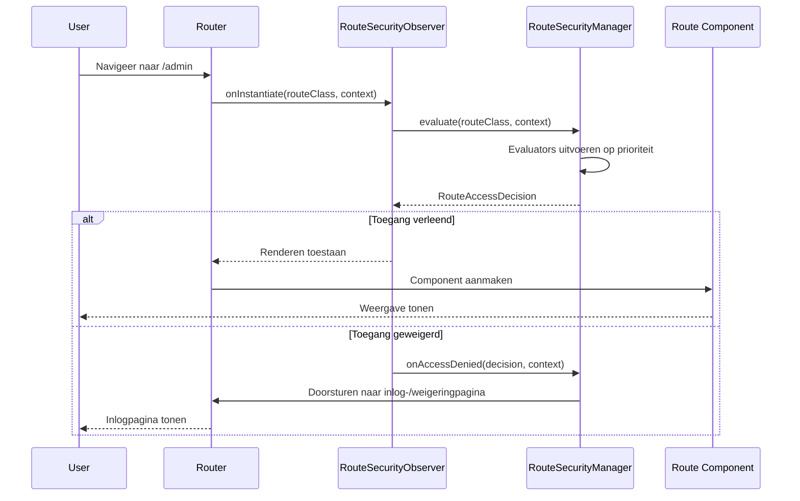

Beveiligingshandhaving in webforJ vindt automatisch plaats tijdens navigatie. Wanneer een gebruiker op een link klikt of naar een route navigeert, onderschept het beveiligingssysteem de navigatie, evalueert het de toegangsregels en staat het de navigatie toe of verwijst het de gebruiker door naar een geschikte pagina. Deze onderschepping is onzichtbaar voor gebruikers en vereist geen handmatige beveiligingscontroles in de code van je componenten.

Als je begrijpt hoe navigatieonderschepping werkt, kun je beveiligingsproblemen oplossen en aangepaste navigatielogica bouwen die met het beveiligingssysteem integreert.

## De `RouteSecurityObserver` {#the-routesecurityobserver}

De `RouteSecurityObserver` is een navigatie-observer die inhaakt op de levenscyclus van de router. De observer luistert naar navigatiegebeurtenissen en evalueert beveiligingsregels voordat er componenten worden gerenderd.

De observer wordt tijdens het opstarten van de app gekoppeld aan de renderer van de router:

```java
// Maak de observer aan met je beveiligingsmanager
RouteSecurityObserver observer = new RouteSecurityObserver(securityManager);

// Koppel de observer aan de renderer van de router
Router router = Router.getCurrent();
if (router != null) {
  router.getRenderer().addObserver(observer);
}
```

Na het koppelen onderschept de observer elk navigatieverzoek. De observer bevindt zich tussen navigatieverzoeken en het renderen van componenten. Wanneer de navigatie begint, vraagt de observer de beveiligingsmanager om de toegang te evalueren. De component wordt alleen gerenderd als de toegang is verleend.

## Verloop van navigatieonderschepping {#navigation-interception-flow}

Wanneer een gebruiker naar een route navigeert, vindt de volgende reeks gebeurtenissen plaats:



Dit verloop laat zien dat de beveiligingsevaluatie plaatsvindt voordat er code van een beveiligde route wordt uitgevoerd. Als de toegang wordt geweigerd, wordt de component nooit geïnstantieerd. Zo wordt voorkomen dat onbevoegde gebruikers bedrijfslogica uitvoeren of toegang krijgen tot beveiligde gegevens.

## Onderscheppingspunten {#interception-points}

De observer onderschept navigatie op een specifiek punt in de routeringslevenscyclus:

**Vóór instantiëring** De methode `onInstantiate()` van de observer wordt aangeroepen met de routeklasse nadat de route is gevonden en voordat de component wordt geïnstantieerd. Dit is het beveiligingscontrolepunt.

Op dit moment weet de router welke routeklasse wordt gerenderd, maar is de route nog niet geïnstantieerd. De observer kan beveiligingsannotaties op de klasse evalueren zonder routelogica uit te voeren.

Als de toegang wordt geweigerd, voorkomt de observer het renderen en start deze een omleiding. De oorspronkelijke route wordt nooit geïnstantieerd.

## Het evaluatieproces {#the-evaluation-process}

Wanneer de observer de navigatie onderschept, delegeert deze de evaluatie aan de beveiligingsmanager. De observer haalt de routeklasse op uit de navigatiecontext en vraagt de manager om de toegang te evalueren. Als de beslissing toegang verleent, gaat de navigatie normaal verder. Als de beslissing toegang weigert, stopt de observer de verdere verwerking om renderen te voorkomen en laat deze de manager de weigering afhandelen.

De manager coördineert de evaluatie door:

1. Te controleren of beveiliging is ingeschakeld in de configuratie
2. De huidige beveiligingscontext (gebruikersinformatie) op te halen
3. De evaluatorketen op volgorde van prioriteit uit te voeren
4. De uiteindelijke toegangsbeslissing terug te geven

De observer handelt op basis van de beslissing: als de toegang is verleend, gaat de navigatie verder; als de toegang is geweigerd, stopt de observer de verdere verwerking en laat deze de manager de weigering afhandelen.

## Hoe toegangsbeslissingen worden genomen {#how-access-decisions-are-made}

De beveiligingsmanager maakt een evaluatorketen aan en voert elke evaluator uit in volgorde van prioriteit. Evaluators kunnen drie soorten beslissingen nemen:

- **Toegang verlenen:** De evaluator keurt de navigatie goed en de route wordt gerenderd. Er worden geen volgende evaluators geraadpleegd. De evaluator retourneert een beslissing die aangeeft dat de toegang is verleend.

- **Toegang weigeren:** De evaluator blokkeert de navigatie. De observer stopt het renderen en start een omleiding. De evaluator retourneert een weigeringsbeslissing, eventueel met een reden. De toegang kan worden geweigerd omdat de gebruiker niet is geauthenticeerd (inloggen vereist) of omdat de gebruiker niet is geautoriseerd (onvoldoende rechten).

- **Delegeren aan de volgende evaluator:** De evaluator neemt geen beslissing en geeft de controle door aan de volgende evaluator in de keten. De evaluator roept de methode `evaluate` van de keten aan, die doorgaat naar de volgende evaluator in volgorde van prioriteit.

De meeste evaluators handelen alleen routes met specifieke annotaties af. Zo evalueert `RolesAllowedEvaluator` alleen routes met de annotatie `@RolesAllowed`. Als de annotatie ontbreekt, delegeert de evaluator aan de volgende evaluator.

## Toegang geweigerd afhandelen {#handling-access-denial}

Wanneer de toegang wordt geweigerd, handelt de methode `onAccessDenied()` van de manager de weigering af op basis van het type:

- **Authenticatie vereist:** De gebruiker is niet ingelogd. De gebruiker wordt doorgestuurd naar de inlogpagina die is ingesteld met `RouteSecurityConfiguration.getAuthenticationLocation()`.

- **Toegang geweigerd:** De gebruiker is ingelogd, maar heeft onvoldoende rechten. De gebruiker wordt doorgestuurd naar de pagina voor geweigerde toegang die is ingesteld met `RouteSecurityConfiguration.getDenyLocation()`.

Voordat de gebruiker wordt doorgestuurd, slaat de manager de oorspronkelijk aangevraagde locatie op in de HTTP-sessie. Na een geslaagde aanmelding kan deze locatie worden opgehaald met de methode `consumePreAuthenticationLocation()` van de manager. Deze methode retourneert de opgeslagen locatie en verwijdert deze uit de sessie. Als er een locatie is opgeslagen, kan de app daarheen navigeren; anders navigeert de app naar een standaardpagina.

## Wanneer beveiliging is uitgeschakeld {#when-security-is-disabled}

Als `RouteSecurityConfiguration.isEnabled()` `false` retourneert, slaat de manager alle evaluaties over en verleent deze onmiddellijk toegang tot elke route. De evaluatorketen wordt niet uitgevoerd en er vinden geen beveiligingscontroles plaats.

Dit is handig tijdens de ontwikkeling of voor applicaties die geen beveiliging nodig hebben. Je kunt beveiliging in- en uitschakelen zonder annotaties te verwijderen of de observer los te koppelen.

## Integratie met de navigatielevenscyclus {#integration-with-navigation-lifecycle}

De beveiligingsobserver integreert met de bredere [navigatielevenscyclus](/docs/routing/navigation-lifecycle/overview), waarin meerdere observers kunnen inhaken op navigatiegebeurtenissen. De beveiligingsevaluatie vindt vroeg in deze levenscyclus plaats, vóór het blokkeren van navigatie of gebeurtenissen in de componentlevenscyclus.

Houd er rekening mee dat de beveiligingsevaluatie als eerste plaatsvindt als je aangepaste navigatie-observers implementeert. Als de toegang wordt geweigerd, worden noch `onInstantiate()` noch `onRouteRendererLifecycleEvent()` van je observer aangeroepen, omdat de route nooit wordt geïnstantieerd.
