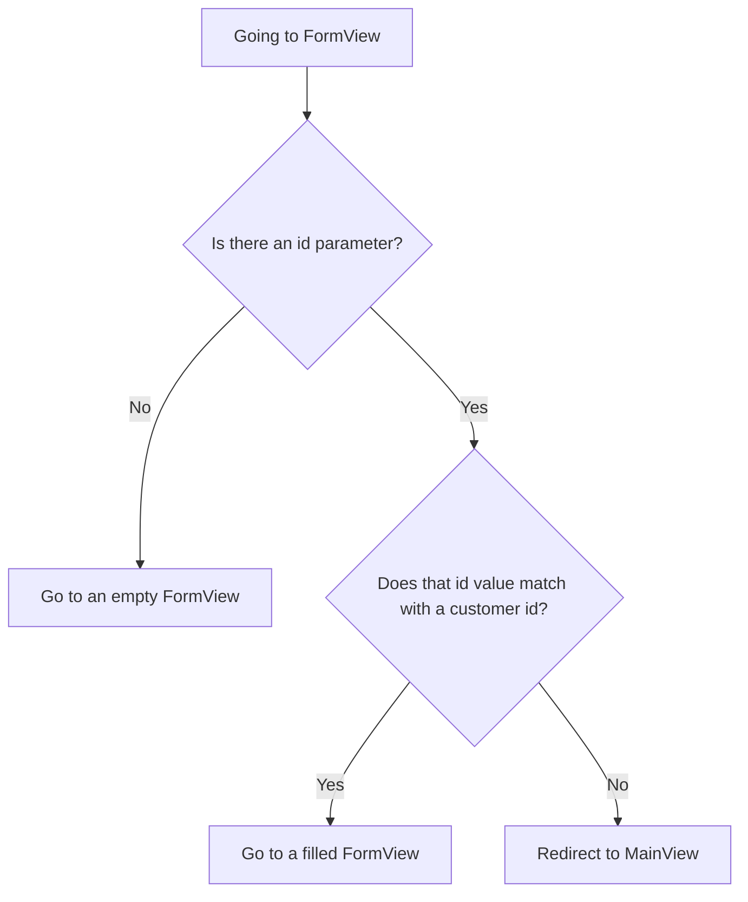

[Routing and Composites](/docs/introduction/tutorial/routing-and-composites) 中的应用只能向数据库添加新客户。利用以下概念，你可以让用户也能编辑现有客户的数据：

- 路由模式
- 通过 URL 传递参数值
- 生命周期观察器

完成此步骤后，你将得到 [4-observers-and-route-parameters](https://github.com/webforj/webforj-tutorial/tree/main/4-observers-and-route-parameters) 的版本。

<!-- <VideoPlayer video="tutorial/scaling-with-routing-and-composites" width={1920} height={1080} title="Scaling with routing and composites" /> -->

## 运行应用 {#running-the-app}

开发应用时，你可以将 [4-observers-and-route-parameters](https://github.com/webforj/webforj-tutorial/tree/main/4-observers-and-route-parameters) 作为对照。要查看应用的运行效果：

1. 导航到包含 `pom.xml` 文件的顶层目录。如果你使用 GitHub 上的版本，请进入 `4-observers-and-route-parameters` 目录。

2. 使用以下 Maven 命令在本地运行 Spring Boot 应用：
    ```bash
    mvn
    ```

运行应用后，会自动在新的浏览器窗口中打开 `http://localhost:8080`。

## 使用客户的 `id` {#using-the-customers-id}

要使用 `FormView` 编辑现有客户，你需要一种方式来指定要编辑的客户。
你可以向 `FormView` 提供一个表示客户 ID 的初始参数。在[使用数据](/docs/introduction/tutorial/working-with-data)中，你创建了一个 `Customer` 实体，它会在客户添加到数据库时，为其分配一个唯一的数字 `Long` 值作为 `id`。

```java
 @Id
 @GeneratedValue(strategy = GenerationType.IDENTITY)
  private Long id;
```

在此步骤中，你将修改 `FormView`，使其在加载任何内容之前使用 `id` 作为初始参数。接着，让 `FormView` 根据 `id` 判断表单是用于添加新客户，还是用于更新现有客户。最后，修改 `MainView`，使其在导航到 `FormView` 时传递 `id` 值。

## 为 `FormView` 添加路由模式 {#adding-a-route-pattern}

在上一步中，将 `FormView` 中的路由设置为 `@Route(customer)`，会将此类映射到本地地址 `http://localhost:8080/customer`。添加路由模式后，你就可以将 `id` 作为初始参数传递给 `FormView`。

[路由模式](/docs/routing/route-patterns)允许你在 URL 中添加参数、将其设为可选参数，并为有效模式设置约束。使用 `@Route` 注解时，以下语法可将 `id` 设为 `FormView` 的可选路由参数：

- **`/:id`** 为路由指定一个名为 `id` 的参数，因此访问 `http://localhost:8080/customer/6` 时，会加载 `FormView`，并将 `id` 参数设为 `6`。

- **`?`** 将 `id` 参数设为可选参数。默认情况下，参数是必需的；将 `id` 设为可选参数后，你就可以使用 `FormView` 添加尚无 `id` 的新客户。

- **`<[0-9]+>`** 将 `id` 限定为正数。在尖括号 `<>` 中，你可以为参数添加正则表达式约束。如果 `id` 不符合约束，例如 `http://localhost:8080/customer/john-smith`，用户将被带到 404 页面。

要为 `FormView` 添加可选路由参数，请将 `@Route` 注解改为：

```java
@Route("customer/:id?<[0-9]+>")
```

## 路由到 `FormView` {#routing-to-formview}

现在，`FormView` 接受可选的 `id` 参数，并且仅当 `id` 是正整数时才会加载。

但是，如果用户手动输入指向不存在客户的 URL，`FormView` 仍然会加载，例如 `http://localhost:8080/customer/5000`。在进入 `FormView` 前添加生命周期观察器，可以让应用决定如何处理传入的 `id` 值。

### 条件路由 {#conditional-routing}

生命周期观察器允许组件在特定阶段响应生命周期事件。[生命周期观察器](/docs/routing/navigation-lifecycle/observers)一文列出了可用的观察器，但此步骤只会用到 `WillEnterObserver`。

`WillEnterObserver` 会在组件完成路由之前触发。
使用此观察器可以检查传入的 `id`。如果 `id` 与现有客户不匹配，你可以将用户重定向回 `MainView`，让他们找到有效的客户进行编辑。

在介绍 `WillEnterObserver` 的代码之前，以下流程图展示了路由到 `FormView` 时可能出现的结果：



### 使用 `WillEnterObserver` {#using-the-willenterobserver}

使用在组件完全加载前触发的生命周期观察器 `WillEnterObserver`，可以添加条件来判断应用是否应继续进入 `FormView`，还是需要将用户重定向到 `MainView`。

每个生命周期观察器都是一个接口，因此需要在 `FormView` 的声明中实现 `WillEnterObserver`：

```java
public class FormView extends Composite<Div> implements WillEnterObserver {
```

`WillEnterObserver` 观察器提供了 `onWillEnter()` 方法，webforJ 会在路由到组件之前调用该方法。此方法有两个参数：`WillEnterEvent` 和 `ParametersBag`。

`WillEnterEvent` 可以通过 `accept()` 方法继续路由到组件，也可以通过 `reject()` 方法停止路由。拒绝当前路由后，你需要将用户重定向到其他位置。

`ParametersBag` 包含 URL 中的路由参数。下一节会使用 `ParametersBag`，通过 `id` 参数为 `onWillEnter()` 创建条件逻辑。

以下 `onWillEnter()` 示例仅展示两种结果：

```java
@Override
public void onWillEnter(WillEnterEvent event, ParametersBag parameters) {

  //Add conditional logic
  if (<condition>) {

    //Allow routing to FormView to proceed
    event.accept();

  } else {

    //Stop routing to FormView
    event.reject();

    //Send the user to MainView
    navigateToMain();
  }
}
```

### 使用 `ParametersBag` {#using-the-parametersbag}

如上一节简要提到的，`ParametersBag` 包含 URL 中的路由参数。每个生命周期观察器都可以访问此对象，你可以在应用中使用它来获取 `id` 值。

`ParametersBag` 对象提供了多种查询方法，可以将参数作为特定对象类型获取。例如，`getInt()` 可以将参数作为 `Integer` 获取。

但是，由于某些参数是可选的，`getInt()` 实际返回的是 `Optional<Integer>`。使用 `Optional<Integer>` 上的 `ifPresentOrElse()` 方法，可以利用 `Integer` 设置变量。

如果没有 `id`，用户可以继续进入 `FormView` 添加新客户。

```java
@Override
public void onWillEnter(WillEnterEvent event, ParametersBag parameters) {

  //Determine which parameter to get, and check if it's present or not
  parameters.getInt("id").ifPresentOrElse(id -> {

    //Use the id as a variable
    customerId = Long.valueOf(id);

  //When no id is present, continue to FormView for a new customer
  }, () -> event.accept());

}
```

### `id` 是否有效？ {#is-the-id-valid}

目前，上一节中的 `WillEnterObserver` 只会在没有 `id` 时接受路由。在继续进入 `FormView` 之前，观察器还需要进行一次验证：确认 `id` 与现有客户匹配。

现在，`FormView` 可以使用 `CustomerService` 的 `doesCustomerExist()` 方法确认客户是否存在。如果没有匹配项，应用可以拒绝当前路由，并使用 `navigateToMain()` 将用户重定向到 `MainView`。

如果 `id` 有效，应用可以使用 `accept()` 继续路由到 `FormView`。创建一个 `fillForm()` 方法，将 `customer` 变量设为数据库中具有相应 `id` 的客户，并设置各字段的值：

```java
public void fillForm(Long customerId) {
  customer = customerService.getCustomerByKey(customerId);
  firstName.setValue(customer.getFirstName());
  lastName.setValue(customer.getLastName());
  company.setValue(customer.getCompany());
  country.selectKey(customer.getCountry());
}
```

与添加新客户时一样，使用工作副本可以让用户在 UI 中编辑客户数据，而无需直接编辑存储库。

### 完整的 `onWillEnter()` {#completed-onwillenter}

前两节详细介绍了如何使用 `ParametersBag` 和 `CustomerService` 处理路由到 `FormView` 时的各种结果。

以下是 `FormView` 中完整的 `onWillEnter()`。它使用 `ParametersBag` 接受或拒绝传入的路由，并调用其他方法来填充表单或将用户发送到 `MainView`：

```java
@Override
public void onWillEnter(WillEnterEvent event, ParametersBag parameters) {

  //Determine which parameter to get, and check if it's present or not
  parameters.getInt("id").ifPresentOrElse(id -> {

    //Use the id as a variable
    customerId = Long.valueOf(id);

    //Check if there's a customer with this id
    if (customerService.doesCustomerExist(customerId)) {

        //This customer exists, so continue to FormView, and initialize the fields using the id
        event.accept();
        fillForm(customerId);
      } else {

        //This customer doesn't exists, so redirect to MainView
        event.reject();
        navigateToMain();
      }

  //No id was present, so continue to FormView for a new customer
  }, () -> event.accept());

}
```

## 添加或编辑客户 {#adding-or-editing-a-customer}

此应用的上一个版本只会在用户提交表单时添加新客户。现在用户可以编辑现有客户，因此 `submitCustomer()` 方法必须在更新数据库之前检查客户是否已存在。

一开始，`FormView` 不需要为客户的 `id` 声明变量，因为新客户提交到数据库时会被分配一个唯一的 `id`。不过，如果你在 `FormView` 中将 `customerId` 声明为初始变量，并赋予它一个未使用的 `id` 值，那么对于新客户，该值会保持不变；对于现有客户，该值会在 `onWillEnter()` 中被覆盖。

这样，你就可以使用 `doesCustomerExist()` 来判断是添加新客户，还是更新现有客户。

```java
private Long customerId = 0L;

//...

private void submitCustomer() {
  if (customerService.doesCustomerExist(customerId)) {
    customerService.updateCustomer(customer);
  } else {
    customerService.createCustomer(customer);
  }
  navigateToMain();
}
```

## 完整的 `FormView` {#completed-formview}

现在 `FormView` 能够处理现有客户的编辑，其代码如下：

<!-- vale off -->
<ExpandableCode title="FormView.java" language="java" startLine={1} endLine={15}>

```java
@Route("customer/:id?<[0-9]+>")
@FrameTitle("Customer Form")
public class FormView extends Composite<Div> implements WillEnterObserver {
  private final CustomerService customerService;
  private Customer customer = new Customer();
  private Long customerId = 0L;
  private Div self = getBoundComponent();
  private TextField firstName = new TextField("First Name", e -> customer.setFirstName(e.getValue()));
  private TextField lastName = new TextField("Last Name", e -> customer.setLastName(e.getValue()));
  private TextField company = new TextField("Company", e -> customer.setCompany(e.getValue()));
  private ChoiceBox country = new ChoiceBox("Country",
      e -> customer.setCountry((Customer.Country) e.getSelectedItem().getKey()));
  private Button submit = new Button("Submit", ButtonTheme.PRIMARY, e -> submitCustomer());
  private Button cancel = new Button("Cancel", ButtonTheme.OUTLINED_PRIMARY, e -> navigateToMain());
  private ColumnsLayout layout = new ColumnsLayout(
      firstName, lastName,
      company, country,
      submit, cancel);

  public FormView(CustomerService customerService) {
    this.customerService = customerService;
    fillCountries();
    setColumnsLayout();
    self.setMaxWidth(600)
        .addClassName("card")
        .add(layout);
    submit.setStyle("margin-top", "var(--dwc-space-l)");
    cancel.setStyle("margin-top", "var(--dwc-space-l)");
  }

  private void setColumnsLayout() {
    List<Breakpoint> breakpoints = List.of(
        new Breakpoint(600, 2));
    layout.setSpacing("var(--dwc-space-l)")
        .setBreakpoints(breakpoints);
  }

  private void fillCountries() {
    ArrayList<ListItem> listCountries = new ArrayList<>();
    for (Country countryItem : Customer.Country.values()) {
      listCountries.add(new ListItem(countryItem, countryItem.toString()));
    }
    country.insert(listCountries);
    country.selectIndex(0);
  }

  private void submitCustomer() {
    if (customerService.doesCustomerExist(customerId)) {
      customerService.updateCustomer(customer);
    } else {
      customerService.createCustomer(customer);
    }
    navigateToMain();
  }

  private void navigateToMain() {
    Router.getCurrent().navigate(MainView.class);
  }

  @Override
  public void onWillEnter(WillEnterEvent event, ParametersBag parameters) {
    parameters.getInt("id").ifPresentOrElse(id -> {
      customerId = Long.valueOf(id);
      if (customerService.doesCustomerExist(customerId)) {
        event.accept();
        fillForm(customerId);
      } else {
        event.reject();
        navigateToMain();
      }

    }, () -> event.accept());
  }

  public void fillForm(Long customerId) {
    customer = customerService.getCustomerByKey(customerId);
    firstName.setValue(customer.getFirstName());
    lastName.setValue(customer.getLastName());
    company.setValue(customer.getCompany());
    country.selectKey(customer.getCountry());
  }
}
```

</ExpandableCode>
<!-- vale on -->

## 从 `MainView` 导航到 `FormView` 以编辑客户 {#navigating-from-mainview-to-formview-to-edit-customers}

在此步骤的前面，你使用现有的 `ParametersBag` 获取了 `id` 的值。创建新的 `ParametersBag` 后，你就可以直接使用所选参数在类之间导航。使用 `Table` 中的数据，是将客户的 `id` 传递给 `FormView` 的一种可行方式。

与按钮类似，将导航绑定到用户选择的操作，可以让用户决定何时进入 `FormView`。为 `Table` 添加事件监听器后，就可以通过 `ParametersBag` 将用户导航到 `FormView`：

```java
table.addItemClickListener(this::editCustomer);

private void editCustomer(TableItemClickEvent<Customer> e) {
  Router.getCurrent().navigate(FormView.class,
      ParametersBag.of("id=" + e.getItemKey()));
  }
```

不过，`Table` 项目的键默认会自动生成。你可以使用 `setKeyProvider()` 方法，明确指定每个键与客户的 `id` 对应：

```java
table.setKeyProvider(Customer::getId);
```

在 `MainView` 中，将 `addItemClickListener()` 和 `setKeyProvider()` 方法添加到 `buildTable()`，然后添加一个方法，根据用户点击表格的位置，通过 `ParametersBag` 将 `id` 值传递给 `FormView`：

```java title="MainView.java" {30-31,34-37}
@Route("/")
@FrameTitle("Customer Table")
public class MainView extends Composite<Div> {
  private final CustomerService customerService;
  private Div self = getBoundComponent();
  private Table<Customer> table = new Table<>();
  private Button addCustomer = new Button("Add Customer", ButtonTheme.PRIMARY,
      e -> Router.getCurrent().navigate(FormView.class));

  public MainView(CustomerService customerService) {
    this.customerService = customerService;
    addCustomer.setWidth(200);
    buildTable();
    self.setWidth("fit-content")
        .addClassName("card")
        .add(table, addCustomer);
  }

  private void buildTable() {
    table.setSize("1000px", "294px");
    table.setMaxWidth("90vw");
    table.addColumn("firstName", Customer::getFirstName).setLabel("First Name");
    table.addColumn("lastName", Customer::getLastName).setLabel("Last Name");
    table.addColumn("company", Customer::getCompany).setLabel("Company");
    table.addColumn("country", Customer::getCountry).setLabel("Country");
    table.setColumnsToAutoFit();
    table.setColumnsToResizable(false);
    table.getColumns().forEach(column -> column.setSortable(true));
    table.setRepository(customerService.getRepositoryAdapter());
    table.setKeyProvider(Customer::getId);
    table.addItemClickListener(this::editCustomer);
  }

  private void editCustomer(TableItemClickEvent<Customer> e) {
    Router.getCurrent().navigate(FormView.class,
        ParametersBag.of("id=" + e.getItemKey()));
  }
}
```

## 下一步 {#next-step}

现在用户可以直接编辑客户数据，应用还应该在将更改提交到存储库之前进行验证。在[验证和绑定数据](/docs/introduction/tutorial/validating-and-binding-data)中，你将创建验证规则，并将数据模型直接关联到 UI，使组件能够在数据无效时显示错误消息。
