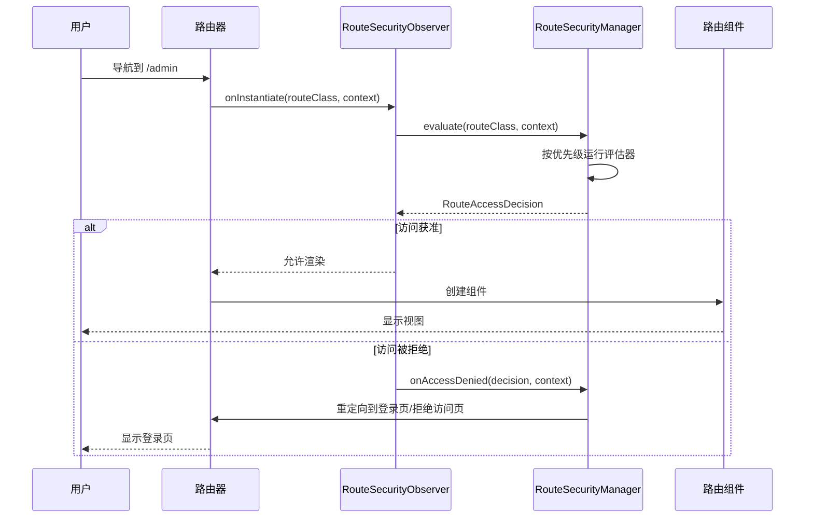

webforJ 中的安全强制执行会在导航过程中自动进行。当用户点击链接或导航到某个路由时，安全系统会拦截导航、评估访问规则，然后允许导航继续，或将用户重定向到相应页面。用户不会察觉到这一拦截，而且无需在组件代码中手动执行安全检查。

了解导航拦截的工作方式，有助于排查安全问题，并构建可与安全系统集成的自定义导航逻辑。

## `RouteSecurityObserver` {#the-routesecurityobserver}

`RouteSecurityObserver` 是一个导航观察器，会挂接到路由器的生命周期中。它监听导航事件，并在渲染任何组件之前评估安全规则。

应用启动时，观察器会附加到路由器的渲染器：

```java
// 使用你的安全管理器创建观察器
RouteSecurityObserver observer = new RouteSecurityObserver(securityManager);

// 将观察器附加到路由器的渲染器
Router router = Router.getCurrent();
if (router != null) {
  router.getRenderer().addObserver(observer);
}
```

附加后，观察器会拦截每个导航请求。观察器位于导航请求与组件渲染之间：导航开始时，它会请求安全管理器评估访问权限。只有在访问获准后，组件才会渲染。

## 导航拦截流程 {#navigation-interception-flow}

用户导航到某个路由时，会按以下顺序执行：



此流程表明，安全评估会在任何敏感路由代码执行之前进行。如果访问被拒绝，组件就不会被实例化，从而防止未经授权的用户触发业务逻辑或访问受保护的数据。

## 拦截点 {#interception-points}

观察器会在路由生命周期中的特定位置拦截导航：

**实例化之前** 路由解析完成后、组件实例化之前，观察器的 `onInstantiate()` 方法会接收路由类。这就是安全检查点。

此时，路由器已知将要渲染哪个路由类，但路由尚未实例化。观察器可以评估类上的安全注解，而无需执行路由逻辑。

如果访问被拒绝，观察器会阻止渲染并触发重定向。原始路由不会被实例化。

## 评估流程 {#the-evaluation-process}

观察器拦截导航时，会将评估委托给安全管理器。观察器从导航上下文中获取路由类，并请求管理器评估访问权限。如果判定结果允许访问，导航就会正常继续。如果判定结果拒绝访问，观察器就会停止传播以阻止渲染，并由管理器处理拒绝访问的情况。

管理器通过以下步骤协调评估：

1. 检查配置中是否启用了安全功能
2. 获取当前安全上下文（用户信息）
3. 按优先级顺序运行评估器链
4. 返回最终的访问判定结果

观察器根据判定结果采取相应操作：如果访问获准，导航继续；如果访问被拒绝，观察器会停止传播，并由管理器处理拒绝访问的情况。

## 访问判定的方式 {#how-access-decisions-are-made}

安全管理器会创建评估器链，并按优先级顺序运行每个评估器。评估器可以作出以下三种判定：

- **允许访问：** 评估器批准导航，路由随即渲染。后续评估器不会再被调用。评估器会返回一个表示已允许访问的判定结果。

- **拒绝访问：** 评估器阻止导航。观察器会停止渲染并触发重定向。评估器会返回拒绝判定，且可以附带原因消息。拒绝访问可能是因为用户尚未通过身份验证（需要登录），也可能是因为用户未获得授权（权限不足）。

- **委托给下一个评估器：** 评估器不作出判定，而是将控制权交给链中的下一个评估器。评估器会调用评估器链的 `evaluate` 方法，按优先级顺序继续执行下一个评估器。

大多数评估器只处理带有特定注解的路由。例如，`RolesAllowedEvaluator` 只会评估带有 `@RolesAllowed` 注解的路由。如果没有该注解，它就会将处理委托给下一个评估器。

## 处理访问拒绝 {#handling-access-denial}

访问被拒绝时，管理器的 `onAccessDenied()` 方法会根据拒绝类型进行处理：

- **需要身份验证：** 用户尚未登录。重定向到 `RouteSecurityConfiguration.getAuthenticationLocation()` 配置的登录页面。

- **访问被拒绝：** 用户已登录，但权限不足。重定向到 `RouteSecurityConfiguration.getDenyLocation()` 配置的拒绝访问页面。

重定向之前，管理器会将最初请求的位置存储在 HTTP 会话中。成功登录后，可以使用管理器的 `consumePreAuthenticationLocation()` 方法获取此位置。该方法会返回存储的位置，并将其从会话中清除。如果存储了位置，应用就可以导航到该位置；否则，应用会导航到默认页面。

## 禁用安全功能时 {#when-security-is-disabled}

如果 `RouteSecurityConfiguration.isEnabled()` 返回 `false`，管理器就会跳过所有评估，并立即允许访问每个路由。评估器链不会运行，也不会执行任何安全检查。

这在开发期间或不需要安全功能的应用中很有用。你可以随时启用或停用安全功能，而无需移除注解或取消注册观察器。

## 与导航生命周期的集成 {#integration-with-navigation-lifecycle}

安全观察器集成在更广泛的[导航生命周期](/docs/routing/navigation-lifecycle/overview)中，多个观察器都可以挂接到导航事件上。安全评估会在该生命周期的早期进行，早于导航阻止或组件生命周期事件。

如果你实现了自定义导航观察器，请注意安全评估会先执行。如果访问被拒绝，由于路由不会被实例化，你的观察器的 `onInstantiate()` 和 `onRouteRendererLifecycleEvent()` 都不会被调用。
